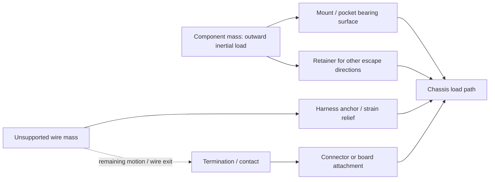

# Strong, compact and lightweight connection methods for meltybrains

**Research checked: 8 November 2026.** This is a source-backed survey of joining and retention methods, not a selected construction plan. It chooses no robot weight class, fastener size, material grade, product, supplier, adhesive, connector family or final design. Historical equipment names identify build evidence only.

**Scope:** mechanical joints, printed features, bonding, internal mounting, electrical terminations, connector retention, board/component support, and design principles for sustained rotation plus combat impacts. The report includes **35 method/application records**, each with six requested fields; a summary table; illustrative calculations; and reported failure/repair records.

**Evidence conventions:** **Source-backed/documented** means the cited engineering reference states a mechanism or process condition. **Reported** means a builder's account. **Planned/proposed** means a change without demonstrated follow-up. **(reasoning)** means this research's engineering interpretation or calculation. **Not found/unknown** means missing evidence. Source inspection and arithmetic checks are not hardware validation. NASA workmanship/fastener documents are engineering references in their own scope, not combat-event rules.

No universal claim such as “this joint withstands hundreds of g” is supported without the mass, radius, speed, geometry, material/process, temperature, load duration and impact conditions. A built part, a successful fight, a coupon result and an isolated joint test provide different kinds of evidence. Where assembly strength was not established, the record says so.

Navigation: [summary](#summary) · [mechanical](#mechanical) · [electrical](#electrical) · [mounting](#mounting) · [design principles](#principles) · [failure points](#failures) · [sources and gaps](#sources).

<a id="summary"></a>

## 1. Summary table of methods and applications

The **strength** column describes a load-transfer mechanism or the limits of available evidence. It is not a score or a qualified survival rating. All qualitative space, weight, repair and generic failure comparisons are **(reasoning)** unless an entry identifies a source report. Actual geometry/materials can reverse an apparent packaging saving. Each row links to a six-field record.

| Method / application | Category | Strength / load mechanism | Space cost | Weight cost | Ease of repair | Main failure mode to examine |
| --- | --- | --- | --- | --- | --- | --- |
| [M01 — Through-bolts, washers and nuts; clamped joints](#m01) | Bolted/clamped | Clamp friction; after slip, bolt shear/hole bearing | Head/nut/washer and tools on both sides | Fastener set plus local bearing material | Unbolt if accessible | Clamp loss, pull-through, hole/bolt damage |
| [M02 — Screws into tapped metal holes](#m02) | Tapped-metal joint | Parent-thread shear and screw tension | Thread engagement and one-sided tool access | Saves loose nut; may need thicker boss | Parent thread damage complicates repair | Stripped thread, bottoming, galling |
| [M03 — Screws directly into polymer: formed, cut or printed threads](#m03) | Direct polymer thread | Polymer thread/boss carries load | Pilot hole and surrounding boss | Little hardware; polymer volume remains | Repeated removal wears thread | Strip, split, creep, layer failure |
| [M04 — Loose nuts, captive nut pockets and cross/barrel nuts](#m04) | Captive nut | Metal thread; pocket reacts load/torque | Nut pocket, shoulder and insertion access | Nut plus retaining structure | Depends on access to trapped nut | Pocket burst, spinout, nut escape |
| [M05 — Heat-set threaded inserts in thermoplastic](#m05) | Heat-set insert | External insert geometry transfers load to plastic | Insert diameter, depth and boss | Insert metal plus surrounding polymer | Reusable thread; failed boss needs repair | Pullout, torque-out, heat/layer damage |
| [M06 — Embedded nuts or structural parts by pausing and resuming FDM](#m06) | Insert printing | Geometric capture through printed walls/layers | Embedded cavity and roof material | Embedded part and surrounding print | Often destructive extraction | Delamination, poor fit, trapped failed part |
| [M07 — Anaerobic threadlocking compounds](#m07) | Threadlocking compound | Resists thread rotation; no assumed substrate gain | Small compound envelope; process access | Small compound addition | Formulation/cure-dependent removal | Incomplete cure; clamp still lost by creep |
| [M08 — Mechanical resistance to unscrewing: prevailing-torque nuts and positive locks](#m08) | Mechanical anti-unscrewing | Interference or physical rotation stop | Nut height or wire/pin/tab access | Locking element and support | Replace/rework locking element | Lock wear/error; preload loss still possible |
| [M09 — Tabs, slots, tongues, shoulders and interlocking bosses](#m09) | Tabs/slots/bosses | Bearing faces transfer load; retainer closes escape | Engagement depth and feature roots | Integrated geometry; possible bracket reduction | Tolerance/deformation can jam | Root crack, tear-out, unconstrained opening |
| [M10 — Dovetail and undercut sliding interlocks](#m10) | Dovetail | Angled flank bearing and undercut capture | Lip thickness and slide/removal clearance | Interlock walls plus end retainer | Slide out unless jammed | Lip/root failure or axial escape |
| [M11 — Component pockets, ledges and retained lids/caps](#m11) | Pocket and retained cap | Wall bearing plus retention in other directions | Wall/cap and clearance/cooling envelope | Can share walls; cap/retainer remains | Open cap; damaged pocket may trap part | Wall crack, cap pry, creep, point loading |
| [M12 — Press/interference fits and fitted pins](#m12) | Press/interference fit | Contact pressure/friction or fitted-pin bearing | Engagement and surrounding material | May omit protruding retainer | Extraction changes fit | Slip/walkout, splitting, bearing preload |
| [M13 — Structural bonding, including two-part epoxy](#m13) | Structural adhesive | Bond transfers distributed load; peel/edges matter | Bondline plus overlap/fillet/fixture needs | Adhesive plus any overlap material | Cure and potentially destructive removal | Interface/cohesive/substrate failure |
| [M14 — Fusion welding metal structures](#m14) | Fusion weld | Weld detail and parent/heat-affected load path | Seam, access and distortion allowance | Filler/gussets versus omitted hardware | Heat/process/alignment work | Toe/throat fatigue, defects, distortion |
| [M15 — Brazing metal joints](#m15) | Braze | Wetted filler interface; gap/load orientation matters | Overlap, heating and fixture access | Filler plus joint/overlap material | Reheat can disturb adjacent joints | Poor wetting, wrong gap, incomplete area |
| [E01 — Direct soldered wire joints and wire-to-board attachment](#e01) | Electrical joint | Continuous metallurgical joint; needs separate wire support | Little connector volume; anchor/bend space remains | Removes housings; insulation/anchors remain | Requires heat and pad access | Wire fatigue, bad wetting, pad peel |
| [E02 — Crimped contacts and crimped lugs](#e02) | Electrical termination with possible insulation support | Deformed barrel retains strands | Barrel plus housing/lug and tool access | Contact/lug and optional housing | Contact replacement if extractable | Bad tool/terminal/wire combination |
| [E03 — Friction-fit separable plugs and sockets](#e03) | Electrical contact plus mating friction | Contact/housing interference | Mating and extraction access | Housing/contact material | Quick separation if accessible | Unplugging or loss of contact force |
| [E04 — Positive connector locks, screw retention and terminal assurance](#e04) | Electrical connector with mechanical retention | Latch, screw/coupling, CPA/TPA | Lock and release/tool clearance | Added locking material | Deliberate release step | Partial latch, back-out, broken housing |
| [E05 — External secondary connector retention](#e05) | Mechanical | Limits connector separation travel | Strap route or bracket envelope | Tie/clip/bracket and anchors | Cut/replace or release retainer | Retainer slides, breaks or loads wire |
| [E06 — Local strain relief: supported wire exits, boots and heat-shrink](#e06) | Mechanical plus insulation where sleeved | Intercepts pull and spreads bending | Flexible transition/bend envelope | Boot/clamp/sleeve | Removable clamp easier than bonded cover | Unsupported sleeve or new hard flex boundary |
| [E07 — Harness routing, chassis ties/clamps and abrasion protection](#e07) | Mechanical/protective | Transfers distributed wire inertia into supports | Routing channel and service slack | Wire length, anchors, abrasion layer | Route documentation aids replacement | Anchor failure, chafe, trapped slack |
| [E08 — Bolted ring lugs, studs and busbars](#e08) | Electrical and bolted mechanical joint | Captured lug and contact pressure | Tools, clearances and guards | Conductive bars/lugs/fasteners | Accessible bolted service | Loosening, joint heating, PCB torque damage |
| [E09 — Independent retention of PCBs, headers, modules and heavy components](#e09) | Mechanical | Body load bypasses leads/header contacts | Mounts, tolerances, cooling and access | Cover/pocket/hardware | Depends on extraction access | Board flex, mount crack, component rocking |
| [E10 — Local adhesive staking and component bonding](#e10) | Mechanical adhesive support | Local bonded fillet carries body/wire load | Fillet and keep-out region | Local material volume | Chemistry-dependent removal | Debonding, softening, lead stress |
| [E11 — Potting / bulk encapsulation](#e11) | Mechanical/electrical/environmental, formulation-dependent | Distributed support through encapsulant | Filled volume and wire exits | Volume × density; can be substantial | May require whole-module replacement | Cure/thermal stress, voids, blocked vents |
| [E12 — Conformal coating](#e12) | Environmental/electrical protection | No assumed structural retention | Thin film plus keep-outs | Less fill volume than potting | Chemistry-dependent rework | Adhesion/coverage fault; mistaken retention credit |
| [A01 — Enclosed battery/electronics module with protective covers](#a01) | Mechanical retention / shielding | Unknown; see F04 | Enclosure walls and service clearance | Walls, covers and attachments | Accessible covers help inspection | Component escape; enclosure can still crack |
| [A04 — Interlocking motor module plus through-fastened sandwich](#a04) | Mechanical interlock / fastening | Unknown; design intent only | Engagement volume and tool access | Interlock material, plates, screws | Module removable unless jammed | Module pull-out and screw-only load paths |
| [A05 — Outboard wheel support independent of the motor's small internal bushings](#a05) | Mechanical shaft support | Unknown; see F09 | Support outside wheel | Bushing, clamp and support structure | Alignment/shimming must be restored | Motor-end loading; overconstraint can damage motor |
| [A06 — Dead-axle hub assembly with separate load-carrying bearings](#a06) | Mechanical shaft support / retention | Unknown; see H02–H03 | Bearings and hub interfaces | Additional support parts | Replaceable parts, precision alignment required | Shaft/set-screw concentration; machining errors remain |
| [A07 — Sensor geometry defined by PCB and chassis CAD](#a07) | Measurement geometry / mechanical retention | Unknown | Sensor location constrains layout | Board/support mass depends on implementation | Preserve datum and recalibrate | Radius/orientation changes; isolation performance unknown |
| [A08 — Printed internal frame sandwiched between load-carrying plates/rings](#a08) | Mechanical retention / load distribution | Unknown | Plates consume stack height | Plate and joint mass | Layer access assists replacement | Outward component loads; weakest plate/joint governs |
| [A09 — Wider tooth attachment footprint to distribute chassis bending](#a09) | Mechanical bolted joint / load distribution | Model evidence only; see F01 | More attachment perimeter | Added footprint material | Replace tooth and inspect chassis | Local chassis bending; impact/fatigue limits unvalidated |
| [A10 — Compliant isolation](#a10) | Compliant mechanical mount | Response changes; no transferable high-g rating | Material plus bounded movement/wire envelope | Pad/isolator and any stop/retainer | Pads may be replaceable; bonds complicate service | Creep, bottoming, debonding, sensor displacement |

M06/M11 also cover insert-printed enclosures and captured boards; those examples are not counted again as separate application records. Some rows are joining processes, others combine processes into a mount, and conformal coating is included to clarify its different protective role. Capacities cannot simply be added when methods share a load path **(reasoning)**.

<a id="mechanical"></a>

## 2. Mechanical joints

Strength characteristics describe the load paths supported by the references; they do not supply a universal allowable load. Space/mass and repair assessments are qualitative **(reasoning)**. Material and process details belong to each individual joint.

<a id="m01"></a>

### M01 — Through-bolts, washers and nuts; clamped joints

1. **What / how:** A bolt crosses clearance holes and tensions against a nut, compressing the stack. The clamp can carry transverse load by interface friction; after slip, shank-to-hole bearing and bolt shear can carry it. These are different load paths, not interchangeable meanings of bolt strength. **(reasoning).**
2. **Strength by load:** **Source-backed:** NASA treats combined tension/shear and fastener-group bearing separately; friction can reduce bolt shear, while hole clearance can make group sharing unequal. Its torque discussion identifies thread/head friction and relative joint stiffness as variables. [NASA RP-1228, printed pp. 15–21, especially pp. 20–21](https://ntrs.nasa.gov/api/citations/19900009424/downloads/19900009424.pdf).
3. **Space / mass:** **(reasoning):** Requires two bearing faces, nut/head clearance and usually tool access on both sides. Long grips and broad washers add mass; they may spread pressure across soft material. A through-bolt does not require sufficient parent material for internal threads.
4. **Buildability / repair:** **(reasoning):** Easily inspected and replaced when both ends are accessible; recessed or buried nuts slow repairs. Assembly preload must suit the whole stack, including plastic crushing and creep, rather than the bolt alone.
5. **Failure / prevention:** **Source-backed:** Plastics can lose clamp load through stress relaxation even below their elastic limit. Metal compression limiters are an additional design family for redirecting clamp force, not an automatic cure for every joint. [SPIROL, “How to Maintain Joint Integrity When Converting from Metal to Plastic,” opening discussion](https://my.spirol.com/resources/white-papers/how-to-ensure-bolted-joint-integrity-when-using-a-compression-limiter-in-a-plastic-assembly/). **(reasoning):** Also check head pull-through, hole ovalization, edge breakout, fastener fatigue and stack separation; a nut that stays on can coexist with lost clamp.
6. **Real build:** **Reported:** Conn Bots describes The Butcher's layered, through-bolted UHMW construction as working well in its 28 November 2020 update. This is qualitative builder experience, without a bolt-load measurement or controlled comparison. [“The Butcher 3.0 Updates,” introductory paragraphs](https://connbots.weebly.com/blog/the-butcher-30-updates).

<a id="m02"></a>

### M02 — Screws into tapped metal holes

1. **What / how:** A screw engages an internal thread cut in a metal part; screw tension clamps the mating part. **(reasoning):** The parent thread becomes a structural member, replacing a separate nut.
2. **Strength by load:** **Source-backed:** NASA's tapped-hole pullout analysis depends on the weaker thread material's shear strength and engagement length, not only the screw's tensile capacity. [NASA RP-1228, printed p. 21, “Calculating Pullout Load for Threaded Hole”](https://ntrs.nasa.gov/api/citations/19900009424/downloads/19900009424.pdf). **(reasoning):** Transverse slip can load hole bearing and screw bending; a deep thread does not remove those modes.
3. **Space / mass:** **(reasoning):** Saves a loose nut and its tool envelope, but needs enough local metal for engagement and edge margin. A thick boss can outweigh the nut it replaces.
4. **Buildability / repair:** **(reasoning):** Drill/tap alignment and chip removal matter, especially in blind holes. Service is from one side. A stripped parent hole may require an oversize repair or an insert; repeated damage consumes surrounding material.
5. **Failure / prevention:** **(reasoning):** Internal-thread stripping, cross-threading, insufficient engagement, bottoming before clamp is achieved, and galling are distinct failure modes. Record actual engagement and check that the screw can clamp before it bottoms. Do not transplant a metal torque table to an unverified thin wall.
6. **Real build:** **Reported:** Northern Arizona University's SumoBot A final report, section 7.3.2, describes the combat frame's tapped components and twenty assembly screws in a built approximately nine-pound robot. This demonstrates construction, not a quantified joint endurance. [Final report, printed pp. 46–47](https://sce.nau.edu/capstone/projects/ME/2017/SumoBotA/Final%20Report.pdf). The original report's indexed section was readable in search; opening the complete 40.5 MB PDF exceeded the browser's content limit.

<a id="m03"></a>

### M03 — Screws directly into polymer: formed, cut or printed threads

1. **What / how:** Thread-forming screws displace polymer into a mating thread; cutting/tapped holes remove material; printed threads are manufactured with the part. These need separate process assumptions. [EJOT, “Direct fastening explained,” questions 1 and 3](https://www.ejot.com/FAQ-Direct-fastening).
2. **Strength by load:** **Source-backed:** Bossard's thermoplastic design guidance distinguishes forming, seating and stripping torque, warns about pressure-induced relaxation, and assigns transverse force to form-fitting features in its illustrated joint family. [Construction recommendations, thermoplastic assembly pages F.075–F.078](https://www.bossard.com/my-en/-/media/bossard-group/website/documents/technical-resources/en/f-064-en.pdf). **(reasoning):** Tensile retention depends on polymer thread shear, boss splitting and layer bonding; it cannot be inferred from the metal screw's strength.
3. **Space / mass:** **(reasoning):** Eliminates a metal nut/insert, but needs a boss and sufficient solid wall around the hole. The apparent hardware saving may be exchanged for polymer volume.
4. **Buildability / repair:** **(reasoning):** Few assembly steps, but pilot diameter, material and installation process interact. Repeated service can wear the parent thread. Test repeated removal as a separate requirement from initial pullout.
5. **Failure / prevention:** **Source-backed:** Bossard warns that countersunk heads impose radial as well as axial forces near edges; larger bearing area reduces local pressure and relaxation in its thermoplastic examples. **(reasoning):** Avoid treating a screw that feels tight while forming its thread as evidence of achieved clamp. Compare seating and failure on representative coupons, including the chosen print direction.
6. **Real build:** **Reported:** Openmelt2's antweight reference platform uses screws self-tapping into its lid/shell arrangement; the author characterizes the overall construction as suitable for testing. [“General Construction”](https://github.com/nothinglabs/openmelt2/tree/main/antweight_reference_platform). Dinner Time uses plastic-thread screws on front supports, while its builder explicitly identifies side impacts pulling them out as a weakness. That statement is a predicted vulnerability, not a reported observed pullout test. [Dinner Time, vertical weapon description](https://blog.aaronbot3000.com/2017/12/dinner-time-modular-beetleweight-combat.html).

<a id="m04"></a>

### M04 — Loose nuts, captive nut pockets and cross/barrel nuts

1. **What / how:** A metal nut supplies threads; a pocket, cross-slot or transverse barrel captures its shape and reacts tightening torque. **(reasoning):** Capture against rotation is separate from retention against pullout or escape through the installation opening.
2. **Strength by load:** **Source-backed:** Charles Guan's construction guide explains that isolated nut slots can burst their narrow retaining shoulders under tension; surrounding finger joints and bracing change the load path. [“How to Build Your Everything Really Really Fast,” step “The T-nut, Crossed-T-nut, Jesus Nut, Slotted-Insert-Nut…”](https://www.instructables.com/How-to-Build-your-Everything-Really-Really-Fast/). **(reasoning):** In printed pockets, nut bearing area, shoulder thickness and layer separation can govern before metal thread failure.
3. **Space / mass:** **(reasoning):** The nut is compact, but its access slot and retaining material consume room. A barrel nut needs transverse drilling and assembly clearance. A pocket can save wrench access after insertion.
4. **Buildability / repair:** **(reasoning):** Open pockets permit replacement; fully enclosed pockets may trap a damaged nut permanently. Clearance must allow insertion without allowing the nut to spin. Actual printer and nut variation matter.
5. **Failure / prevention:** **(reasoning):** Nut spinout rounds the pocket; axial breakout removes the retaining shoulder; an open entry path can permit escape when the screw is absent. These need different checks. Do not use a small dab of assembly glue as evidence of a structural load path.
6. **Real build:** **Reported/documented assembly:** Snapshot Gen2's build instructions put square nuts into its printed wheels and tighten set screws against shaft flats. This is a precise captive-nut use, not evidence for a chassis joint or a specified shock rating. [Snapshot build guide, step 1](https://palmbeachbots.com/pages/snapshot-plastic-ant-build-along).

<a id="m05"></a>

### M05 — Heat-set threaded inserts in thermoplastic

1. **What / how:** A heated metal insert displaces softened thermoplastic around external knurls/undercuts; cooling mechanically retains it and leaves a reusable metal internal thread. [SPIROL insert design guide, installation and proper-flow sections](https://www.spirol.com/assets/files/ins-threaded-inserts-design-guide-us.pdf).
2. **Strength by load:** **Source-backed:** SPIROL ties torque-out and pullout performance to plastic filling the insert's retention features, correct hole geometry and surrounding material. Its heat/ultrasonic page distinguishes headed retention against jack-out or reverse pull-through. [SPIROL, heat/ultrasonic inserts](https://www.spirol.com/product/threaded-inserts-for-plastics/heat-ultrasonic-inserts/). **(reasoning):** A metal internal thread does not strengthen a thin boss, weak layer interface or poor insert installation.
3. **Space / mass:** **(reasoning):** Adds metal and generally a larger boss than a direct screw. A short insert saves depth but changes engaged retention area; no universal mass-strength ranking follows.
4. **Buildability / repair:** **Source-backed:** SPIROL emphasizes controlled temperature, pressure, depth and alignment; its manufacturer guidance cautions that an uncontrolled soldering iron can be inconsistent. **(reasoning):** Thread servicing is easy after successful installation, while replacing a pulled-out insert may require a new part or a repaired larger boss.
5. **Failure / prevention:** **(reasoning):** Check axial pullout, insert rotation during tightening, layer peeling around the boss, cracking from poor hole size and local heat damage. A sectioned installation coupon can reveal whether the plastic actually filled the retention geometry; this is a process check, not a combat proof test.
6. **Real build:** **Reported:** Drop Test's builder reports installing heat-set inserts in both a PLA fit prototype and later frame assembly. [“A 1 lb. Spring Powered Flipper: The Complete Journey,” “Construction and Initial Testing” and “Full Assembly”](https://connbots.weebly.com/blog). The later four-rail revision improved printability/maintenance but added screws and inserts, creating weight pressure. [“Prep for Smashbotz 2021,” Drop Test 2.1](https://connbots.weebly.com/blog/prep-for-smashbotz-2021). Neither passage isolates insert joint strength.

<a id="m06"></a>

### M06 — Embedded nuts or structural parts by pausing and resuming FDM

1. **What / how:** A print pauses; a nut, plate or other part is installed in a modeled cavity; subsequent layers close over it. **Source-backed:** Markforged describes this as overprinting, with clearance and a printable top surface required. [Markforged, “A Guide to Embedding Components in 3D Printed Parts”](https://prod2.markforged.com.imarc.net/zh/resources/blog/embedding-components-in-3d-printed-parts).
2. **Strength by load:** **(reasoning):** Encapsulation can mechanically block withdrawal through more material than an open pocket, but the load still reaches polymer walls and interlayer bonds. A trapped plate needs geometry that carries force; plastic touching a smooth metal face is not automatically a strong adhesive bond. No combat load rating was found for this general method.
3. **Space / mass:** **(reasoning):** Can remove bolt heads, nuts and tool clearance but adds embedded mass and surrounding print material. It may reduce external envelope while making replacement harder.
4. **Buildability / repair:** **Source-backed:** The embedded object must not protrude into the nozzle/head path; tolerance and pause height are central process conditions in the Markforged guide. **(reasoning):** A failed print can trap an expensive part. Fully captive hardware is often difficult to replace without destroying the print.
5. **Failure / prevention:** **(reasoning):** Check weak roof bridging, gaps, interrupted-layer bonding, metal/plastic thermal mismatch, part rotation inside the cavity and layer delamination. Coupon fitting checks assembly; they do not establish impact survival.
6. **Real build:** **Reported:** Hit N Spin's enclosure was printed around its titanium blade to reduce fasteners/space. The author reports several tolerance trials and explicitly notes that a replacement enclosure must be printed onto the blade, making competition spares impractical. [Hit N Spin, “The Enclosure”](https://www.swallenhardware.io/battlebots/2019/10/16/hit-n-spin). This is a built meltybrain example, not a measured enclosure retention test.

<a id="m07"></a>

### M07 — Anaerobic threadlocking compounds

1. **What / how:** A liquid fills the clearance between mating metal threads and cures when confined. **Source-backed:** Anaerobic chemistry needs suitable metal surfaces and oxygen exclusion; it does not bond well to glass, rubber or plastic. [3M, “Anaerobic Adhesives,” mechanism description](https://www.3m.com/3M/en_US/bonding-and-assembly-us/structural-adhesives/anaerobic-adhesives/).
2. **Strength by load:** **Source-backed:** Henkel describes transverse sliding of threads/clamped parts as a cause of rotational self-loosening. [“Keeping it Together,” threadlocker whitepaper](https://dm.henkel-dam.com/is/content/henkel/WHITEPAPERS-Threadlocker.pdf). **(reasoning):** Resisting thread rotation does not increase parent plastic bearing strength, repair stripped threads, restore lost clamp from creep, or replace a shear load path.
3. **Space / mass:** **(reasoning):** Little added geometric envelope and small compound mass, but application and cleanup access are required. It adds consumables and time rather than a large mechanical component.
4. **Buildability / repair:** **(reasoning):** Cure conditions, contamination, active/inactive metals and selected formulation control the process. A quick assembly turnaround and repeated pit removal are different needs from a permanent locked joint. Color is not a sufficient specification across chemistries or manufacturers.
5. **Failure / prevention:** **(reasoning):** Incomplete cure, oily threads, excessive gap, insufficient cure time or removal damage can defeat the intended function. Confirm chemical compatibility with every neighboring polymer. A paint witness line reveals relative movement only; it is not a locking method or preload measurement.
6. **Real build:** **Not found:** No sufficiently precise named meltybrain/combat build and validated threadlocker-specific result was located in the sources used for this entry. Combat-building tutorials discuss use, but advice alone is not a tested robot example. This absence is a search limit, not evidence that builders do not use it.

<a id="m08"></a>

### M08 — Mechanical resistance to unscrewing: prevailing-torque nuts and positive locks

1. **What / how:** A prevailing-torque nut creates thread interference through polymer or deformed metal. A drilled fastener with correctly arranged safety wire, a castellated nut/cotter pin or a locking tab physically limits rotation. These are different mechanisms. **(reasoning).**
2. **Strength by load:** **Source-backed:** NASA describes interference locking elements and their temperature/reuse limitations; it also notes that a fully flattened split helical washer contributes no useful locking action. [NASA RP-1228, printed pp. 6–10, “Locknuts” and “Lockwashers”](https://ntrs.nasa.gov/api/citations/19900009424/downloads/19900009424.pdf). **(reasoning):** A positive stop can prevent total loss while permitting enough motion to reduce clamp. Retention and preload preservation must be evaluated separately.
3. **Space / mass:** **(reasoning):** Prevailing nuts add nut height; positive locking adds holes, wire/pins/tabs, tool room and inspection access. A small piece can complicate an otherwise tightly packed assembly.
4. **Buildability / repair:** **(reasoning):** Nuts are readily exchanged. Wire and tabs generally require rework at each disassembly. A locking element that has worn or lost resistance must not be assumed reusable indefinitely.
5. **Failure / prevention:** **(reasoning):** Check incomplete engagement of the locking region, damaged nylon, heat/chemical exposure, wrong wire direction, missing pins and chafing loose wire ends. Mechanical locking does not solve fastener fracture, parent-thread stripping or crushed plastic.
6. **Real build:** **Not found:** No precise build and observed result establishing one of these particular mechanisms was selected here. General combat fastener advice is intentionally not substituted for a named implemented example.

<a id="m09"></a>

### M09 — Tabs, slots, tongues, shoulders and interlocking bosses

1. **What / how:** Geometric features register parts and transfer load by surface bearing; a screw, bond or other retainer prevents disengagement. **(reasoning):** A simple open slot locates in some directions but is not a complete constraint in every direction.
2. **Strength by load:** **Source-backed:** Guan's guide explains the need for multiple planes of constraint and bracing in tabbed nut-slot assemblies to prevent book-like opening. [Construction guide, T-nut/constraint discussion](https://www.instructables.com/How-to-Build-your-Everything-Really-Really-Fast/). **(reasoning):** Contact face area, tab root bending, surrounding tear-out and assembly clearance determine when load reaches the retainer. Too much clearance can turn a broad nominal interface into an impact against a small edge.
3. **Space / mass:** **(reasoning):** Integrates into existing stock, potentially reducing separate brackets; requires engagement depth and sufficient material around slots. More tabs do not automatically yield proportionally more capacity.
4. **Buildability / repair:** **(reasoning):** Compatible with cut plate, machining and printing. Tolerance errors across several tabs can prevent assembly; excessive clearance creates movement. Serviceable retaining fasteners permit disassembly if impacts have not jammed the fit.
5. **Failure / prevention:** **(reasoning):** Tab shear, root cracks, pocket breakout, fretting and opening in an unconstrained direction are possible. Evaluate the load path after likely deformation, not only the perfectly fitted CAD position.
6. **Real build:** **Reported implemented change:** Butcher's September 2021 preparation post shows a machined motor pulley with internal bosses engaging motor recesses, plus face screws. The author intended bosses to carry rotational shock and screws to retain axially. This distinguishes a built part from the earlier November 2020 proposal; the preparation post does not validate endurance. [“Prep for Smashbotz 2021,” Butcher 3.0](https://connbots.weebly.com/blog/prep-for-smashbotz-2021); [earlier proposed interface](https://connbots.weebly.com/blog/the-butcher-30-updates).

<a id="m10"></a>

### M10 — Dovetail and undercut sliding interlocks

1. **What / how:** A flared tongue slides into an undercut groove. **(reasoning):** The undercut resists separation normal to the engaged faces while the insertion direction needs its own retention.
2. **Strength by load:** **Source-backed application:** Stratasys describes dovetails when joining sectioned FDM parts. [FDM Design Guide, section 4.3 / PDF p. 8](https://www.stratasys.com/siteassets/sdm/content---website-storage/design-guides/dg_sdm_fdm_0725a.pdf?v=490918). **(reasoning):** Tension across the joint loads the angled flanks and can spread the female section. Strength is limited by flank bearing, lip bending/root fracture and material anisotropy. This source supplies a construction method, not a combat strength ranking.
3. **Space / mass:** **(reasoning):** Undercuts need surrounding wall thickness and slide-in clearance. A compact external profile can conceal considerable local material. Retaining posts/bolts add mass.
4. **Buildability / repair:** **(reasoning):** Printed undercuts may need support or a suitable build direction; machining needs cutter access. Tight fit can seize after burrs or impact; loose fit can hammer the flanks. Service needs clear access along the slide axis.
5. **Failure / prevention:** **(reasoning):** Check female-section spreading, chipped lips, tab-root cracks, friction seizure and escape along the insertion axis. An undercut is not inherently self-locking under every force direction.
6. **Real build:** **Reported:** Dinner Time's modular weapon interface combines a dovetail with two aluminum retaining posts. Its builder reports roughly two-minute changes because internal wiring access still requires removing the cover. The robot's reported competition success does not isolate the interface's strength. [Dinner Time, interface description](https://blog.aaronbot3000.com/2017/12/dinner-time-modular-beetleweight-combat.html).

<a id="m11"></a>

### M11 — Component pockets, ledges and retained lids/caps

1. **What / how:** A shaped cavity bears against a component; an opposing lid, strap, clamp or cap closes its escape direction. **(reasoning):** This can capture a motor, board, battery or bearing without relying solely on an adhesive interface.
2. **Strength by load:** **(reasoning):** A close pocket carries compression where the part loads a wall. In the rotating frame, an outboard wall opposes the part's outward inertial tendency. A lid or retainer closes other escape directions; its fasteners can see prying/tension. Clearance permits impact before contact. No universal pocket strength or acceptable clearance was found; it depends on the retained component and walls. Markforged's cavity guidance establishes fit/overprinting constraints, not a shock rating. [Embedded-component guide](https://prod2.markforged.com.imarc.net/zh/resources/blog/embedding-components-in-3d-printed-parts).
3. **Space / mass:** **(reasoning):** Can use existing enclosure walls, but needs adequate wall/cap thickness and wire/cooling clearance. Tool access, removable covers and tolerances may enlarge the envelope.
4. **Buildability / repair:** **(reasoning):** Printed cavities accommodate unusual shapes. A removable cap can permit quick replacement; an overly tight pocket may require destructive extraction after deformation.
5. **Failure / prevention:** **(reasoning):** Check cracked pocket corners, cap lift, creep, point loading of delicate packages and abrasion from motion. A pocket around a component body must not accidentally make solder joints or terminals carry its inertia. Battery swelling and heat make an initially snug fit a changing condition.
6. **Real build:** **Reported/documented assembly:** Snapshot's motors slide into housings and receive rear caps, then mounts screw into the chassis. [Snapshot guide, step 5](https://palmbeachbots.com/pages/snapshot-plastic-ant-build-along). Hit N Spin's author removed PCB mounting holes because the battery and cover held it in place; this is a packaging example with no quantified board-retention test, not an endorsement of that arrangement. [Hit N Spin, “The Layout”](https://www.swallenhardware.io/battlebots/2019/10/16/hit-n-spin).

<a id="m12"></a>

### M12 — Press/interference fits and fitted pins

1. **What / how:** Deliberate dimensional interference creates contact pressure; friction resists axial/rotational movement. A fitted pin can instead primarily locate or carry shear in bearing. **(reasoning):** A locating pin, a friction-retained pin and a separately captured pin are not equivalent.
2. **Strength by load:** **Source-backed:** NTN links insufficient bearing fit to creep and excessive fit to reduced internal clearance, heating and early failure; fit selection depends on load, temperature and materials. [“Bearing with Shaft & Housing Fits,” technical discussion](https://ntnamericas.com/technical-resources/shaft-housing-fits/). **(reasoning):** This bearing-specific evidence does not establish a printed weapon-pin capacity. Polymer stress relaxation can reduce an initially tight interference, while radial expansion can split a thin boss.
3. **Space / mass:** **(reasoning):** Can eliminate separate retainers and protruding heads, but needs engagement length, surrounding wall and assembly tooling access. Removal features may restore some of the saved envelope.
4. **Buildability / repair:** **(reasoning):** Requires controlled actual dimensions and surface condition. FDM nominal holes are not a reliable interference specification. Repeated extraction can wear or enlarge the hole, changing the next fit.
5. **Failure / prevention:** **(reasoning):** Check walkout, spin/slip, split housing, cracked layers and damage from pressing through the wrong bearing race. Tolerance/retention tests need the final material, temperature and cycle history.
6. **Real build:** **Reported, explicitly unvalidated:** Openmelt2 provides a detachable weapon using a press-fit pin, while its author gives no assurance of robustness. Proposed hot-glue reinforcement is a suggestion, not a demonstrated fix. [“Detachable Weapon”](https://github.com/nothinglabs/openmelt2/tree/main/antweight_reference_platform). **Reported failure:** Butcher's builder says an earlier plastic press-fit motor pulley slipped/failed over time because it was not machined to suitable tolerance. [Butcher 3.0, “Weapon Upgrades”](https://connbots.weebly.com/blog/the-butcher-30-updates).

<a id="m13"></a>

### M13 — Structural bonding, including two-part epoxy

1. **What / how:** Adhesive transfers force across bonded surfaces; an epoxy is one chemistry within structural adhesives, not a name for every two-part glue. [3M, structural adhesive FAQs](https://eaa.3m.com/3M/en_US/bonding-and-assembly-us/structural-adhesives/faqs/).
2. **Strength by load:** **Source-backed:** 3M's epoxy whitepaper favors distributed shear/tension over edge-concentrated peel/cleavage. **(reasoning):** Coupon overlap-shear data cannot be used directly as impact strength for a small butt joint or a different polymer. [“Designing for Adhesively-Bonded Joints,” joint configuration](https://multimedia.3m.com/mws/media/1965232O/3ms-structural-two-part-epoxy-adhesive-whitepaper.pdf).
3. **Space / mass:** **(reasoning):** A thin bond can avoid holes and hardware; a lap overlap adds substrate area, and thick fillets/potting add mass. Low external profile does not mean negligible joint volume.
4. **Buildability / repair:** **Source-backed:** The whitepaper distinguishes working, handling and final-cure stages, and requires clean sound substrate rather than bonding to oil, rust or weak surface layers. **(reasoning):** Bonding may simplify assembly but imposes fixturing/cure time and often destructive disassembly. A five-minute handling claim is not proof of final strength in five minutes.
5. **Failure / prevention:** **(reasoning):** Identify adhesive/interface failure, cohesive adhesive fracture and substrate tearing separately. Check surface energy, preparation, mix, bond thickness, temperature and polymer compatibility on representative material. Do not assume generic epoxy bonds polyethylene/UHMW effectively merely because it adheres to metal.
6. **Real build:** **Reported failed repair:** At November Necrosis 2020, Butcher's pressed/glued motor pulley came loose. A five-minute-epoxy repair held temporarily, then Maverick's impacts loosened the pulley again. This establishes a failed attempt in that application, not a failure of all epoxies or the later redesigned interface. [“November Necrosis 2020,” Butcher versus Quicksilver/Maverick; original blog section](https://connbots.weebly.com/blog).

<a id="m14"></a>

### M14 — Fusion welding metal structures

1. **What / how:** Parent metal locally melts and joins, often with filler. A weld may carry load directly along a seam rather than through discrete bolts. **(reasoning):** Weld geometry and welding process need their own specification; “welded” does not identify strength.
2. **Strength by load:** **Source-backed:** TWI describes weld-toe flaws and joint configuration as important fatigue factors, using joint-specific fatigue curves rather than parent tensile strength alone. [“Fatigue Testing,” arc-welded joint discussion](https://www.twi-global.com/technical-knowledge/job-knowledge/fatigue-testing-078). **(reasoning):** Tension, bending, shear and impact can govern at different regions; stronger plate does not guarantee a stronger welded detail.
3. **Space / mass:** **(reasoning):** Can remove nut/head/tool envelopes and some brackets; weld metal, overlaps, gussets and access allowances add material. Distortion may require machining allowance.
4. **Buildability / repair:** **(reasoning):** Needs material/process knowledge, access, fixturing and heat management. A welded frame can be compact but normally cannot be disassembled for module replacement. Repairs require re-establishing alignment and weld quality, not just closing a visible crack.
5. **Failure / prevention:** **Source-backed:** TWI distinguishes fatigue at the weld toe from failure through a fillet's throat, requiring different treatments. It says post-weld improvement techniques need defined methods and operator training. [“Methods for Improving the Fatigue Strength of Welded Joints”](https://www.twi-global.com/technical-knowledge/faqs/faq-are-there-any-methods-of-improving-the-fatigue-strength-of-welded-joints). **(reasoning):** Also investigate lack of fusion, defects, heat-affected material changes and residual deformation. A visually neat bead alone is insufficient evidence.
6. **Real build:** **Reported:** Team HUGE's first-party 2018 build log records grinding chassis pieces to fit and welding five chassis halves, then selecting the best two. It also records difficult post-weld access for forgotten countersinks. This demonstrates fabrication and service-access consequences, not a quantified weld strength. [HUGE 2018 build log, main chronology and frame gallery captions](https://hugebattlebots.com/team-huge-battlebots-blog/huge-build-log-2018).

<a id="m15"></a>

### M15 — Brazing metal joints

1. **What / how:** Molten filler joins compatible parent materials without melting the parent metal. **Source-backed:** TWI distinguishes brazing from fusion welding and explains the roles of wetting, gap and capillary flow. [“What is Brazing?”](https://www.twi-global.com/technical-knowledge/faqs/faq-what-is-brazing).
2. **Strength by load:** **Source-backed:** TWI's braze-welding discussion warns that an excessively wide butt gap can leave load carried primarily as tension in filler, reducing joint strength. Its material/process-specific dimensions are not a universal gap specification. [“Braze Welding,” joining setup](https://www.twi-global.com/technical-knowledge/job-knowledge/braze-welding-134). **(reasoning):** Overlap shear, peel/prying and thermal effects need separate assessment; filler marketing strength is not assembly strength.
3. **Space / mass:** **(reasoning):** Can avoid fastener envelopes but may need overlap, interlocks, fillets and heat access. Heating a large frame can require fixtures/support not reflected in finished mass.
4. **Buildability / repair:** **(reasoning):** Needs controlled surface preparation, compatible filler, thermal process and fixture. Reheating for repair can disturb adjacent joints or alignment. It is generally a fabrication operation rather than rapid mechanical disassembly.
5. **Failure / prevention:** **(reasoning):** Poor wetting, oxides, unsuitable gap, filler defects, incomplete bonded area and parent heat damage can all govern. Validate the actual alloy/process/joint combination rather than copying one builder's torch procedure.
6. **Real build:** **Reported experimental construction:** Cold Arbor's builder selected zinc–aluminum brazing after TIG equipment delays; used punched tab/slot joints to hold assembly; and described wetting/whole-part heating difficulties. The post explicitly frames combat survival as a future test, not established success. [Cold Arbor Update 5, 16 January 2010](https://www.etotheipiplusone.net/?p=520). The original site's search-indexed article text was inspected; direct article retrieval returned a cache miss. The author's own reference index independently identifies this robot's brazed construction. [References, Cold Arbor entry](https://www.etotheipiplusone.net/?page_id=660).

### Printed substrate: orientation, walls, infill and local reinforcement

These affect every printed method above rather than creating a standalone universal fastening method.

- **Source-backed:** Prusa's infill guidance identifies perimeters as a major strength lever and infill as contributing to compression resistance. It does not establish a combat-safe wall count or infill percentage. [Infill, “Increasing model strength”](https://help.prusa3d.com/article/infill_42?product=sl1).
- **Source-backed:** Stratasys identifies undersized/seamed printed holes, uses ribs/gussets to support bosses and fillets to reduce stress concentration. Its minimum printable wall guidance concerns successful manufacture, not an impact design allowable. [FDM Design Guide, sections 3.1, 3.3, 3.7–3.8](https://www.stratasys.com/siteassets/sdm/content---website-storage/design-guides/dg_sdm_fdm_0725a.pdf?v=490918).
- **(reasoning):** The important orientation is the load relative to the layers at the boss root, nut shoulder, dovetail lip and pocket wall. A global orientation that strengthens one feature can weaken another. Walls around a hole, not only the global infill setting, determine how the load enters the part. Reinforcing a threaded region can move failure into adjacent thin material.
- **Reported failure:** Conn Bots attributes Drop Test's repeated frame splitting at November Necrosis 2020 to print orientation and layer-line fracture. This is builder diagnosis, without microscopy or controlled alternative-orientation tests. [Original event-report section, “Things That Didn't Work” under Drop Test](https://connbots.weebly.com/blog).
- **Reported build settings, not a general recipe:** Openmelt2's test chassis used PLA, solid infill and a high shell count. Those settings demonstrate one test build; they do not establish the same durability with another polymer, slicer, temperature, printer or scale. [Reference platform, “3d Printing Notes”](https://github.com/nothinglabs/openmelt2/tree/main/antweight_reference_platform).
- **(reasoning):** Embedded rods/plates/inserts require an explicit route for forces into their surrounding polymer. Simply embedding a stiffer object can create a stress concentration or a new delamination path. Local coupon tests should include real print settings, conditioning and repeated assembly, followed by representative full-assembly loading where justified.

<a id="electrical"></a>

## 3. Electrical connections and board-level retention

Electrical contact quality, terminal retention, connector mating retention, harness strain relief, board mounting and component-body support are distinct interfaces **(reasoning)**. N4/N1 and other short source labels below are resolved in the source register at the end.

<a id="e01"></a>

### E01 — Direct soldered wire joints and wire-to-board attachment

1. **What/how:** A permanent electrical connection formed by solder wetting the conductor and terminal/pad. Wire-to-wire splices, plated solder holes and surface pads have different mechanical geometries; a soldered connection alone does not define a wire restraint.
2. **Loads/evidence:** N4 §13.3.1 documents fatigue concentration at the boundary between solder-wicked rigid wire and flexible wire. **(reasoning):** eliminating a separable contact removes an unplugging interface, but leaves conductor, joint and board-pad failure paths. No universal superiority over crimping established.
3. **Space/mass — (reasoning):** Removes plug housings and mating clearance; local insulation and anchor space remain necessary. A splice bundle can be bulkier than point-to-point wiring.
4. **Build/repair — (reasoning):** Requires suitable heat delivery, wetting, cleanliness and access. Desoldering permits replacement but consumes time and can damage a pad; repeated service changes the practical trade-off.
5. **Failure/prevention — (reasoning):** Unsupported wire can peel a pad or fatigue beside the joint; poor wetting can produce intermittent contact; excess heat can damage insulation or housings. Inspect before covering, anchor the flexible wire and preserve a bend away from the stiff boundary.
6. **Real build:** Halo reports board connectors shearing off and switching to direct solder connections as the fix. No quantified before/after shock result is supplied. [Original report](https://www.swallenhardware.io/battlebots/2019/11/13/event-report-robot-ruckus-2019).

<a id="e02"></a>

### E02 — Crimped contacts and crimped lugs

1. **What/how:** A controlled tool deforms a terminal barrel around strands; some contacts have a separate insulation-support crimp. A crimp may end in a plug contact, ring lug or splice, so it is a termination process rather than a complete retention system.
2. **Loads/evidence:** TE documents matched wire/terminal/tool selection, controlled strand deformation and secure insulation support. N4 §7.2.26 requires stranded wire for crimped contacts. **(reasoning):** avoiding solder wicking retains flexibility, but an unsuitable crimp can still pull out or fracture strands.
3. **Space/mass — (reasoning):** Small contacts can be compact; the complete housing, latch and access envelope may dominate. Large lugs have substantial barrel and bolt clearance.
4. **Build/repair — (reasoning):** Requires the contact's specified tooling and preparation; visual inspection and representative pull testing are useful process checks. Removable contacts can support wire replacement if extraction access exists.
5. **Failure/prevention — (reasoning):** Wrong wire range, insulation in the conductor barrel, cut strands, under/overcrimping or damaged lances can defeat retention. A firm hand tug is not a substitute for a defined process or specified acceptance test. Do not assume adding solder repairs a bad crimp.
6. **Real build:** HyperShock reports adopting crimps wherever possible for easier, more consistent assembly and to avoid melting connector housings; this is a team process report, not a controlled crimp-versus-solder trial. [Original account](https://hypershock.tv/blogs/inside-the-bot/putting-the-shock-in-hypershock).

<a id="e03"></a>

### E03 — Friction-fit separable plugs and sockets

1. **What/how:** Mating contacts and housing interference supply extraction resistance without a fully engaging latch. Includes many bullet connections and unlatched headers; exact construction matters.
2. **Loads/evidence:** Molex describes friction retention as compact and generally intended for low vibration. **(reasoning):** steady radial pull and repeated shocks can act along an extraction axis; insertion feel does not establish a minimum retention force over repeated service.
3. **Space/mass — (reasoning):** Few locking parts, but requires finger/tool access and enough wire to separate. A captive external retainer may erase the apparent packaging advantage.
4. **Build/repair — (reasoning):** Fast disconnect helps replace batteries or motors. Inspect contact fit, contamination and housing damage after service; avoid pulling on wires.
5. **Failure/prevention — (reasoning):** Unplugging, reduced contact spring force and partially engaged contacts are distinct faults. A restraint can prevent separation while leaving a high-resistance contact; check both electrical performance and mechanical engagement.
6. **Real build:** HyperShock reports tight and loose battery bullets, using pliers for tight ones and cable ties for loose ones. [Original account](https://hypershock.tv/blogs/inside-the-bot/putting-the-shock-in-hypershock). This documents variability and secondary retention, not a rated load limit.

<a id="e04"></a>

### E04 — Positive connector locks, screw retention and terminal assurance

1. **What/how:** A latch, screw, bayonet or similar feature mechanically restrains connector halves. Connector-position assurance (CPA) blocks unintended latch release; terminal-position assurance (TPA) retains individual contacts inside the housing. These protect different interfaces.
2. **Loads/evidence:** Molex distinguishes positive locking from friction and explains CPA/TPA functions. **(reasoning):** positive retention provides an additional separation load path; the housing, latch, contact retention and board attachment still need assessment. Locking does not make a connector impact-proof.
3. **Space/mass — (reasoning):** Adds material and latch travel, screw access or rotation clearance. Tool clearance can matter more than the added part mass.
4. **Build/repair — (reasoning):** Requires verification of full engagement and correct terminal seating. Screws need the specified torque and suitable anti-loosening provisions; a broken latch should not be treated as serviceable because it still conducts.
5. **Failure/prevention — (reasoning):** Partial engagement, accidentally pressed latches, terminal back-out, housing fracture and board-pad tear-out remain possible. Check both halves and each contact, support the harness and avoid using the plug as a structural mount.
6. **Real build:** A manufacturer-hosted Bloodsport case study reports friction-fit drive connectors disconnecting, followed by screw-locked replacements and team-reported successful matches. It is promotional, supplies no independent shock data, and is **reported** rather than validated here. [Case study](https://www.harwin.com/blog/kona-powers-battlebot-bloodsport). Direct original team build-log confirmation: **not found** in this search.

<a id="e05"></a>

### E05 — External secondary connector retention

1. **What/how:** A removable clip, captive bracket, strap, tie or designed cover prevents an already-mated connector from separating. It supplements mating retention; it is not an electrical joint.
2. **Loads/evidence:** HyperShock reports a retention system for a twist-lock motor-sensor connector. **(reasoning):** a retainer can transfer cable inertia to a support rather than the mating interface. Its effectiveness depends on geometry, anchor strength and not releasing the primary lock.
3. **Space/mass — (reasoning):** Ties add little material but require a suitable route; brackets occupy more volume and can require fasteners. Retention travel must be less than the travel that loses electrical contact.
4. **Build/repair — (reasoning):** Cut-and-replace restraints are simple but create service work; reusable clips require compatible tolerances. Make engagement visible and retain a deliberate removal route.
5. **Failure/prevention — (reasoning):** A tie can cut insulation, creep, slide off a taper, press a latch or load only the wires. Adhesive tape or glue can obscure a partially mated plug. Anchor the housing/appropriate harness region and inspect after removal; qualify the restraint at operating temperature.
6. **Real build:** HyperShock's motor sensor retention and tied battery connectors are **reported implemented**. Load ratings and isolated before/after tests are absent. [Original account](https://hypershock.tv/blogs/inside-the-bot/putting-the-shock-in-hypershock).

<a id="e06"></a>

### E06 — Local strain relief: supported wire exits, boots and heat-shrink

1. **What/how:** A clamp or support intercepts wire pull near a termination, leaving a flexible transition. Boots and sleeves can spread bending and insulate; their geometry determines whether they actually transfer load.
2. **Loads/evidence:** N4 §§7.2.20/.28/.29 requires stress relief at connector exits and harness support against shock/vibration. FIRST describes immobilizing wire near a connector with slack on the connector side. **(reasoning):** reducing relative wire motion reduces bending at the joint, but slack must itself be retained.
3. **Space/mass — (reasoning):** Small local additions; adds bend-radius and service-loop volume. Thick sleeving increases local stiffness, moving the flex boundary.
4. **Build/repair — (reasoning):** Fit sleeves before termination where necessary. A removable clamp preserves access; adhesive-lined or continuous coverings can make inspection and replacement harder.
5. **Failure/prevention — (reasoning):** Sleeving over a solder joint can electrically insulate without anchoring anything to the chassis. Avoid claiming strain relief solely because a joint is covered; examine the actual load path, sharp sleeve ends and flex transition. Avoid shrinking heat onto temperature-sensitive parts.
6. **Real build:** TRAC reports encoder/ESC signal wires breaking under impact in both debut fights; fresh epoxied wires were **planned**, with success **not established**. This identifies a failure needing wire-exit support, not proof of a particular strain-relief solution. [Original log](https://community.robotshop.com/robots/show/trac-my-second-meltybrain-featherweight-fighting-robot).

<a id="e07"></a>

### E07 — Harness routing, chassis ties/clamps and abrasion protection

1. **What/how:** Routing channels, mechanically anchored ties, lacing, clamps and edge protection constrain the path of a wire bundle. Bundling wires together and attaching that bundle to structure are separate operations.
2. **Loads/evidence:** N4 §7.2.11 documents protection from chafing, sharp edges, flexing and vibration. **(reasoning):** intermediate anchors reduce the free wire mass acting on an end connection; a weak adhesive tie base merely moves the failure point.
3. **Space/mass — (reasoning):** More anchors consume mass and access space; short routes save wire mass. Minimum-length taut routes sacrifice movement allowance, while large loops can strike moving parts.
4. **Build/repair — (reasoning):** Record routes and leave access to removable assemblies. Replace damaged ties rather than reusing them; protect wire at metal apertures and avoid clamp pressure that deforms insulation.
5. **Failure/prevention:** **(reasoning):** guard against abrasion, debris, motor/wheel contact, trapped slack and different movement of connected mounts. Electrical routing also matters: HyperShock reports a malfunction fixed by moving a signal wire away from parallel motor phase leads. That is **reported remediation**, not a universal spacing rule. [Original account](https://hypershock.tv/blogs/inside-the-bot/putting-the-shock-in-hypershock).
6. **Real build:** The HyperShock routing incident above is an implemented fix. A meltybrain build documenting a quantified tie/clamp qualification was **not found**.

<a id="e08"></a>

### E08 — Bolted ring lugs, studs and busbars

1. **What/how:** A ring lug is captured under a fastener against a conductive contact surface; a busbar distributes current through a rigid conductor. Crimp/solder termination, contact pressure and fastener retention are separate parts of the assembly.
2. **Loads/evidence:** HyperShock reports ring terminals and busbars, plus PCB damage risk while torquing board studs and a retaining coverplate. **(reasoning):** a captured ring avoids simple axial unplugging, but does not prevent loosened fasteners or loss of contact pressure. Support must carry tightening torque and wire forces.
3. **Space/mass — (reasoning):** Bars, studs, insulation barriers and tools can be heavy/bulky; rigid distribution may remove overlapping wire bundles. Comparison depends on layout, not just terminal dimensions.
4. **Build/repair — (reasoning):** Tool access and reproducible torque are needed; exposed live areas need insulation/guarding. Service can be straightforward when the lug is accessible, slow when buried under other hardware.
5. **Failure/prevention — (reasoning):** Loose joints can heat; overtightening can damage the terminal or PCB; rotating lugs can short adjacent conductors. Provide mechanical support and clearances, follow actual hardware torque instructions, and inspect joint resistance/heating as well as tightness.
6. **Real build:** HyperShock implemented busbars and stud-connected ESCs; further plug-in modularity was **planned** in this article. No transferrable high-g rating is established. [Original account](https://hypershock.tv/blogs/inside-the-bot/putting-the-shock-in-hypershock).

<a id="e09"></a>

### E09 — Independent retention of PCBs, headers, modules and heavy components

1. **What/how:** Standoffs, screws, captive pockets, covers, brackets or clamps retain boards and component bodies. A stacked sensor/radio module may need its own restraint instead of relying on pin headers; large capacitors, inductors and regulators require component-specific consideration.
2. **Loads/evidence:** Halo reports socketed Xbee/Teensy ejection, a cracked radio-header solder joint and regulator-pin shear. **(reasoning):** supporting a component body shortens the leverage carried by its leads; board bending and mount resonance can still transmit damaging loads. No general strength ranking between pockets, screws and adhesive is established.
3. **Space/mass — (reasoning):** Hardware adds material and tool access; captive pockets can exploit enclosure space but need tolerances. Retaining a heavy item near a board does not automatically protect the board.
4. **Build/repair — (reasoning):** Removable covers or screws aid access; tight pockets and bonding can complicate extraction. Avoid clamping components or board areas not intended to carry load; preserve connector and sensor access.
5. **Failure/prevention:** **(reasoning):** inspect mount cracking, board flex, module rocking and header fretting. NI warns against twisting a capacitor after soldering and requires vent clearance; its sleeve is not guaranteed electrical insulation. **(reasoning):** preserve vents and check component-specific adhesive/temperature restrictions before restraining capacitors. [Nichicon guidelines](https://www.nichicon.co.jp/english/products/pdf/aluminum-e.pdf).
6. **Real build:** Halo's failures above are **reported**, not laboratory measurements. [Original report](https://www.swallenhardware.io/battlebots/2019/11/13/event-report-robot-ruckus-2019). Hit N Spin reports holding its PCB by the battery and cover after removing inaccessible mounting holes; no isolated mount qualification is provided. [Original build](https://www.swallenhardware.io/battlebots/2019/10/16/hit-n-spin).

<a id="e10"></a>

### E10 — Local adhesive staking and component bonding

1. **What/how:** Local fillets connect a component body or wire run to the board/support. N1 defines staking as adhesive support additional to existing attachment. It differs from filling the entire assembly with resin.
2. **Loads/evidence:** N1 §§4.3/9 requires compatible adhesion, noncorrosive materials and preservation of lead stress relief. **(reasoning):** a designed fillet can divert body loads from leads; rigid and resilient materials move and distribute stress differently. No generic epoxy/hot-glue/silicone high-g rating follows from this.
3. **Space/mass — (reasoning):** Local material usually fills less volume than full potting, but fillet dimensions and access consume space. Added material changes rotating balance.
4. **Build/repair — (reasoning):** Requires surface preparation, controlled location, cure and inspection. Some compounds can be removed locally; others damage components or pads during removal. Validate on representative materials before bonding valuable assemblies.
5. **Failure/prevention — (reasoning):** Adhesion loss, contaminated surfaces, brittle fracture, softening and stress concentration can defeat staking. Do not immobilize a required flexible lead bend or contaminate switches, sockets, optical paths and vents. More adhesive is not evidence of better retention.
6. **Real build:** Halo reports epoxy retention of ejected socketed modules as a fix. Additional regulator epoxy was **proposed** after pin shear; a successful regulator repair is **not established**. [Original report](https://www.swallenhardware.io/battlebots/2019/11/13/event-report-robot-ruckus-2019). TRAC's epoxied replacement wires were also **planned**. [Original log](https://community.robotshop.com/robots/show/trac-my-second-meltybrain-featherweight-fighting-robot).

<a id="e11"></a>

### E11 — Potting / bulk encapsulation

1. **What/how:** A compound surrounds much or all of a component/module, often within a mold or enclosure. It can restrain bodies and insulate simultaneously, depending on formulation and application.
2. **Loads/evidence:** N1 §12 addresses protection against mechanical and environmental stresses, adhesion and cracks/voids; §4.3.6 requires avoiding damaging processing stress. PA explicitly prohibits sealed potting/molding for the catalogue's capacitor products, citing deformation, thermal and ingress concerns. **(reasoning):** encapsulation must be assessed at component level; a board-wide pour cannot be assumed safe.
3. **Space/mass — (reasoning):** Added mass scales with filled volume and density; it can occupy otherwise empty clearance. It may alter balance and move the load onto the potting-to-enclosure bond.
4. **Build/repair — (reasoning):** Requires control of cure, compatibility, voids and heat paths. Some encapsulants permit removal; hard bulk potting can make component repair impractical, encouraging whole-module replacement.
5. **Failure/prevention — (reasoning):** Cure shrinkage/heat, thermal expansion mismatch, trapped contaminants, blocked vents, poor cooling and debonding can cause new faults. A wire exiting a hard block still needs a flexible transition and external restraint. Verify temperature and sensor behavior after encapsulation.
6. **Real build:** Halo's RR2019 report proposes full-board epoxy after using spot epoxy; future component-shear prevention was an **expectation**, not a reported test result. An implemented, validated full-potting result for that revision was **not found**. [Original report](https://www.swallenhardware.io/battlebots/2019/11/13/event-report-robot-ruckus-2019). [Panasonic limitations](https://industrial.panasonic.com/cdbs/www-data/pdf/ABE0000/ast-ind-176393.pdf).

<a id="e12"></a>

### E12 — Conformal coating

1. **What/how:** A relatively thin protective film follows board/component contours. It is a distinct process from local staking and bulk encapsulation; it may provide environmental/electrical protection without a designed structural load path.
2. **Loads/evidence:** N1 §10 controls uniform coverage and keep-out areas separately from staking. **(reasoning):** give no structural retention credit to an ordinary coating without a specific mechanical qualification. A coated plug can still unplug and a coated component can still shear from the board.
3. **Space/mass — (reasoning):** Usually less material and volume than bulk filling, but thickness, coverage and density govern actual additions. Small mass does not imply mechanical reinforcement.
4. **Build/repair — (reasoning):** Requires cleaning, masking, cure and coverage inspection. Rework depends on coating chemistry; coating over test points can slow diagnosis.
5. **Failure/prevention — (reasoning):** Poor adhesion, trapped contamination, incorrect thickness and contamination of contacts or sensors can create faults. Define coating-free connector interfaces, service contacts, moving mechanisms, optical windows and vents as required by actual components. Do not treat coating as a replacement for a latch, bracket or wire anchor.
6. **Real build:** A primary meltybrain build showing conformal coating specifically validated for retention was **not found** in the inspected sources. N1 is process guidance, not a combat demonstration. [NASA polymeric standard](https://standards.nasa.gov/sites/default/files/standards/NASA/B/2/nasa-std-87391B-Change-2.pdf).

### Battery, motor, controller and switch/link interfaces

The following are **reasoning**, not a selected wiring plan. Electrical current capacity, temperature and polarity require their own design work alongside retention.

**Reasoning — removable power link:** retaining a link against inadvertent release and preserving prompt deliberate manual removal are simultaneous requirements. A permanent adhesive across the removal interface could defeat the disconnect's purpose. Any clip, strap, cover or latch must preserve the necessary access, removal action and indication, and later be checked against the actual event's rules. A main power link is not interchangeable with a reset button, software stop or signal connector.

| Interface | Electrical joint options in this survey | Independent retention question | Unresolved evidence |
|---|---|---|---|
| Battery leads and power disconnect | Soldered or crimped termination; separable plug, lug or removable conductive link | Battery body restraint must stop the battery loading its leads; secure the mated disconnect while preserving deliberate access/removal | Actual battery, current, disconnect mechanism and event requirements unspecified |
| Battery balance/service leads | Small contacts or soldered service harness | Retain unused leads so they cannot reach conductors or moving parts; avoid tying their load into cell exits | No selected pack or inspected cell-tab construction |
| Motor-to-ESC phase leads | Direct solder, crimped/separable contacts, bolted lugs | Restrain heavy wire and account for movement between motor and ESC mounts; protect winding exits | Wire current/temperature, free length and motor geometry unspecified |
| Motor encoder/Hall leads | Solder or retained small connectors | Restrain at both ends; protect fine conductors and avoid phase-wire routing problems | TRAC reports this failure category; final repair result absent |
| ESC power input and capacitors | Pads, holes, plugs or studs; component-specific capacitor mounting | Retain ESC body independently; support wire mass and capacitor bodies while preserving cooling/vents | Actual ESC/component mechanical specifications absent |
| Controller, sensor, radio, LED board | Soldered wires, locking plugs, headers or board-to-board contacts | Retain every module and board; support cables without changing sensor alignment or covering optical paths | No selected stack, sensor position or mount compliance |
| Switch or removable link | Solder terminals, crimp lugs or designed contact assembly | Secure the switch/link housing and protect actuation from unintended inertial movement; service/removal force must not be carried only by solder joints | Applicable event safety requirements must be checked after event/class selection |

**Reported switch evidence:** Take Cover's builder traced resets to rotational loading depressing its tactile reset button. This is unintended actuation rather than a loose joint, so retention research must include moving mechanisms. [Original log](https://community.robotshop.com/robots/show/take-cover-translational-drift-featherweight-fighting-robot). Hit N Spin reports an onboard soldered breaker and battery/ESC solder holes; that demonstrates implementation, not independent mechanical qualification. [Original build](https://www.swallenhardware.io/battlebots/2019/10/16/hit-n-spin).

<a id="mounting"></a>

## 4. Internal-part mounting applications

These applications combine the joining mechanisms above. Quantitative assembly strength remains unknown except for explicitly identified modeled evidence. The nominal sensor location is not proof of mount rigidity. The cited S1–S8 source labels are resolved in the source register.

<a id="a01"></a>

### A01 — Enclosed battery/electronics module with protective covers

1. **Method:** Halo grouped PCB beside battery in a covered enclosure with layered top/bottom protection.
2. **Strength evidence:** F04 shows its enclosure cracked despite remaining assembled; retention load rating unknown.
3. **Space/mass:** Builder reported weight savings from grouping electronics. **(reasoning):** an enclosure consumes boundary volume but can consolidate supports and routing.
4. **Repair:** **(reasoning):** detachable covers permit inspection; actual disassembly time unknown.
5. **Failure addressed:** **(reasoning):** contain battery inertia and prevent internal movement; armor alone does not prove support strength.
6. **Real build:** [Halo, S2](https://www.swallenhardware.io/battlebots/2021/12/10/event-report-robot-ruckus-2021). Internal battery restraints and contact pressures not established.

<a id="a04"></a>

### A04 — Interlocking motor module plus through-fastened sandwich

1. **Method:** Disperse's design used a dovetail wheel module and screw-clamped plates around the body.
2. **Strength evidence:** Load sharing was intended, not pull-tested; quantitative capacity unknown.
3. **Space/mass:** **(reasoning):** interlock adds engaged perimeter and material; screw access consumes clearance.
4. **Repair:** **(reasoning):** removable fasteners allow module exchange if deformation does not jam the joint.
5. **Failure addressed:** Intended to keep centrifugal loading off screws alone and retain a module after some fastener failures. This was a design rationale, not an observed successful failure-containment test.
6. **Real build:** [Disperse, S5](https://forum.bristolbotbuilders.com/t/disperse-a-dumb-meltybrain-build-log/521), initial sandwich/dovetail sections.

<a id="a05"></a>

### A05 — Outboard wheel support independent of the motor's small internal bushings

1. **Method:** Room-Ba clamped flanged bushings into its body outside the wheels.
2. **Strength evidence:** F09 demonstrates sensitivity to incorrect shimming; support-system load rating unknown.
3. **Space/mass:** **(reasoning):** adds bearing/bushing and surrounding support mass; reduces the unsupported wheel span and motor-endcap load if correctly aligned.
4. **Repair:** **(reasoning):** clamped supports are replaceable, but shims and axial freedom need rechecking after service.
5. **Failure addressed:** Wheel-induced axial/radial loading and motor-endcap wear. Misalignment or overconstraint can create a different failure.
6. **Real build:** [Room-Ba, S4](https://forum.bristolbotbuilders.com/t/weaponised-mathematics-the-anatomy-of-a-meltybrain/758), part 1.

<a id="a06"></a>

### A06 — Dead-axle hub assembly with separate load-carrying bearings

1. **Method:** LiftOff's September 2021 revision used a 6 mm dead axle, paired bearings and machined inner/outer hubs.
2. **Strength evidence:** Project history reported elimination of set-screw failures in that revision, but also hub-alignment problems. Whole-assembly capacity unknown; a bearing catalog capacity is not a combat impact rating.
3. **Space/mass:** Reported mass increase required weapon-weight reduction. **(reasoning):** separate bearings take volume but can bypass a delicate motor shaft.
4. **Repair:** **(reasoning):** modular parts are exchangeable; accurate alignment remains necessary.
5. **Failure addressed:** Set-screw/shaft load concentration; see H02–H03.
6. **Real build:** [S8](https://wiki.nhrl.io/wiki/index.php?title=Project_LiftOff), revision 5. Provenance qualification above applies.

<a id="a07"></a>

### A07 — Sensor geometry defined by PCB and chassis CAD

1. **Method:** Sunshine laid out its accelerometer at an intended 11 mm radius and 45° orientation using CAD-defined PCB geometry.
2. **Strength evidence:** Placement documented; PCB fastener details and shock strength unknown.
3. **Space/mass:** **(reasoning):** close placement reduces steady centrifugal acceleration but competes for central volume. Exact positioning can constrain board outline and harness routing.
4. **Repair:** **(reasoning):** replacement must preserve radius/orientation, then recheck calibration.
5. **Failure addressed:** **(reasoning):** prevents uncontrolled geometric change in an acceleration-based speed estimate; does not itself provide impact isolation.
6. **Real build:** [Sunshine, S7](https://medium.com/@vikramaditya.nishant/building-sunshine-my-meltybrain-combat-robot-c30aa733fb97), electronics section.

<a id="a08"></a>

### A08 — Printed internal frame sandwiched between load-carrying plates/rings

1. **Method:** Sunshine combined a printed frame and load-bearing aluminum rings, with hard inner and soft outer printed material.
2. **Strength evidence:** Builder later identified the rings as the weak point. No ultimate load or successful replacement validation reported.
3. **Space/mass:** **(reasoning):** plates occupy top/bottom thickness; distributing restraint can reduce reliance on isolated plastic bosses.
4. **Repair:** **(reasoning):** separable layers permit replacement if joints remain accessible; exact procedure unknown.
5. **Failure addressed:** Intended to withstand outward component loads. Proposed steel-midplate redesign was future work.
6. **Real build:** [Sunshine, S7](https://medium.com/@vikramaditya.nishant/building-sunshine-my-meltybrain-combat-robot-c30aa733fb97), mechanical section.

<a id="a09"></a>

### A09 — Wider tooth attachment footprint to distribute chassis bending

1. **Method:** Halo lengthened the impactor's attachment base and revised bolt position rather than simply thickening its ring.
2. **Strength evidence:** Comparative FEA predicted improvement under an assumed 300 lbf load. This is a model input, not a measured impact. The revised contact model allowed separation; no fatigue-life validation reported.
3. **Space/mass:** Revised standard tooth mass reported as 0.253 lb versus 0.209 lb previously; larger footprint consumes circumference.
4. **Repair:** **(reasoning):** a bolted tooth is replaceable, but the underlying ring must also be inspected.
5. **Failure addressed:** Local ring bending/cracking at tooth root, F01.
6. **Real build:** [Halo, S1](https://www.swallenhardware.io/battlebots/2019/3/31/halo-pt-11-mechanics-of-a-good-impactor).

<a id="a10"></a>

### A10 — Compliant isolation with a retained travel envelope

1. **What / how:** An elastomer, foam, compliant printed feature or other elastic element separates a component from the supporting chassis; a cover, strap or geometry can limit escape. These are two functions: compliance and retention **(reasoning)**.
2. **Strength by load:** Sensor-mounting guidance documents that softer couplings change transmissibility and mounted frequency response. It does not establish a combat survival rating. Under sustained radial force an elastic mount can displace; an ideal linear model gives `δ = F/k` **(reasoning)**. The mount, adhesive and travel stop each need a defined load path. [Manufacturer mounting/frequency-response guidance](https://www.pcb.com/resources/technical-information/mounting).
3. **Space / mass:** Compliant material adds mass; a bounded movement envelope, wiring allowance and any restraint consume space. A soft pocket can share enclosure volume, but its loaded shape is different from its uncompressed shape **(reasoning)**.
4. **Buildability / repair:** Removable pads/straps can permit service; bonded pads can leave residue or require replacement. Compression, heat and age can change the fit; restoring the same unloaded assembly does not prove the same dynamic response **(reasoning)**.
5. **Failure / prevention:** Investigate creep, compression set, debonding, bottoming, rubbing, resonance and wires bridging the isolation path. For a radial accelerometer, also investigate effective radius/orientation changes; cushioning the board is not by itself evidence of correct heading estimation **(reasoning)**.
6. **Real build:** RONIN's original repository describes foam-damped motor-controller mounting and instructs mounting those boards with foam tape. This is a documented non-melty spinner construction method; an isolated before/after shock test, mount displacement under high-g body rotation and a melty accelerometer qualification were **not found**. No component choices from that repository are adopted here. [Project documentation, Key Features / Electronics Setup](https://github.com/AnastKara/Combat_Robot_3lb).

<a id="principles"></a>

## 5. Design principles and worked calculations

### Rotational load: formula and worked example

For a component following a circular path at constant angular speed:

```text
ω = 2π × RPM / 60                 angular speed, rad/s
a_r = r × ω²                     radial acceleration, m/s²
F_r = m × r × ω²                 required radial force, N
g_multiple = a_r / 9.80665        acceleration expressed in g
```

Use mass `m` in kilograms and radius `r` in metres. The real restraint force keeping the component on its circular path acts inward. In the robot's rotating frame the component imposes an outward inertial load on its restraint. These are two descriptions of the same steady rotation, not two independently added loads. [OpenStax: circular motion and centripetal force](https://openstax.org/books/physics/pages/6-2-uniform-circular-motion).

**Worked example (reasoning):** Consider a **5 g** component whose centre of mass is **30 mm** from the spin axis, at **4,000 RPM**. These are calculation assumptions, not build selections.

```text
m = 0.005 kg
r = 0.030 m
ω = 2π × 4,000 / 60 = 418.879 rad/s
a_r = 0.030 × 418.879² = 5,263.789 m/s² ≈ 536.76 g
F_r = 0.005 × 5,263.789 = 26.319 N
```

The required steady restraint force is approximately **26.3 N**, or **2.68 kg-force**. The component's mass remains 5 g. This does not mean a casually described “holds 2.7 kg” adhesive or connector is qualified: loading direction, time, temperature, attachment area and failure definition must agree **(reasoning)**.

| Change to that example | Calculated steady force |
| --- | ---: |
| 2,000 RPM, same mass and radius | 6.58 N |
| 4,000 RPM, same mass and radius | 26.32 N |
| 8,000 RPM, same mass and radius | 105.28 N |
| Half the mass, same radius and RPM | 13.16 N |
| Half the radius, same mass and RPM | 13.16 N |

All table entries are **(reasoning)** calculations. Force scales linearly with mass and radius and with the square of RPM. A connector/strap may retain several items or a section of harness, so the supported mass can exceed the mass of the connector itself **(reasoning)**.

Steady spin does not bound a collision load. Impacts, body deformation, acceleration/deceleration, wheel loads and vibration can add forces in other directions. The calculation assumes a fixed axis and radius; a tumbling or damaged robot can violate those assumptions. No arbitrary universal “impact multiplier” or safety factor is assigned here **(reasoning)**.

### Tension, shear, bearing, bending and peel

| Joint orientation or geometry | How the load reaches it | Consequence to examine |
| --- | --- | --- |
| Screw axis along the radial force | Axial loading can separate the joint or pull threads/insert out | Bolt tension, preload, parent-material pull-out, head pull-through |
| Screw axis across the radial force | A clamped interface can carry friction; after slip, shank/contact surfaces can take shear and bearing | Clamp loss, slip, hole ovalization, thin-wall tear-out and bolt bending |
| Component bearing against a chassis pocket wall | Contact carries load into the structure | Contact pressure, wall bending and local crushing; a separate retention direction still exists |
| Bond loaded along its plane | Predominantly shear, depending on stiffness and geometry | Bond area, overlap, adherend deformation, substrate failure |
| Tall part bonded or fastened at its base | Offset centre of mass produces a moment | Edge tension/cleavage/peel and local bending, not just average force divided by area |
| Wire or plug used as a component tether | Load crosses terminals, contacts and possibly PCB pads | Terminal pull-out, contact release, pad lift or solder/lead fracture |

The robot-specific load-path interpretation in this table is **(reasoning)**. Threaded-joint engineering explicitly considers preload, slip, separation and eccentric loading; the cited spaceflight standard is an engineering reference, not a combat-robot rule. [NASA-STD-5020A, Change 1 (2019 edition), sections on joint slip/separation](https://www.nasa.gov/wp-content/uploads/2018/01/nasa-std-5020a_w-chg_1_nasa_fastener_standards.pdf).

Adhesive guidance distinguishes distributed tension/shear from edge-concentrated peel/cleavage; an offset lap can add bending and peel. A large nominal bonded area therefore does not establish a uniform stress distribution. [Structural adhesive joint-design bulletin](https://multimedia.3m.com/mws/media/79082O/joint-design-for-structural-adhesives-technical-bulletin.pdf).

For the example force above, an attachment offset of only **4 mm** gives `M = F × e = 26.319 × 0.004 ≈ 0.105 N·m` **(reasoning)**. That moment changes how a small pad, boss or bonded edge is loaded. Dividing force equally among screws, or using `F/area` as the whole adhesive calculation, would omit stiffness and eccentricity effects **(reasoning)**.

Under steady body-fixed rotation, the radial load is sustained in the component's local direction; it does not automatically reverse once per revolution. Impacts, motor modulation, vibration and changing contact conditions introduce changing loads. Sustained creep and cyclic fatigue therefore need different evidence **(reasoning)**.

### Geometry and compact load paths

These are design implications **(reasoning)**, not a final layout:

- A locating pocket, shoulder or interlock can carry the radial load through contact with the chassis, while a separate clip, cover or screw retains the extraction direction. The pocket wall and its surrounding chassis must still carry the resulting force.
- Moving the attachment closer to the component's force line reduces the lever arm `e`. A local gusset or fillet changes the load path, but adds material unless volume is removed elsewhere; no mass-free strength gain is assumed.
- Spreading load over an existing wall, washer, flange or longer engagement can change crushing and pull-through behavior. It can also consume local volume or reduce remaining wall thickness. A deeper counterbore is not automatically a stronger joint.
- Eliminating a separate bracket or long wire can reduce added parts and their rotating mass, but integrated pockets, repair access and required slack can occupy space. Minimum space depends on the entire assembly and removal path.
- Moving a heavy internal part inward reduces its radial force at fixed RPM. It also changes balance and rotational inertia (`I = m r²` for a point mass); it is not a free change to the weapon's energy distribution.
- Two redundant restraints only provide independent protection if they do not share the same fragile boss, thin wall, solder pad or adhesive surface.
- A part's datasheet strength, an adhesive coupon result, connector mating force, contact pull-out force and an assembled mount's impact capacity are different measurements. None alone supplies an overall robot “g rating.”

No numerical strength increase is claimed for these geometric changes. Assembly-specific dimensions, material state, print direction, tolerances, load duration and tests are not yet available.

### Fastener size, material and weight-class effects

Fastener material, finish, friction and temperature are engineering variables, not merely a choice of nominal diameter. [NASA fastener manual, materials and torque discussion](https://ntrs.nasa.gov/api/citations/19900009424/downloads/19900009424.pdf).

For geometrically similar circular sections, area scales with diameter squared, while length and material density also affect mass. Actual threaded tensile area, thread engagement, head contact area and local chassis geometry must replace that simple comparison in a real joint **(reasoning)**. A larger screw removes a larger hole and can shift failure into a narrow plastic boss or thin PCB region; a lighter fastener material does not establish equivalent allowable stress or fatigue behavior **(reasoning)**. No fastener grade, diameter, torque or material substitution is selected, and no mass-specific strength advantage is claimed without the missing dimensions and properties.

Weight class does not determine a universal g load: the actual supported mass, radius and RPM do. Fixed-size connectors, release clearances and tool access can occupy a larger fraction of a small robot; a larger assembly may instead be governed by heavier components, larger support spans or different fabrication processes **(reasoning)**. This explains packaging tradeoffs without assigning a method to one class.

### Accelerometer mounting: position and measurement both matter

A sensor mount has two jobs: retain the electronics and preserve the relationship between the measured motion and the body. Manufacturer guidance documents that PCB/mount resonance can appear as false acceleration; added compliant mounting changes frequency response. These are measurement-system effects, not merely survival issues. [Sensor/PCB mounting discussion](https://www.analog.com/en/resources/analog-dialogue/articles/single-and-dual-axis-micromachined-accelerometers.html), [accelerometer mounting and frequency response](https://www.pcb.com/resources/technical-information/mounting).

MEMS guidance also addresses package stress, mechanical shock and thermal gradients. Stiff support should not be interpreted as permission to bend a board, clamp a package, or encapsulate it without evaluating stress. [Manufacturer handling/mounting technical note, revision 8 (2025)](https://www.st.com/resource/en/technical_note/cd00134799-surface-mounting-guidelines-for-mems-sensors--in-an-lga-package--stmicroelectronics.pdf).

For an ideal radial-acceleration estimator using nominal radius `r₀`, suppose the sensor actually moves outward by `Δr` while true angular speed remains unchanged:

```text
a_measured = ω_true² × (r₀ + Δr)
ω_estimated = sqrt(a_measured / r₀)
ω_estimated / ω_true = sqrt(1 + Δr / r₀)
```

**Illustration (reasoning):** With nominal `r₀ = 10 mm` and outward movement `Δr = 0.1 mm`, the inferred rate is about **0.499% high**. At 4,000 RPM that would accumulate approximately **119.7° of heading error per second**, if this were the only estimator error and no trim/reference correction were applied. These are idealized calculations, not a measured failure threshold. Multi-sensor estimators and calibration can behave differently.

A compliant mount can absorb some shock but can also deflect under sustained rotation. In an ideal linear spring model, its steady deflection is `δ = F/k`; changing stiffness changes displacement as well as vibration transmission **(reasoning)**. A damping material can protect a board while allowing its accelerometer's effective radius or orientation to change. Conversely, a rigid mount can preserve geometry while transmitting more of an impact. The relevant comparison is survival plus estimator error over the required bandwidth, not simply “soft” versus “hard” **(reasoning)**. [Broader inertial-sensor assembly/resonance discussion](https://www.analog.com/en/resources/technical-articles/overcoming-disorientation-practical-ways-to-assemble-mems-inertial-sensors.html).

### Evidence needed before claiming a joint is strong enough

This is an evaluation framework **(reasoning)**, not a record of tests already performed:

1. Record supported mass, centre-of-mass radius, RPM range, force direction and mounting eccentricity.
2. Identify every load-transfer interface, including the parent plastic/PCB, terminal retention, adhesive substrate and fastener head contact.
3. Distinguish sustained radial loading from impacts and cyclic loading; evaluate creep, temperature and repeated repair separately.
4. Test representative joints made with the actual print/material, orientation, hole, surface preparation, cure, wire and tool process. A component pull test does not by itself validate the full mount.
5. Check movement and electrical continuity/intermittency; for the accelerometer, also check that mounting/calibration remains stable.
6. Record post-test damage and whether a change was actually retested. A proposed fix is not a successful repair.
7. Reassess balance, sensor geometry and serviceability after repairs. Powered spin/impact tests need suitable containment; a pull-test result is not approval to spin an uncontained robot.

No pull, vibration, impact, thermal, creep or spin tests were performed for this research. No connection method, material grade, fastener size, adhesive, torque or load rating has been selected.


The calculation inputs and unrounded outputs are preserved in [load-calculations.json](load-calculations.json). They are generated calculations, not measured robot data.

### Example load-path decomposition (reasoning)

This illustrates two possible load paths; it is not a selected joint or wiring design. “Outward” uses the robot's rotating frame.



The component body, harness and contact each have a mechanical path. An anchor that fails simply transfers its load elsewhere; drawing an anchor does not prove its capacity **(reasoning)**.

<a id="failures"></a>

## 6. Reported failure points and the methods that address them

The inspected logs do not provide a representative denominator, so **“most common” cannot be established statistically**. This section groups recurring or consequential reported failure points without a frequency ranking. A repeated failure in successive fights is an incident record, not an independent root cause. The methods column identifies the mechanism to investigate **(reasoning)**; it does not assert that every listed method successfully fixed that failure.

| Failure point | Evidence in this report | Related methods / checks (reasoning) |
| --- | --- | --- |
| Electrical connector or socket separates; terminal/board attachment fails | E01, E03–E05, E09–E10 | Separate mating lock, terminal seating, secondary restraint, harness anchoring and body/board support |
| Fine wire, solder boundary or component lead breaks | E01, E06, E09–E11 | Local strain relief, limited unsupported wire mass, component staking/support; inspect the next unsupported boundary |
| Switch/reset mechanism actuates unintentionally | Electrical subsystem map | Secure housing and evaluate moving mechanism, orientation and access; retention must preserve deliberate shutdown |
| Battery enclosure or internal frame cracks/moves | F04, A01, A08; H04 supplementary | Pocket/cradle load path, lid/fastener geometry, substrate and local bearing; preserve cell protection and repair access |
| Tire/hub/shaft retention or support fails | F02–F03, F05/F07/F08/F09/F13; H01–H03 supplementary | Bond/press-fit qualification, torque-transfer geometry, independent support/retention, shims and alignment |
| Motor rail or mount bends | F06, F08 | Short force lever arms, supported mounting geometry, load transfer into chassis; check parent structure |
| Tooth attachment, fastener region or split seam concentrates damage | F01, F10–F12 | Attachment footprint, head-bearing/remaining wall, engagement, interlock and protected seam geometry |
| Accelerometer geometry changes or mount distorts measurement | A07/A10 and radius-error calculation | Known datum, bounded movement, PCB/package strain and frequency response; no surveyed generic isolated-sensor qualification |

### Named-builder mechanical incidents

Reported observations are not independently reproduced here. Disperse was explicitly a sit-and-spin precursor without translational control at the documented stage; it supplies rotation/retention evidence, not proof of a translating controller. Source display dates, when known, are recorded in the register.

Each row records an observed failure, what was changed or proposed, and the limit of the claimed remedy. Similar repeated incidents are retained separately when they happened at different stages or fights.

| ID | Build / stage | Reported failure and cause assessment | Response and validation status | Original source / evidence locator |
|---|---|---|---|---|
| F01 | Halo, first competition, 2018 | Ring cracked and deflected beside bolted impactor; builder attributed stress concentration to its short base. | Wider-base tooth redesigned; comparative FEA supported improvement. No combat validation in this article. | [S1](https://www.swallenhardware.io/battlebots/2019/3/31/halo-pt-11-mechanics-of-a-good-impactor), first-impactor photograph and iteration 3. |
| F02 | Halo, Robot Ruckus 2021, first match | Replacement-model motor bearing failed on first hit. | Old-model motor fitted for next match; see F03. Bearing replacement/hub conversion subsequently planned. | [S2](https://www.swallenhardware.io/battlebots/2021/12/10/event-report-robot-ruckus-2021), motor problems. |
| F03 | Halo, same event, second match | Substituted old motor also lost its bearing. | Substitution demonstrably failed; redesigned support remained future work. | [S2](https://www.swallenhardware.io/battlebots/2021/12/10/event-report-robot-ruckus-2021), motor problems. |
| F04 | Halo, same event | PLA battery enclosure cracked at several sites under impact shock, though remained assembled. | Non-PLA production parts planned; earlier brick-impact checks had not predicted combat cracking. | [S2](https://www.swallenhardware.io/battlebots/2021/12/10/event-report-robot-ruckus-2021), fracture photograph / no-more-PLA section. |
| F05 | Torment Nexus, pre-fight arena test, RoboGames 2024 | Tires detached, jammed motors and melted at full spin-up. | Assemblies replaced; speed limited. Durable fix not yet established. | [S3](https://tormentnexus.ca/blog/torment-nexus-robogames-2024-recap), testing section. |
| F06 | Torment Nexus, fight 1 | Aluminum motor-support rails bent after one hit. | Weakness identified; no validated structural remedy reported. | [S3](https://tormentnexus.ca/blog/torment-nexus-robogames-2024-recap), fight 1 photograph. |
| F07 | Torment Nexus, fight 2 | Tires immediately detached again; builder suspected prior bond deterioration. | Riveted bicycle tread and retaining wire proved infeasible; superglue tried. | [S3](https://tormentnexus.ca/blog/torment-nexus-robogames-2024-recap), fight 2 / wheel-panic sections. |
| F08 | Torment Nexus, fight 3 | Rails bent again, misaligning one motor and disabling that drive side. | Tires stayed attached with superglue for this fight. Rail problem unresolved. One-fight tire success is limited evidence. | [S3](https://tormentnexus.ca/blog/torment-nexus-robogames-2024-recap), fight 3. |
| F09 | Room-Ba, testbed stage reported August 2026 | Incorrect external-bushing shimming let a motor wear through its endcap, increasing shaft endplay. | Motor damaged; successful corrective-shimming test not reported. | [S4](https://forum.bristolbotbuilders.com/t/weaponised-mathematics-the-anatomy-of-a-meltybrain/758), part 1. |
| F10 | Disperse MKI, reported October 2025 | Weapon end repeatedly snapped on impacts. | MKII changed tooth material and reinforced/reworked the end; later tooth breakage still reported. | [S5](https://forum.bristolbotbuilders.com/t/disperse-a-dumb-meltybrain-build-log/521), MKII. |
| F11 | Disperse MKI | Counterbored plate regions failed. | Longer low-head screws removed counterbores; comparative durability unmeasured. | [S5](https://forum.bristolbotbuilders.com/t/disperse-a-dumb-meltybrain-build-log/521), MKII. |
| F12 | Disperse MKI | Opposing spinners could enter the split-body seam. | Split construction removed; builder reported reduced vulnerability, without quantified testing. | [S5](https://forum.bristolbotbuilders.com/t/disperse-a-dumb-meltybrain-build-log/521), MKII. |
| F13 | Disperse MKII, third Bristol Social fight | Tire lost after inadequately gluing replacement; slip-off versus opponent removal uncertain. | Tapped out; no subsequent retention validation reported. | [S5](https://forum.bristolbotbuilders.com/t/disperse-a-dumb-meltybrain-build-log/521), third 1v1. |

These rows cover tire/hub retention, motor support/bearings, battery enclosure retention, fastener-region geometry, and tooth/chassis load transfer. The separate electrical ledger supplies actual solder/header/connector incidents; no electrical failure should be inferred from an unexplained drive stoppage here.

### Supplementary historical project-page incidents

The [S8 revision history](https://wiki.nhrl.io/wiki/index.php?title=Project_LiftOff) reports the following. These are useful original project-page leads, but are deliberately separate from the thirteen named-builder firsthand records above.

| ID | Stage | Failure / response | Evidence status |
|---|---|---|---|
| H01 | LiftOff, May 2021 | Added internal thrust bearing still failed by third fight. | Reported failure. |
| H02 | LiftOff, July 2021 | Revised motor improved bearing durability but moved failures to set screws/axle. | Reported migration of failure location. |
| H03 | LiftOff, September 2021 | Machining/clamping defects misaligned hubs, causing rubbing and heat. | Builder-voiced attribution; quantitative measurements absent. |
| H04 | LiftOff, December finals / February 2022 redesign | Plastic failed around metal ring; shell changed to TPU. | Change reported; controlled comparison absent. |

### Repair outcomes and electrical evidence

The six-field electrical records preserve the relevant original reports and their outcome limits: reported implemented changes in E01/E05/E07/E09/E10; proposed rather than demonstrated repairs in E06/E11; and a manufacturer-hosted, attributed team case study in E04. The same observation is not counted twice merely because it appears under more than one interface. No unexplained loss of drive is relabelled as a wiring failure.

The mechanical records also retain a failed adhesive repair (M13), an unvalidated press-fit weapon pin (M12), an intended interlocking load path without endurance proof (M09), and modeled rather than measured impactor improvement (A09). These evidence limits matter when interpreting “what fixed it.”

<a id="sources"></a>

## 7. Sources, retrieval limits and unresolved evidence

All links were consulted on **8 November 2026**. Historical build/edition dates differ from that research date. Sources are original builders, project repositories, engineering organizations/manufacturers, agency documents and an academic report. The manufacturer-hosted Bloodsport case study and league-hosted LiftOff revision notes are specifically qualified rather than treated as independently verified firsthand test data.

### Electrical source register

- **N4:** [NASA-STD-8739.4A, Change 4 — cable/harness workmanship, official PDF](https://standards.nasa.gov/sites/default/files/standards/NASA/A/4/nasa-std-87394a_w_change_4_0.pdf). [Official version/status page](https://standards.nasa.gov/node/283). Inspected sections 7.2, 9, 10.1, 12–13 and inspection material. PDF has 113 pages; printed page numbers match PDF page number + 1.
- **N1:** [NASA-STD-8739.1B, Change 2 — polymeric applications, official PDF](https://standards.nasa.gov/sites/default/files/standards/NASA/B/2/nasa-std-87391B-Change-2.pdf). [Official version/status page](https://standards.nasa.gov/node/280). Inspected definitions, §§4.3, 9–12. PDF has 53 pages.
- **TE:** [TE Connectivity application-tooling catalogue, crimp-quality guidelines, p. 8](https://www.te.com/content/dam/te-com/documents/application-tooling/global/5-1773465-1_Manual%20%26%20Semi-Auto%20Tooling_Catalog.pdf). Manufacturer workmanship examples, not a robot qualification. Search-index excerpt inspected; full-document web fetch exceeded size limit.
- **M:** [Molex — Connector Contact Retention Guide](https://www.molex.com/en-us/trends-insights/engineering-insights/connector-contact-retention). Manufacturer explanation of friction, positive locking, CPA, TPA and service trade-offs. No numerical retention rating transferred from it.
- **H:** [Team HyperShock — Putting the Shock in HyperShock / Power Distribution](https://hypershock.tv/blogs/inside-the-bot/putting-the-shock-in-hypershock), Kyle Awner, 10 January 2022. Original team account; heavyweight combat example, not a meltybrain and not evidence of equivalent small-robot performance.
- **HA:** [Spencer Allen — Halo, Event Report: Robot Ruckus 2019](https://www.swallenhardware.io/battlebots/2019/11/13/event-report-robot-ruckus-2019), displayed 15 November 2019. Original meltybrain failure/fix account. URL date differs from display date; retain the displayed date when citing it.
- **HS:** [Spencer Allen — Hit N Spin](https://www.swallenhardware.io/battlebots/2019/10/16/hit-n-spin), displayed 3 November 2019. Original meltybrain build; URL date differs from display date.
- **TR:** [Gareth Barnaby — TRAC, my second meltybrain featherweight fighting robot](https://community.robotshop.com/robots/show/trac-my-second-meltybrain-featherweight-fighting-robot), posted 25 November 2018, updated 20 May 2019. Original builder log.
- **TC:** [Gareth Barnaby — Take Cover, translational drift featherweight fighting robot](https://community.robotshop.com/robots/show/take-cover-translational-drift-featherweight-fighting-robot), 10 October 2018. Original builder log.
- **NI:** [Nichicon — Application Guidelines for Aluminum Electrolytic Capacitors](https://www.nichicon.co.jp/english/products/pdf/aluminum-e.pdf), §§2-1 and mounting/handling guidance. Manufacturer component limitations; actual part data still required.
- **PA:** [Panasonic Industry — polymer capacitor catalogue, Matters to Be Observed](https://industrial.panasonic.com/cdbs/www-data/pdf/ABE0000/ast-ind-176393.pdf). Restrictions apply to the products covered, not universally to every capacitor. Search-index excerpt inspected; full-document web fetch exceeded size limit.
- **F:** [FIRST Tech Challenge — Robot Wiring Guide](https://ftc-docs.firstinspires.org/en/latest/robot_building/wiring_guide/wiring-guide.html), strain relief section. Original robotics-organization guidance; not a combat rule or combat validation.

### Build-log and mounting source register

- **S1 — Halo:** Pierce's first-person mechanical analysis, [Halo Pt. 11: Mechanics of a Good Impactor](https://www.swallenhardware.io/battlebots/2019/3/31/halo-pt-11-mechanics-of-a-good-impactor), displayed 31 March 2019. Failure photographs, geometry iterations and comparative FEA. See sections “The First Impactor” and “Iteration 3.”
- **S2 — Halo:** Spencer Allen, [Robot Ruckus 2021 event report](https://www.swallenhardware.io/battlebots/2021/12/10/event-report-robot-ruckus-2021), displayed 9 January 2022 (URL date differs). See “Halo Electronics Placement,” “Halo had motor problems,” and future-work sections.
- **S3 — Torment Nexus:** Matt Inglot/team, [RoboGames 2024 recap](https://tormentnexus.ca/blog/torment-nexus-robogames-2024-recap), displayed 27 April 2024 in the publication footer. Team observations, damage photographs and linked fights.
- **S4 — Room-Ba:** Joe Earlam / IrregularJoe, [Weaponised Mathematics](https://forum.bristolbotbuilders.com/t/weaponised-mathematics-the-anatomy-of-a-meltybrain/758), first post 4 August 2026. First-person construction and testing account.
- **S5 — Disperse:** William / Team UR, [build log](https://forum.bristolbotbuilders.com/t/disperse-a-dumb-meltybrain-build-log/521), design 9 July 2025; event update 6 October 2025. See “Disperse MKII” and subsequent fights. Mechanism suggestions in the initial design remain predictions unless the later update establishes an outcome.
- **S6 — Hit 'N Spin:** Spencer Allen, [build article](https://www.swallenhardware.io/battlebots/2019/10/16/hit-n-spin), displayed 3 November 2019. Physical assembly photographs, enclosure and PCB layout discussion.
- **S7 — Sunshine:** Nishant Vikramaditya, [Building Sunshine](https://medium.com/@vikramaditya.nishant/building-sunshine-my-meltybrain-combat-robot-c30aa733fb97), 24 August 2026. First-person prototype, CAD and sensor-placement account.
- **S8 — Project LiftOff:** [NHRL revision history](https://wiki.nhrl.io/wiki/index.php?title=Project_LiftOff). Original league-hosted project page, with builder-voiced technical notes and annotated internals. Individual passage authorship was not verified; keep this provenance distinction when requiring strictly named firsthand authors. Inspected historical content spans revisions 1–7 through 2022; other search snapshots showed a newer revision, so do not infer current specifications from these historical notes.

### Complete linked-source directory

- [NASA RP-1228, printed pp. 15–21, especially pp. 20–21 — ntrs.nasa.gov](https://ntrs.nasa.gov/api/citations/19900009424/downloads/19900009424.pdf)
- [SPIROL, “How to Maintain Joint Integrity When Converting from Metal to Plastic,” opening discussion — my.spirol.com](https://my.spirol.com/resources/white-papers/how-to-ensure-bolted-joint-integrity-when-using-a-compression-limiter-in-a-plastic-assembly/)
- [“The Butcher 3.0 Updates,” introductory paragraphs — connbots.weebly.com](https://connbots.weebly.com/blog/the-butcher-30-updates)
- [Final report, printed pp. 46–47 — sce.nau.edu](https://sce.nau.edu/capstone/projects/ME/2017/SumoBotA/Final%20Report.pdf)
- [EJOT, “Direct fastening explained,” questions 1 and 3 — ejot.com](https://www.ejot.com/FAQ-Direct-fastening)
- [Construction recommendations, thermoplastic assembly pages F.075–F.078 — bossard.com](https://www.bossard.com/my-en/-/media/bossard-group/website/documents/technical-resources/en/f-064-en.pdf)
- [“General Construction” — github.com](https://github.com/nothinglabs/openmelt2/tree/main/antweight_reference_platform)
- [Dinner Time, vertical weapon description — blog.aaronbot3000.com](https://blog.aaronbot3000.com/2017/12/dinner-time-modular-beetleweight-combat.html)
- [“How to Build Your Everything Really Really Fast,” step “The T-nut, Crossed-T-nut, Jesus Nut, Slotted-Insert-Nut…” — instructables.com](https://www.instructables.com/How-to-Build-your-Everything-Really-Really-Fast/)
- [Snapshot build guide, step 1 — palmbeachbots.com](https://palmbeachbots.com/pages/snapshot-plastic-ant-build-along)
- [SPIROL insert design guide, installation and proper-flow sections — spirol.com](https://www.spirol.com/assets/files/ins-threaded-inserts-design-guide-us.pdf)
- [SPIROL, heat/ultrasonic inserts — spirol.com](https://www.spirol.com/product/threaded-inserts-for-plastics/heat-ultrasonic-inserts/)
- [“A 1 lb. Spring Powered Flipper: The Complete Journey,” “Construction and Initial Testing” and “Full Assembly” — connbots.weebly.com](https://connbots.weebly.com/blog)
- [“Prep for Smashbotz 2021,” Drop Test 2.1 — connbots.weebly.com](https://connbots.weebly.com/blog/prep-for-smashbotz-2021)
- [Markforged, “A Guide to Embedding Components in 3D Printed Parts” — prod2.markforged.com.imarc.net](https://prod2.markforged.com.imarc.net/zh/resources/blog/embedding-components-in-3d-printed-parts)
- [Hit N Spin, “The Enclosure” — swallenhardware.io](https://www.swallenhardware.io/battlebots/2019/10/16/hit-n-spin)
- [3M, “Anaerobic Adhesives,” mechanism description — 3m.com](https://www.3m.com/3M/en_US/bonding-and-assembly-us/structural-adhesives/anaerobic-adhesives/)
- [“Keeping it Together,” threadlocker whitepaper — dm.henkel-dam.com](https://dm.henkel-dam.com/is/content/henkel/WHITEPAPERS-Threadlocker.pdf)
- [FDM Design Guide, section 4.3 / PDF p. 8 — stratasys.com](https://www.stratasys.com/siteassets/sdm/content---website-storage/design-guides/dg_sdm_fdm_0725a.pdf?v=490918)
- [“Bearing with Shaft & Housing Fits,” technical discussion — ntnamericas.com](https://ntnamericas.com/technical-resources/shaft-housing-fits/)
- [3M, structural adhesive FAQs — eaa.3m.com](https://eaa.3m.com/3M/en_US/bonding-and-assembly-us/structural-adhesives/faqs/)
- [“Designing for Adhesively-Bonded Joints,” joint configuration — multimedia.3m.com](https://multimedia.3m.com/mws/media/1965232O/3ms-structural-two-part-epoxy-adhesive-whitepaper.pdf)
- [“Fatigue Testing,” arc-welded joint discussion — twi-global.com](https://www.twi-global.com/technical-knowledge/job-knowledge/fatigue-testing-078)
- [“Methods for Improving the Fatigue Strength of Welded Joints” — twi-global.com](https://www.twi-global.com/technical-knowledge/faqs/faq-are-there-any-methods-of-improving-the-fatigue-strength-of-welded-joints)
- [HUGE 2018 build log, main chronology and frame gallery captions — hugebattlebots.com](https://hugebattlebots.com/team-huge-battlebots-blog/huge-build-log-2018)
- [“What is Brazing?” — twi-global.com](https://www.twi-global.com/technical-knowledge/faqs/faq-what-is-brazing)
- [“Braze Welding,” joining setup — twi-global.com](https://www.twi-global.com/technical-knowledge/job-knowledge/braze-welding-134)
- [Cold Arbor Update 5, 16 January 2010 — etotheipiplusone.net](https://www.etotheipiplusone.net/?p=520)
- [References, Cold Arbor entry — etotheipiplusone.net](https://www.etotheipiplusone.net/?page_id=660)
- [Infill, “Increasing model strength” — help.prusa3d.com](https://help.prusa3d.com/article/infill_42?product=sl1)
- [Original report — swallenhardware.io](https://www.swallenhardware.io/battlebots/2019/11/13/event-report-robot-ruckus-2019)
- [Original account — hypershock.tv](https://hypershock.tv/blogs/inside-the-bot/putting-the-shock-in-hypershock)
- [Case study — harwin.com](https://www.harwin.com/blog/kona-powers-battlebot-bloodsport)
- [Original log — community.robotshop.com](https://community.robotshop.com/robots/show/trac-my-second-meltybrain-featherweight-fighting-robot)
- [Nichicon guidelines — nichicon.co.jp](https://www.nichicon.co.jp/english/products/pdf/aluminum-e.pdf)
- [Panasonic limitations — industrial.panasonic.com](https://industrial.panasonic.com/cdbs/www-data/pdf/ABE0000/ast-ind-176393.pdf)
- [NASA polymeric standard — standards.nasa.gov](https://standards.nasa.gov/sites/default/files/standards/NASA/B/2/nasa-std-87391B-Change-2.pdf)
- [Original log — community.robotshop.com](https://community.robotshop.com/robots/show/take-cover-translational-drift-featherweight-fighting-robot)
- [Halo, S2 — swallenhardware.io](https://www.swallenhardware.io/battlebots/2021/12/10/event-report-robot-ruckus-2021)
- [Disperse, S5 — forum.bristolbotbuilders.com](https://forum.bristolbotbuilders.com/t/disperse-a-dumb-meltybrain-build-log/521)
- [Room-Ba, S4 — forum.bristolbotbuilders.com](https://forum.bristolbotbuilders.com/t/weaponised-mathematics-the-anatomy-of-a-meltybrain/758)
- [S8 — wiki.nhrl.io](https://wiki.nhrl.io/wiki/index.php?title=Project_LiftOff)
- [Sunshine, S7 — medium.com](https://medium.com/@vikramaditya.nishant/building-sunshine-my-meltybrain-combat-robot-c30aa733fb97)
- [Halo, S1 — swallenhardware.io](https://www.swallenhardware.io/battlebots/2019/3/31/halo-pt-11-mechanics-of-a-good-impactor)
- [Manufacturer mounting/frequency-response guidance — pcb.com](https://www.pcb.com/resources/technical-information/mounting)
- [Project documentation, Key Features / Electronics Setup — github.com](https://github.com/AnastKara/Combat_Robot_3lb)
- [OpenStax: circular motion and centripetal force — openstax.org](https://openstax.org/books/physics/pages/6-2-uniform-circular-motion)
- [NASA-STD-5020A, Change 1 (2019 edition), sections on joint slip/separation — nasa.gov](https://www.nasa.gov/wp-content/uploads/2018/01/nasa-std-5020a_w-chg_1_nasa_fastener_standards.pdf)
- [Structural adhesive joint-design bulletin — multimedia.3m.com](https://multimedia.3m.com/mws/media/79082O/joint-design-for-structural-adhesives-technical-bulletin.pdf)
- [Sensor/PCB mounting discussion — analog.com](https://www.analog.com/en/resources/analog-dialogue/articles/single-and-dual-axis-micromachined-accelerometers.html)
- [Manufacturer handling/mounting technical note, revision 8 (2025) — st.com](https://www.st.com/resource/en/technical_note/cd00134799-surface-mounting-guidelines-for-mems-sensors--in-an-lga-package--stmicroelectronics.pdf)
- [Broader inertial-sensor assembly/resonance discussion — analog.com](https://www.analog.com/en/resources/technical-articles/overcoming-disorientation-practical-ways-to-assemble-mems-inertial-sensors.html)
- [S3 — tormentnexus.ca](https://tormentnexus.ca/blog/torment-nexus-robogames-2024-recap)
- [NASA-STD-8739.4A, Change 4 — cable/harness workmanship, official PDF — standards.nasa.gov](https://standards.nasa.gov/sites/default/files/standards/NASA/A/4/nasa-std-87394a_w_change_4_0.pdf)
- [Official version/status page — standards.nasa.gov](https://standards.nasa.gov/node/283)
- [Official version/status page — standards.nasa.gov](https://standards.nasa.gov/node/280)
- [TE Connectivity application-tooling catalogue, crimp-quality guidelines, p. 8 — te.com](https://www.te.com/content/dam/te-com/documents/application-tooling/global/5-1773465-1_Manual%20%26%20Semi-Auto%20Tooling_Catalog.pdf)
- [Molex — Connector Contact Retention Guide — molex.com](https://www.molex.com/en-us/trends-insights/engineering-insights/connector-contact-retention)
- [FIRST Tech Challenge — Robot Wiring Guide — ftc-docs.firstinspires.org](https://ftc-docs.firstinspires.org/en/latest/robot_building/wiring_guide/wiring-guide.html)

### Retrieval limitations

- All inline URLs point to the original agency, manufacturer, engineering organization, academic report or builder; none is a supplier shortlist.
- NASA RP-1228 is historical engineering reference material. It is not cited as a current combat rule or as proof that a particular torque is safe. No numerical strength or generic torque is reproduced here.
- The full Northern Arizona University report and RioBotz tutorial exceeded the browser's file-size limit. Only the specifically readable original indexed NAU section is used. No RioBotz PDF claim is relied upon here.
- Some Instructables full-page extraction returned no readable lines, but its original indexed text exposed the precise relevant construction sections. Those citations support qualitative geometry, not numerical allowables.
- The Cold Arbor original article was readable in indexed original text but not directly retrievable; that limitation is retained beside the example. A later directory listing was used only to discover the original and is not evidence.
- Do not change **Reported** to **Confirmed** when incorporating this material into a portfolio. This project has completed source research, not hardware validation.

- The official current NASA PDFs were accessible. Earlier unamended mirrors surfaced during search but were superseded in these notes by the official Change 4 / Change 2 documents. NASA workmanship is not represented as the user's governing event standard.
- OpenMelt2's GitHub `master/readme.md` URL returned a web cache-miss error. No electrical retention claim is based on that unread file.
- Full web fetches of the TE tooling catalogue (about 40 MB) and Panasonic capacitor catalogue (about 24 MB) were rejected by the web reader's content-size limit. The directly indexed primary-source excerpts support only the short claims recorded here; full surrounding catalogue applicability was not inspected. Confirm the specific part's current instructions before using either in a design.
- Search initially surfaced a long Spencer Allen category archive. Individual Halo/Hit N Spin pages were then opened and are the cited evidence; duplicated archive text is not treated as a second source.
- Bloodsport's screw-lock result is available in a manufacturer promotional case study with attributed team comments. A direct team build log with equivalent details was not recovered; no absolute “cannot shake loose” claim is adopted.
- Meltybrain-specific examples of quantified crimp, connector-latch, cable-anchor, conformal-coating or full-potting qualification were not found in this search. Absence here is not evidence that no such builds exist.
- No manufacturer-specific connector test severity, wire gauge, thermal/current rating or mating-cycle rating has been generalized to a method family. Actual selected-part data and test conditions remain future work.

### Limits on strength claims

- No transferable joint load rating, safety factor, connector pull-out force or “g rating” was established for a proposed robot. No representative hardware was built or tested here.
- Some method families have no sufficiently precise named combat-build example in the inspected material; the relevant entries retain **not found** rather than replacing evidence with advice.
- Model results, qualitative builder judgments, limited fight outcomes and untested proposed changes remain distinct. A published FEA input or factor of safety is not a measured combat load or a life prediction.
- Space and weight costs are qualitative **(reasoning)**. Tool access, insertion/removal paths, restraints, local walls, cure space and post-damage removal can dominate the nominal connector or fastener envelope. No selected assembly mass is available.
- No event or weight class was selected. Material rules, accessible power isolation and any restrictions on reinforcement remain design inputs for the actual event; joining research is not rule approval.
- No joint design can be qualified from the family name alone. Geometry, actual materials, manufacturing/installation process, temperature, conditioning, service cycles and load cases remain unresolved until a design is developed and tested.
- A failed fetch is not proof of a dead source. Indexed-original-only or incomplete retrieval is disclosed above. No source known to be dead is used as unseen evidence.
