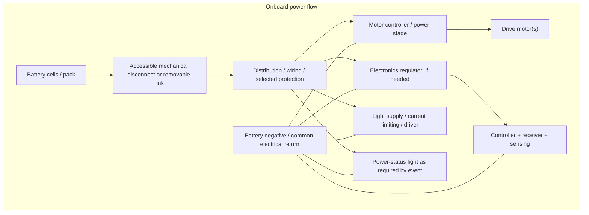
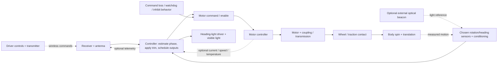
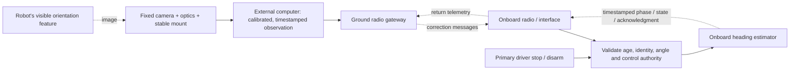

# Meltybrain component inventory — before part selection

Research checked **8 November 2026**. This document inventories the component roles of electronic, wheeled meltybrain/translational-drift combat robots, their support equipment, and an optional external-camera correction system. It selects no weight class, product, brand, model, price, supplier or preferred architecture. Source project names identify evidence, not purchasing recommendations.

The inventory draws on original firmware, hardware/construction notes, builder accounts, experiments, robotics research and organizer rules. A part shown in a test platform is evidence of use, not evidence of competition durability. Source inspection is not hardware testing. **(reasoning)** marks engineering interpretation and extensions beyond a source's explicit report.

A melty needs a way to time body rotation and change ground force at the intended phase. It does not universally need every listed sensor, separate circuit board, transmission or external reference. Some functions are internal to a chip, board, motor or structure. Alternative architectures and integrated parts should not be counted twice **(reasoning)**. A mechanical translational-drift mechanism would have a different inventory; the scope here is the electronic control architecture described in the task.

## 1. One-page component checklist

**R = required function**, **C = common in the inspected examples**, **O = optional**. **O→R** means required only when that branch is chosen. A role can be inside another part. “Common” is descriptive, not a measured percentage. Rule-required items depend on the event. This checklist groups small supporting parts; the numbered inventory below separates them.

| Area | Components and status |
| --- | --- |
| Computing | **R:** processor, circuit interconnections, clock, program memory, working memory, control firmware/timing. **C:** persistent calibration storage, programming/debug connection. **O:** reset/boot control, separate watchdog/supervisor. |
| Heading/motion sensing | **R:** a usable rotation/heading-estimation approach. **O→R:** high-range accelerometer(s), angular-rate sensor, magnetic-field sensor, rotating pickup coil, wheel/motor encoder and target. **O:** inversion/light sensor, ranging sensor. These are alternatives or supplements. |
| Sensor support | **O→R:** analog amplifier, converter, comparator, reference/bias and filter resistors/capacitors, interface pull resistors, logic-level translation, optical lens/hood/light guide. |
| External optical reference | **O→R:** beacon emitter, driver/current control, timing controller, power source and mounting; onboard optical receiver/photodiode, conditioning and viewing aperture. |
| Driver feedback | **C:** heading light. **O→R:** current limiting, light driver, digital light controller, visible mount/light window. **Rule-dependent R:** power-status indicator. |
| Radio and control | **R for radio operation:** operator transmitter/controls and its power, onboard receiver, antennas, signal interface, command-freshness/failsafe behavior. **O→R:** antenna feed, arming switch, trim control, telemetry radio/gateway, logging memory/socket, detachable data connectors. |
| Drive electronics | **R:** motor(s), controllable power stage, command interface, inductive-current return path. **O→R:** bridge/inverter, gate driver, brushless commutation/rotor feedback, current sensing, enable/inhibit, thermal path, configuration interface. Brushes/commutator are intrinsic to brushed motors. |
| Mechanical drive | **R for wheeled layouts:** wheel/contact surface, hub/coupling, shaft/axle, rotational support, motor mounting and retention. **O→R:** separate tire, outboard bearings/bushings, shims/spacers/thrust surfaces, retainers, gearbox/gears, belt/pulleys/tension adjustment, compliant coupling. **O:** skids and drive guards. |
| Power | **R for battery operation:** cells/pack interconnect, conductors/terminations, insulation and secure battery retention. **O→R:** power connectors, distribution junction, regulator, local/bulk capacitors, motor-noise suppression, regenerative-energy handling. **O:** voltage/current/temperature monitoring, balance connector, management/protection board, fuse/breaker/current limiting, polarity/transient protection. **Rule-dependent R:** accessible power disconnect/link. |
| Structure and retention | **R:** chassis/load paths; motor, battery and electronics retention; wire support and insulation. **C/O by layout:** shell/armour, floor, access lid, impact surface/impactor joint, internal partitions/cushioning, sensor/antenna/light mounts, disconnect access, connectors, fasteners/washers/nuts/inserts, adhesives/retainers, balance adjustment, inversion features, replaceable wear modules. |
| Rule/handling equipment | **Rule-dependent R:** motion/weapon lock and attachment, edge covers, power light, disconnect labels/access, safe transport/handling support. **R for spin tests in this workflow:** suitable containment. Exact materials, stopping behavior and exemptions are event-specific. |
| Building and testing, off robot | **R for rechargeable/programmed workflow:** compatible charger/leads/input supply and programming computer/interface. **C:** storage/charging containment, cradle, scale/measurement tools, assembly/repair tools and task protection. **O:** balance jig, calibration fixture, electrical instruments, independent rotation reference/recording. Event rules may make items compulsory. |
| Optional overhead vision | **O→R within add-on:** camera, lens, stable mount/cables, observable robot feature, usable illumination, image-processing computer/interface, calibration reference, ground/robot radio endpoints and antennas, external power/data wiring, time alignment, correction validation and operator override. |

See the detailed entries for dependencies and evidence. **R** identifies a function within the stated architecture; it is not an instruction to buy a separate module.

## 2. Detailed component inventory

All six fields are supplied for each component role. Statements labelled **(reasoning)** are interpretations; linked evidence identifies an implementation or rule rather than a universal requirement. Physical integration can combine several entries. For the structural entries, definitions, classifications, variations and dependencies are **(reasoning)** unless explicit build evidence or a rule is identified.

The optional camera branch is a decomposition of the requested add-on **(reasoning)**. Overhead robot localization and two-way melty host links are documented separately; this research did not verify a complete combat-speed overhead-camera melty installation.

### Control and computation

#### C01 — Main microcontroller

1. **What it is (reasoning):** A small computer chip that executes the robot program.
2. **What it does:** Times the spin estimate, motor changes and operator commands; the Halo main sketch coordinates these tasks. [Code](https://github.com/swallenhardware/MeltyHalo/blob/8728d60a406723eba0ffa8731a02fe69b4399611/haloBot.ino)
3. **Status (reasoning):** Conditionally required for a programmable electronic meltybrain. The function is not proof that an additional controller board is necessary.
4. **Variations (reasoning):** Bare chip, small development board, or processor integrated into a receiver or motor controller.
5. **Dependencies (reasoning):** Suitable power, clock, program storage, sensor interfaces and motor-command connection.
6. **Melty concerns (reasoning):** Compute load, blocking communication and restart behavior affect phase timing. A processor reset must not leave stale motor commands active.

#### C02 — Controller circuit board

1. **What it is (reasoning):** The physical carrier that mounts and electrically connects controller components.
2. **What it does:** Holds the control and sensing circuits in a repeatable arrangement; separate board-oriented code exists in Rotini firmware. [Code](https://github.com/AlfredoSystems/SimpleMelt/blob/41fb0fe5ce6664cb1e4d9da1856c095c56a147bb/examples/Rotini-V4/RotiniV4.h)
3. **Status (reasoning):** An interconnection structure is necessary; a separate commercial development board is optional.
4. **Variations (reasoning):** Custom printed circuit board, development board on a carrier, or compact prototype assembly.
5. **Dependencies (reasoning):** Solder joints, mounting and electrical connections to the other subsystems.
6. **Melty concerns (reasoning):** Mounting position changes sensor geometry. Unsupported connectors, heavy modules and flexible joints experience rotating loads and impacts.

#### C03 — Clock source

1. **What it is (reasoning):** The timing reference used by the processor and its peripherals.
2. **What it does:** Provides the time base for angle integration and output scheduling; the original controller explicitly depends on its board clock. [Code](https://github.com/nothinglabs/openmelt/blob/5bc3d4302229542ae18d205e803a478480f0aa44/main.c)
3. **Status (reasoning):** Required as a function; often inside the processor. A separate crystal or oscillator is conditional.
4. **Variations (reasoning):** Internal oscillator, external crystal with associated components, or packaged oscillator.
5. **Dependencies (reasoning):** Matching processor clock configuration and appropriate support components.
6. **Melty concerns (reasoning):** Frequency error becomes heading-rate error. Temperature sensitivity and timing jitter matter, while processor speed alone does not establish accurate timestamps.

#### C04 — Program storage

1. **What it is (reasoning):** Nonvolatile memory that holds firmware when power is removed.
2. **What it does:** Retains the control program between uses; all inspected standalone firmware requires executable program storage. [Example](https://github.com/swallenhardware/MeltyHalo/blob/8728d60a406723eba0ffa8731a02fe69b4399611/haloBot.ino)
3. **Status (reasoning):** Required for ordinary standalone firmware; usually integrated into the microcontroller or board.
4. **Variations (reasoning):** Internal flash or a separate memory chip.
5. **Dependencies (reasoning):** Programming access and a boot process capable of reading it.
6. **Melty concerns (reasoning):** Electrical noise or interrupted updates must not create an apparently valid but incomplete program. This is usually an intrinsic component, not an additional purchase.

#### C05 — Working memory

1. **What it is (reasoning):** Temporary electronic memory used while the program runs.
2. **What it does:** Holds recent sensor samples, filters, radio packets and estimated state; the infrared orientator uses a sample history. [Code](https://github.com/gavin4d/dangerDonut/blob/140206fd95df1dd11c0fde63067f5b25440ca995/components/orientator/orientator.cpp)
3. **Status (reasoning):** Required for software state; normally integrated rather than a separate physical part.
4. **Variations (reasoning):** Internal memory or additional memory on some controller modules.
5. **Dependencies (reasoning):** Processor support and sufficient capacity for the chosen algorithm.
6. **Melty concerns (reasoning):** A long sampling history or display buffer competes with control memory. Sharing mutable buffers between tasks needs deliberate synchronization.

#### C06 — Persistent calibration memory

1. **What it is (reasoning):** Storage used to retain offsets and settings after shutdown.
2. **What it does:** Saves sensor correction and heading configuration; an inspected controller has explicit configuration storage routines. [Code](https://github.com/nothinglabs/openmelt2/blob/7d062906950647350195b2b439e6f40e28492ce7/openmelt/config_storage.cpp)
3. **Status (reasoning):** Common but optional. It can reuse program memory or integrated nonvolatile storage.
4. **Variations (reasoning):** Internal nonvolatile memory, external memory chip, or removable storage.
5. **Dependencies (reasoning):** A defined data format, validation and a controlled save process.
6. **Melty concerns (reasoning):** A stored value is not automatically valid after sensor relocation, wheel changes or a shifted centre of mass. Writing should not stall time-critical control.

#### C07 — Watchdog or reset supervisor

1. **What it is (reasoning):** A circuit or integrated timer that detects missing software activity or bad supply conditions.
2. **What it does:** Allows recovery or shutdown when control code stops progressing; Halo configures a hardware watchdog and a motor-enable response. [Code](https://github.com/swallenhardware/MeltyHalo/blob/8728d60a406723eba0ffa8731a02fe69b4399611/haloBot.ino)
3. **Status (reasoning):** Optional as a separate chip; watchdog functionality is common and may be built into the processor. Event-required failsafe behavior is a separate requirement.
4. **Variations (reasoning):** Internal watchdog, external watchdog, or voltage/reset supervisor.
5. **Dependencies (reasoning):** Reset or enable connection and a defined safe response.
6. **Melty concerns (reasoning):** A watchdog is ineffective if unrelated activity keeps servicing it after the motor-control task freezes. Reset alone does not guarantee that motors stop.

#### C08 — Reset or boot control

1. **What it is (reasoning):** A button, contact pad or circuit that requests reset or selects programming mode.
2. **What it does:** Provides maintenance access to controller startup behavior; this is a general electronics provision rather than a universal melty mechanism.
3. **Status (reasoning):** Optional as a standalone physical button; a board may provide pads, automatic reset or an integrated button.
4. **Variations (reasoning):** Pushbutton, contact pads, or programmer-controlled signal.
5. **Dependencies (reasoning):** Processor reset/boot pins and required bias components.
6. **Melty concerns (reasoning):** Access should not cause accidental resets under centrifugal load or impact. A reset control is not a substitute for the robot's power isolation.

#### C09 — Programming and debug connection

1. **What it is (reasoning):** A physical service interface through which firmware is loaded or inspected.
2. **What it does:** Makes software changes and logs accessible; the investigated projects use serial or native computer connections. [Example](https://github.com/swallenhardware/MeltyHalo/blob/8728d60a406723eba0ffa8731a02fe69b4399611/haloBot.ino)
3. **Status (reasoning):** Common; conditionally required during programming or diagnosis, not necessarily installed as a large connector during competition.
4. **Variations (reasoning):** Computer connector, small header, contact pads or debug contacts.
5. **Dependencies (reasoning):** Compatible bootloader or debug interface and an external host.
6. **Melty concerns (reasoning):** A protruding service cable cannot stay attached while spinning. Debug output must not consume the timing budget or unintentionally power other circuits.

#### C10 — Logic-level translator

1. **What it is (reasoning):** A circuit that makes signal voltages compatible between devices.
2. **What it does:** Connects electronics that cannot safely share signal levels; digital sensor and receiver interfaces require compatible logic. [Interface example](https://github.com/AlfredoSystems/SimpleMelt/blob/41fb0fe5ce6664cb1e4d9da1856c095c56a147bb/examples/Rotini-V4/RotiniV4.h)
3. **Status (reasoning):** Conditionally required; unnecessary where every connected interface is already compatible.
4. **Variations (reasoning):** Dedicated translator chip, transistor circuit, or translation integrated into a breakout.
5. **Dependencies (reasoning):** Known interface voltage, direction and signal type.
6. **Melty concerns (reasoning):** A translator suitable for a slow shared bus may not preserve fast pulse edges. Added delay and rise time can affect sensor and motor-command timing.

#### C11 — Control firmware and timing peripherals

1. **What it is:** The program and integrated timer/interrupt facilities that schedule the robot's actions; a software component and processor functions, not necessarily separate hardware **(reasoning)**.
2. **What it does:** Turns commands and sensor readings into phase-dependent motor changes and indicator timing. [Original controller main loop](https://github.com/swallenhardware/MeltyHalo/blob/8728d60a406723eba0ffa8731a02fe69b4399611/haloBot.ino).
3. **Status:** **Required** within the programmable electronic architecture **(reasoning)**.
4. **Variations:** Polling, interrupt/timer scheduling, or coordinated tasks/cores; calibration, filtering, trim and mode handling are software functions **(reasoning)**.
5. **Dependencies:** Processor, clock, memory, sensor/receiver interfaces and motor/indicator outputs **(reasoning)**.
6. **Melty concerns:** Fresh measurements, bounded delays, safe startup and output behavior during faults matter. A fast processor does not by itself establish correct phase scheduling **(reasoning)**.

### Heading, motion and optional environmental sensing

#### S01 — High-range accelerometer

1. **What it is (reasoning):** A sensor measuring linear acceleration along its sensitive axes.
2. **What it does:** Can infer spin rate from centripetal acceleration and known geometry; the inspected Meltylock implementation uses this method. [Code](https://github.com/LukeUeda/TesselateF/blob/be723a45c5e1ce119b98b6c251c9d3bd641fe22f/teensy/src/Meltylock.cpp)
3. **Status (reasoning):** Conditionally required for an accelerometer-based estimator; not a universal requirement for every melty architecture.
4. **Variations (reasoning):** Analog or digital output, different axis counts, single sensor or differential sensor arrangement.
5. **Dependencies (reasoning):** Rigid mounting, defined orientation and effective radius, suitable interface and calibration.
6. **Melty concerns (reasoning):** Measurement range, bandwidth, offset, impact clipping, translation acceleration and a moving centre of rotation all affect the estimate. Shock survival is not the same as measurement range.

#### S02 — Angular-rate sensor

1. **What it is (reasoning):** A gyroscope measuring how fast the body turns.
2. **What it does:** Offers a direct rotation-rate measurement; gyroking integrates its gyro-derived rate. [Code](https://github.com/GHF/gyroking/blob/061499f1712dd6591c0326473e1a67c21ff2f774/src/Tortilla_control.cpp)
3. **Status (reasoning):** Alternative or supplemental heading sensor, not universally required alongside an accelerometer.
4. **Variations (reasoning):** Analog or digital gyroscope, integrated inertial module or dedicated rate sensor.
5. **Dependencies (reasoning):** Range compatible with intended body motion, timing and bias calibration.
6. **Melty concerns (reasoning):** A sensor can clip during ordinary body spin even while remaining electrically healthy. Bias integrates into heading drift, and impact recovery needs explicit handling.

#### S03 — Magnetic-field sensor

1. **What it is (reasoning):** A sensor measuring local magnetic field components.
2. **What it does:** Can supply an external heading reference; the current heading estimator blends magnetic heading with acceleration-derived rate. [Code](https://github.com/AlfredoSystems/SimpleMelt/blob/41fb0fe5ce6664cb1e4d9da1856c095c56a147bb/src/HeadingEstimator.h)
3. **Status (reasoning):** Optional alternative or supplemental reference; required only if the chosen estimator depends on it.
4. **Variations (reasoning):** Analog bridge sensor, digital compass sensor, or integrated magnetic sensor module.
5. **Dependencies (reasoning):** Usable field orientation, calibration, sufficient update rate and an appropriate filter.
6. **Melty concerns (reasoning):** Motor fields, current paths and nearby steel may distort heading. A compass that works while stationary may not track a rapidly rotating robot.

#### S04 — Infrared receiver and demodulator module

1. **What it is (reasoning):** A light-sensitive receiver with circuitry that extracts usable pulses from an optical carrier.
2. **What it does:** Detects an external optical heading reference; the Halo sketch reads its infrared input. [Code](https://github.com/swallenhardware/MeltyHalo/blob/8728d60a406723eba0ffa8731a02fe69b4399611/haloBot.ino)
3. **Status (reasoning):** **Optional overall; required if the stated branch or event depends on it.** Conditional on using an external optical reference.
4. **Variations (reasoning):** Integrated demodulating receiver or a detector with separate conditioning and demodulation circuits. A deliberately unmodulated optical reference uses a different receiver arrangement.
5. **Dependencies (reasoning):** Matching beacon signal, line of sight, suitable placement and a digital input.
6. **Melty concerns (reasoning):** Receiver filtering and automatic gain behavior can delay or suppress pulses. Reflections and temporary occlusion are different failures from radio loss.

#### S05 — Photodiode sensing element

1. **What it is (reasoning):** A semiconductor that produces a small current when illuminated.
2. **What it does:** Provides an analog optical heading signal; Hit ’N Spin's hybrid code processes a photodiode reading. [Code](https://github.com/swallenhardware/MeltyHitNSpinV1_1/blob/b90ebff61acd8a871345de8344e8a8c2954188b7/src/accelerometer.c)
3. **Status (reasoning):** **Optional overall; required if the stated branch or event depends on it.** Conditional on a raw photodiode sensing design; not additional to every packaged receiver.
4. **Variations (reasoning):** Separate photodiode, integrated optical detector or multiple detectors.
5. **Dependencies (reasoning):** Optical arrangement and a suitable analog front end or converter.
6. **Melty concerns (reasoning):** Ambient light can saturate the front end. The detector's field of view and signal-processing lag influence the apparent heading.

#### S06 — Phototransistor sensing element

1. **What it is (reasoning):** A light-sensitive transistor used to measure illumination.
2. **What it does:** Can distinguish which robot face points upward; Oreo compares its upper and lower light sensors. [Code](https://github.com/Mew463/Oreo/blob/fff232c423e8b3225261daab77ff7cfec03477ce/Robot%20Code/lib/Photo_Transistors/Photo_Transistors.h)
3. **Status (reasoning):** Optional secondary orientation sensor in the demonstrated approach.
4. **Variations (reasoning):** Discrete detectors, paired light sensors or a module containing them.
5. **Dependencies (reasoning):** Bias network or analog input and exposed optical paths.
6. **Melty concerns (reasoning):** Arena lighting, shadows and reflections can imitate a flip. Orientation detection must not be mistaken for a full absolute heading measurement.

#### S07 — Gravity, tilt or inversion sensor

1. **What it is (reasoning):** A sensor used to tell which way the robot is tilted or whether it is upside down.
2. **What it does:** Can select the correct drive interpretation after a flip. One inspected implementation smooths vertical acceleration and exposes an inverted-state function; applying it to driving remains a code TODO. [Code](https://github.com/skysdottir/potatomelt-esp32/blob/65881d9c3547ad4d1383086f021128e3632c0e42/potatomelt/src/subsystems/imu.cpp)
3. **Status (reasoning):** Optional unless the chosen control scheme needs inversion detection. Existing accelerometer axes or the light sensors above may provide the role without another part.
4. **Variations (reasoning):** Accelerometer-based gravity estimate, dedicated inclinometer, tilt switch or another orientation detector.
5. **Dependencies (reasoning):** A defined upright direction, interpretation logic and a reliable observation condition.
6. **Melty concerns (reasoning):** Spin, impact and airborne motion mix other acceleration with gravity. A stationary tilt measurement does not establish reliable inversion detection during a fight.

#### S08 — Analog amplifier

1. **What it is (reasoning):** A circuit that enlarges a small sensor signal.
2. **What it does:** Can make optical or magnetic signals readable; the spinning-compass experiment uses an amplifier before its comparator. [Experiment](https://robots.wa4dsy.net/spinning-compass)
3. **Status (reasoning):** Conditionally required for weak analog signals; often already inside a sensor module.
4. **Variations (reasoning):** Operational amplifier, instrumentation amplifier or sensor-specific amplifier.
5. **Dependencies (reasoning):** Power rails, gain-setting components, bias/reference and input/output headroom.
6. **Melty concerns (reasoning):** Large gain can amplify motor interference or cause saturation. Filtering changes phase, so clean-looking waveforms can still give delayed heading.

#### S09 — Analog-to-digital converter

1. **What it is (reasoning):** A circuit that turns a voltage into a digital number.
2. **What it does:** Lets firmware read analog acceleration, light or monitoring signals; gyroking uses a separate converter. [Code](https://github.com/GHF/gyroking/blob/061499f1712dd6591c0326473e1a67c21ff2f774/src/main.cpp)
3. **Status (reasoning):** **Optional overall; required if the stated branch or event depends on it.** Conditional on analog measurement. Frequently integrated into the processor or sensor.
4. **Variations (reasoning):** Internal converter or separate converter chip.
5. **Dependencies (reasoning):** Suitable input range, voltage reference and sampling interface.
6. **Melty concerns (reasoning):** Resolution, sample timing, reference noise and acquisition delay all matter. A digital sensor already includes conversion and does not require a second converter simply to read it.

#### S10 — Comparator

1. **What it is (reasoning):** A circuit that switches a digital output when an analog signal crosses a threshold.
2. **What it does:** Can turn a magnetic or optical waveform into timing edges; demonstrated in the spinning-compass experiment. [Experiment](https://robots.wa4dsy.net/spinning-compass)
3. **Status (reasoning):** **Optional overall; required if the stated branch or event depends on it.** Conditional analog-front-end component.
4. **Variations (reasoning):** Separate comparator, suitable integrated comparator, or module containing threshold detection.
5. **Dependencies (reasoning):** Stable threshold/reference, power and any required output bias.
6. **Melty concerns (reasoning):** Noise can produce extra edges; hysteresis and filtering alter switching behavior. An edge gives a reference event, not continuous angle by itself.

#### S11 — Signal-filter resistor

1. **What it is (reasoning):** A resistor used to set analog filtering, gain or sensor bias.
2. **What it does:** Forms part of an analog sensing network; the physical component supports the selected front-end circuit.
3. **Status (reasoning):** **Optional overall; required if the stated branch or event depends on it.** Conditional support component, not a standalone heading method.
4. **Variations (reasoning):** Fixed resistor, adjustable resistor or integrated resistor network.
5. **Dependencies (reasoning):** The rest of the analog circuit and an appropriate tolerance.
6. **Melty concerns (reasoning):** Its value influences filter delay, loading and offset. Do not confuse an analog resistor network with a software filter.

#### S12 — Signal-filter or coupling capacitor

1. **What it is (reasoning):** A capacitor used to remove offsets, reduce noise or shape bandwidth.
2. **What it does:** Can condition an analog magnetic or optical signal before timing extraction; the compass experiment uses coupling and filtering capacitors. [Experiment](https://robots.wa4dsy.net/spinning-compass)
3. **Status (reasoning):** **Optional overall; required if the stated branch or event depends on it.** Conditional on the analog design; distinct from power-supply decoupling.
4. **Variations (reasoning):** Coupling capacitor, feedback capacitor or passive filter capacitor.
5. **Dependencies (reasoning):** Associated resistors, amplifier/comparator and suitable voltage behavior.
6. **Melty concerns (reasoning):** Signal phase changes with filter design. Startup settling can resemble a valid heading change until the circuit stabilizes.

#### S13 — Optical lens, hood or light guide

1. **What it is (reasoning):** A physical optical part controlling which light reaches a detector.
2. **What it does:** Can narrow beacon direction, reduce unwanted paths or route light through a shell.
3. **Status (reasoning):** Optional optical support; sometimes required by a particular optical layout.
4. **Variations (reasoning):** Lens, opaque hood, aperture, tube or light guide.
5. **Dependencies (reasoning):** A compatible detector and durable alignment.
6. **Melty concerns (reasoning):** Vibration, shell flex and impact can change the viewing direction. A hood that rejects reflections may also make the beacon easier to lose.

#### S14 — External heading-beacon light emitter

1. **What it is (reasoning):** A light source outside the spinning robot used as a directional reference.
2. **What it does:** Provides the signal sought by an optical heading receiver; optical-reference timing is implemented in the infrared orientator. [Code](https://github.com/gavin4d/dangerDonut/blob/140206fd95df1dd11c0fde63067f5b25440ca995/components/orientator/orientator.cpp)
3. **Status (reasoning):** **Optional overall; required if the stated branch or event depends on it.** Conditional system component for an external optical reference; usually offboard.
4. **Variations (reasoning):** Steady emitter, modulated emitter or an array aimed toward the arena.
5. **Dependencies (reasoning):** Power, positioning and a receiver that can recognize the emitted signal.
6. **Melty concerns (reasoning):** Opponent occlusion, arena reflections and human aiming can interrupt the reference. A heading beacon is not the robot's own heading indicator.

#### S15 — Beacon driver transistor

1. **What it is (reasoning):** A switching device that controls current through an external beacon emitter.
2. **What it does:** Lets the beacon controller pulse an emitter without directly carrying its load current.
3. **Status (reasoning):** **Optional overall; required if the stated branch or event depends on it.** Conditional on beacon current and modulation arrangement; may be integrated.
4. **Variations (reasoning):** Transistor, dedicated emitter driver or integrated driver stage.
5. **Dependencies (reasoning):** Emitter, current control, supply and controller signal.
6. **Melty concerns (reasoning):** Pulse current and thermal loading belong to the driver design. Increasing emitter brightness does not resolve multipath or receiver delay.

#### S16 — Beacon timing controller

1. **What it is (reasoning):** A circuit generating the optical beacon's timing pattern.
2. **What it does:** Makes a modulated external beacon recognizable to its receiver.
3. **Status (reasoning):** **Optional overall; required if the stated branch or event depends on it.** Conditional for a modulated beacon; unnecessary for a deliberately steady reference.
4. **Variations (reasoning):** Small programmable controller, oscillator circuit or dedicated modulator.
5. **Dependencies (reasoning):** Power and a matching emitter/driver and receiver strategy.
6. **Melty concerns (reasoning):** Beacon timing must match receiver expectations. This is a separate offboard role, not automatically another onboard processor.

#### S17 — External beacon power source

1. **What it is (reasoning):** The electrical source supplying an offboard optical reference.
2. **What it does:** Keeps an external heading beacon operating independently of the spinning robot.
3. **Status (reasoning):** Conditionally required for a powered external beacon; may already be provided by its controller or another offboard device.
4. **Variations (reasoning):** Battery, regulated external supply or shared offboard supply.
5. **Dependencies (reasoning):** Beacon emitter, driver and timing circuit with compatible power requirements.
6. **Melty concerns (reasoning):** A depleted or disconnected beacon can remove heading correction while the control radio remains healthy. Beacon loss needs its own interpretation; it is not automatically a receiver failsafe event.

#### S18 — Rotating pickup coil

1. **What it is (reasoning):** A wound conductor that develops a voltage as its magnetic orientation changes.
2. **What it does:** Offers another magnetic-reference sensing principle; a builder investigated a rotating coil for melty heading. [Experiment](https://www.swallenhardware.io/battlebots/2022/9/18/magnetometers-for-meltybrains)
3. **Status (reasoning):** Experimental alternative; not generally required.
4. **Variations (reasoning):** Air-core or cored winding with suitable support.
5. **Dependencies (reasoning):** Analog amplification, signal processing and mechanically secure winding.
6. **Melty concerns (reasoning):** Its signal depends on speed and local field. Motor interference and low-speed behavior can prevent usable reference extraction; the cited experiment is not proof of general reliability.

#### S19 — Wheel or motor encoder sensor

1. **What it is (reasoning):** A device measuring rotation of a wheel or motor shaft.
2. **What it does:** Can report drive speed; ESC-telemetry heading experiments illustrate the use of wheel speed as a proxy. [Code](https://github.com/AmbientChaos/Spin-Doctor-V2/blob/3cbab8af342c968bbac6675bf68d4acf4e922bd1/Telemetry.h)
3. **Status (reasoning):** Optional feedback, or conditional if the chosen estimator needs wheel speed. Electronic motor telemetry may supply the role without a separate encoder.
4. **Variations (reasoning):** Optical or magnetic encoder, rotor-position switches used for commutation, or electrical speed derived by a motor controller. Rotor-position feedback may be integrated into a motor.
5. **Dependencies (reasoning):** A measured target or motor electrical information, signal connection and geometry.
6. **Melty concerns (reasoning):** Motor electrical speed, shaft speed, wheel speed and body spin are different quantities. Pole count and gearing are needed for conversions; wheel slip, lift and tyre deformation still break the body-spin inference. Commutation feedback is not an absolute arena heading reference.

#### S20 — Encoder target or code disc

1. **What it is (reasoning):** A rotating pattern or magnet that an encoder reads.
2. **What it does:** Makes shaft movement observable to a separate encoder.
3. **Status (reasoning):** **Optional overall; required if the stated branch or event depends on it.** Conditional if the selected encoder requires an added target; can be built into the motor or wheel.
4. **Variations (reasoning):** Patterned disc, ring, magnet or built-in rotor feature.
5. **Dependencies (reasoning):** Matching sensor, fixed spacing and secure alignment.
6. **Melty concerns (reasoning):** A shifted target changes timing or direction detection. Its retention must tolerate rotation and impact without rubbing.

#### S21 — Range or object-detection sensor

1. **What it is (reasoning):** A sensor measuring distance or detecting nearby objects.
2. **What it does:** Can support navigation or autonomous translation; Kasari parses range measurements alongside acceleration. [Code](https://github.com/celeron55/kasari/blob/ec8fc793330301a57c84c984fd68ebf532efdcd2/kasarisw/src/sensors.rs)
3. **Status (reasoning):** Optional secondary sensing; not inherently required to time basic melty translation.
4. **Variations (reasoning):** Optical ranging, scanning distance sensor, ultrasonic sensing or contact sensing, according to the chosen environment.
5. **Dependencies (reasoning):** Processing, power, mounting and an unobstructed measurement path.
6. **Melty concerns (reasoning):** Body rotation changes where the measurement points. Timestamps and sensor latency are needed to associate each reading with the correct direction.

### Human-visible indication

#### L01 — Heading-indicator light

1. **What it is (reasoning):** A light switched at selected body orientations so a spinning robot appears to have a front.
2. **What it does:** Lets a driver see the estimated translation reference; angle-indexed lighting is implemented in Halo. [Code](https://github.com/swallenhardware/MeltyHalo/blob/8728d60a406723eba0ffa8731a02fe69b4399611/Animations.ino)
3. **Status (reasoning):** Common in manually driven melties, but not physically necessary for every autonomous or externally tracked design.
4. **Variations (reasoning):** Single LED, distributed LEDs, monochrome light or addressable array.
5. **Dependencies (reasoning):** Suitable current control, output interface and visible mounting.
6. **Melty concerns (reasoning):** The visible arc is an output of the estimate, not proof that the estimate is correct. Occlusion, viewing angle and missed timing windows affect visibility.

#### L02 — Power or armed-status light

1. **What it is (reasoning):** A light showing an electrical or arming state independently of heading.
2. **What it does:** Communicates state while stationary; some event rules require a visible power indication. [Rules example](https://bristolbotbuilders.com/tools/checklist/)
3. **Status (reasoning):** Rule-dependent and commonly required; verify the intended event. It may share hardware only if the required meaning remains clear.
4. **Variations (reasoning):** Dedicated LED, separate status channel or a deliberate always-visible indicator.
5. **Dependencies (reasoning):** Connection to the state or supply being indicated.
6. **Melty concerns (reasoning):** A periodically flashing heading light may disappear when stopped or be off during a fault. A software-controlled light need not prove that drive power has actually been removed.

#### L03 — LED current-limiting resistor

1. **What it is (reasoning):** A resistor that limits current through an ordinary LED.
2. **What it does:** Sets safe current for a directly driven indicator.
3. **Status (reasoning):** Conditionally required unless another circuit already controls current.
4. **Variations (reasoning):** Separate resistor, resistor network or resistor integrated into an indicator assembly.
5. **Dependencies (reasoning):** LED characteristics and its supply/driver arrangement.
6. **Melty concerns (reasoning):** Uncontrolled current can damage the light or output pin. Resistive current limiting is not appropriate to every high-power or addressable-light design.

#### L04 — LED driver transistor or current driver

1. **What it is (reasoning):** A circuit that lets a low-power logic output control a larger light load.
2. **What it does:** Separates heading timing from the light's load current; Sunshine defines a switched LED output. [Code](https://github.com/Nv7-GitHub/sunshine/blob/f900217bd7e486aa8bf07354697bc85d60384e0a/sunshine_brain/include/config.h)
3. **Status (reasoning):** **Optional overall; required if the stated branch or event depends on it.** Conditional on output current, voltage and indicator design; may be integrated.
4. **Variations (reasoning):** Switching transistor, constant-current driver or driver inside an addressable LED.
5. **Dependencies (reasoning):** Power, current control and a compatible logic input.
6. **Melty concerns (reasoning):** Switching edges and wiring can add electrical noise. A high-power light also brings heat and event-specific restrictions.

#### L05 — Addressable-light controller

1. **What it is (reasoning):** The circuitry that accepts digital colour/brightness data for a light or array.
2. **What it does:** Supports patterned heading displays and artwork; Halo's animation code drives a light strip. [Code](https://github.com/swallenhardware/MeltyHalo/blob/8728d60a406723eba0ffa8731a02fe69b4399611/Animations.ino)
3. **Status (reasoning):** Optional display feature; commonly integrated into the LEDs rather than a separate board.
4. **Variations (reasoning):** Clocked or single-data-wire controller, embedded pixel driver or separate display driver.
5. **Dependencies (reasoning):** Compatible timing, voltage and power distribution.
6. **Melty concerns (reasoning):** A library call may block or mask interrupts. Display bandwidth and latency must be kept separate from the control loop's needs.

### Radio, commands, feedback and logging

#### R01 — Operator transmitter

1. **What it is (reasoning):** The handheld or other operator device that sends commands.
2. **What it does:** Provides manual spin, movement and arming input; Halo receives a custom operator packet. [Code](https://github.com/swallenhardware/MeltyHalo/blob/8728d60a406723eba0ffa8731a02fe69b4399611/Comms.ino)
3. **Status (reasoning):** Required for a radio-operated design. Some events also require remote activation/deactivation for autonomous robots. [Rules example](https://wiki.nhrl.io/wiki/index.php?title=NHRL_Rules)
4. **Variations (reasoning):** Stick handset, other proportional controller or a purpose-built command station.
5. **Dependencies (reasoning):** Matching receiver/link, power and suitable operator controls.
6. **Melty concerns (reasoning):** A loss-of-link policy must stop the relevant systems. The transmitter's channel count alone does not prove a usable arming control exists.

#### R02 — Onboard radio receiver

1. **What it is (reasoning):** A circuit that receives the operator's wireless commands.
2. **What it does:** Passes validated commands into the melty controller; a receiver parser is implemented in the inspected firmware. [Code](https://github.com/PsychoticRobotics/Project-Meltybrain/blob/a089aafa578768386fcce71b592ad79e2035c38c/src/Receiver.cpp)
3. **Status (reasoning):** Conditional on wireless command or event-required radio shutdown; it may share a board with the controller.
4. **Variations (reasoning):** Pulse-output receiver, serial-output receiver or integrated radio/controller.
5. **Dependencies (reasoning):** Compatible transmitter, antenna, supply and controller interface.
6. **Melty concerns (reasoning):** A receiver may keep outputting old commands after RF loss. A controller must distinguish fresh radio control from merely changing electrical edges.

#### R03 — Radio antenna

1. **What it is (reasoning):** The conductor that radiates or receives radio energy.
2. **What it does:** Makes the wireless command or feedback link possible.
3. **Status (reasoning):** Required as a radio function; may already be printed or integrated into a module.
4. **Variations (reasoning):** Printed antenna, wire antenna, ceramic element or separate antenna.
5. **Dependencies (reasoning):** Matching radio connection and an appropriate mounting environment.
6. **Melty concerns (reasoning):** Conductive shells, batteries, motors and orientation can reduce link quality. An exposed or poorly retained antenna can be damaged or pulled into moving parts.

#### R04 — Antenna connector or feed cable

1. **What it is (reasoning):** A physical connection between a radio and a separate antenna.
2. **What it does:** Allows antenna placement away from the controller when required.
3. **Status (reasoning):** **Optional overall; required if the stated branch or event depends on it.** Conditional; absent when the antenna is directly integrated.
4. **Variations (reasoning):** Coaxial lead, small radio-frequency connector or direct soldered feed.
5. **Dependencies (reasoning):** A compatible radio/antenna interface and strain relief.
6. **Melty concerns (reasoning):** A loose feed may look like random software failsafes. Feed routing must survive rotation without making the antenna system mechanically vulnerable.

#### R05 — Command and arming switch

1. **What it is (reasoning):** A physical operator control that requests a defined operating state.
2. **What it does:** Separates intentional enabling from proportional movement commands; firmware commonly contains idle/active states. [Code](https://github.com/swallenhardware/MeltyHalo/blob/8728d60a406723eba0ffa8731a02fe69b4399611/haloBot.ino)
3. **Status (reasoning):** **Optional overall; required if the stated branch or event depends on it.** A deliberate activation function is needed for the chosen control scheme; a separate physical switch is conditional and may be built into the transmitter.
4. **Variations (reasoning):** Toggle, momentary control, key, guarded control or suitable integrated handset input.
5. **Dependencies (reasoning):** A transmitted channel or message and a robot-side state machine.
6. **Melty concerns (reasoning):** An arming input is not the same as mechanical power isolation. Link recovery or processor reboot must not unexpectedly restore the last active state.

#### R06 — Voltage-monitor divider resistors

1. **What it is (reasoning):** A resistor pair or network that scales supply voltage for measurement.
2. **What it does:** Allows battery monitoring by the controller; Sunshine exposes an analog battery input with a divider relationship. [Code](https://github.com/Nv7-GitHub/sunshine/blob/f900217bd7e486aa8bf07354697bc85d60384e0a/sunshine_brain/include/config.h)
3. **Status (reasoning):** Optional monitoring hardware unless a chosen protection/control function depends on it; often already on a board.
4. **Variations (reasoning):** Discrete divider or integrated measurement front end.
5. **Dependencies (reasoning):** Converter input, return reference and appropriate resistor ratings.
6. **Melty concerns (reasoning):** An open connection or wrong scale can imitate a depleted or overcharged battery. Monitoring is not itself a physical power cutoff.

#### R07 — Removable logging memory

1. **What it is (reasoning):** A physical storage medium used to preserve test data.
2. **What it does:** Can retain sensor records without continuously sending them over radio; the accelerometer manager contains logging support. [Code](https://github.com/PsychoticRobotics/Project-Meltybrain/blob/a089aafa578768386fcce71b592ad79e2035c38c/src/Accelerometer.cpp)
3. **Status (reasoning):** Optional debugging or evidence-collection hardware.
4. **Variations (reasoning):** Removable memory card or other onboard data storage.
5. **Dependencies (reasoning):** A storage interface, power and a deliberate file/logging strategy.
6. **Melty concerns (reasoning):** Write stalls, interrupted power and unsecured media can lose data or disturb phase timing. Logs confirm only the signals actually recorded.

#### R08 — Logging-memory socket or connector

1. **What it is (reasoning):** The physical holder and electrical contacts for removable storage.
2. **What it does:** Connects a removable logging medium to the controller.
3. **Status (reasoning):** **Optional overall; required if the stated branch or event depends on it.** Conditional on removable storage; may already be built into the board.
4. **Variations (reasoning):** Card socket, board-mounted connector or a retained module.
5. **Dependencies (reasoning):** Matching medium, signal connections and mechanical retention.
6. **Melty concerns (reasoning):** A spring-loaded holder may release during impact unless retained. Connector mass and placement affect the rotating assembly.

#### R09 — Telemetry or sensor connector

1. **What it is (reasoning):** A physical detachable connection carrying low-power data or sensor signals.
2. **What it does:** Allows separate sensor, receiver or controller boards to communicate.
3. **Status (reasoning):** **Optional overall; required if the stated branch or event depends on it.** Conditional on modular construction; direct soldered wiring can serve the same connection role.
4. **Variations (reasoning):** Small plug/socket, header, board-to-board connection or solder pads.
5. **Dependencies (reasoning):** Matching pinout, secure contacts and appropriate wiring.
6. **Melty concerns (reasoning):** Intermittent contacts create plausible-looking stale samples. A shared return connection is still necessary unless an intentionally isolated interface is used.

#### R10 — Operator transmitter power source

1. **What it is:** The electrical supply for the operator's command device **(reasoning)**.
2. **What it does:** Keeps the operator's radio/control endpoint functioning independently of the spinning robot **(reasoning)**.
3. **Status:** **Required power function** for an active transmitter; it may already be integrated **(reasoning)**.
4. **Variations:** Replaceable cells, rechargeable pack, or power supplied by a connected host or control station **(reasoning)**.
5. **Dependencies:** Transmitter voltage requirements, charging method if rechargeable, connectors and any host connection **(reasoning)**.
6. **Melty concerns:** Loss of this supply is a primary-control loss that must lead to the defined robot failsafe; continued onboard operation is not evidence the driver still has control **(reasoning)**. [Organizer requirement to test transmitter-power-down behavior](https://wiki.nhrl.io/wiki/index.php?title=NHRL_Rules).

### Small supporting electrical parts

#### E01 — Power-decoupling capacitor

1. **What it is (reasoning):** A local capacitor placed near a chip's supply pins.
2. **What it does:** Supports short current demands of the controller or sensor; this is general circuit support rather than a heading algorithm.
3. **Status (reasoning):** Common and often electrically necessary; usually already fitted to a board or module.
4. **Variations (reasoning):** Ceramic or other suitable low-impedance capacitor.
5. **Dependencies (reasoning):** Short supply/return path and the component's required power arrangement.
6. **Melty concerns (reasoning):** Motor noise and fast radio activity can disturb sensitive electronics. Merely adding capacitance far away does not replace correct local placement.

#### E02 — Bulk supply capacitor

1. **What it is (reasoning):** A larger energy-storage capacitor across an electronics or motor supply.
2. **What it does:** Helps with slower supply disturbances; early melty notes discuss a large supply capacitor against voltage problems. [Code notes](https://github.com/nothinglabs/openmelt/blob/5bc3d4302229542ae18d205e803a478480f0aa44/main.c)
3. **Status (reasoning):** **Optional overall; required if the stated branch or event depends on it.** Conditional support component, not a universal standalone requirement.
4. **Variations (reasoning):** Electrolytic, polymer or another suitable bulk capacitor.
5. **Dependencies (reasoning):** Correct polarity where applicable, voltage compatibility and secure mounting.
6. **Melty concerns (reasoning):** Stored energy, ripple heating and mechanical retention matter. It cannot repair inadequate wiring or an unsuitable regulator.

#### E03 — Bias, pull-up or pull-down resistor

1. **What it is (reasoning):** A resistor that gives an otherwise floating signal a defined state.
2. **What it does:** Can hold control enables inactive or support shared sensor buses.
3. **Status (reasoning):** Conditionally required by the interface; often present internally or on a module.
4. **Variations (reasoning):** Separate resistor, resistor network or integrated bias.
5. **Dependencies (reasoning):** Known idle state and the connected devices' electrical behavior.
6. **Melty concerns (reasoning):** A default state should remain understandable during reset, disconnected sensors and partial power. A resistor alone does not implement a complete failsafe.

#### E04 — Signal or supply protection component

1. **What it is (reasoning):** A component that limits electrical stress at a circuit boundary.
2. **What it does:** Can protect controller inputs or rails from selected transients; this is an optional engineering provision rather than an assumed build feature.
3. **Status (reasoning):** **Optional overall; required if the stated branch or event depends on it.** Conditional on the electrical environment and protection strategy; may be integrated.
4. **Variations (reasoning):** Clamp diode, transient suppressor, series impedance or deliberately isolated interface.
5. **Dependencies (reasoning):** Defined voltage/current paths and compatible signal bandwidth.
6. **Melty concerns (reasoning):** Protection must address the actual fault and return path. Added capacitance or series impedance can degrade fast sensor or motor-command signals.

### Drive electronics and power

#### D01 — Drive motor

1. **What it is:** An electromechanical actuator with a rotor and windings.
2. **Role:** Produces wheel torque to spin and translate the chassis.
3. **Required, common or optional:** Required propulsion function for this drive architecture.
4. **Variations:** Brushed or electronically commutated brushless; geared or ungeared; different rotor and winding constructions.
5. **Dependencies:** A compatible controller, supply, motor mount and mechanical torque path.
6. **Meltybrain concerns:** **(reasoning):** loaded torque and acceleration determine the resulting impulse; an unloaded speed label does not establish that response.

Evidence: [Motor fundamentals](https://www.diodes.com/design/support/technical-articles/driving-brushed-dc-motors), [loaded motor dynamics](https://www.maxongroup.us/medias/sys_master/8798985748510.pdf?attachment=true).

#### D02 — Brushed-motor commutator and brushes

1. **What it is:** Internal rotating contacts and stationary brushes in a brushed motor.
2. **Role:** Switch winding connections as the rotor turns.
3. **Required, common or optional:** **Optional overall; required if the stated branch or event depends on it.** Integral to a brushed motor; absent from brushless drive. Usually not a separate robot assembly.
4. **Variations:** Brush material and commutator construction vary within the motor.
5. **Dependencies:** A compatible brushed motor construction and electrical suppression where needed.
6. **Meltybrain concerns:** **(reasoning):** contact interruption and brush noise can disturb delivered torque or heading electronics even when the requested command is correct.

Evidence: [Motor fundamentals](https://www.diodes.com/design/support/technical-articles/driving-brushed-dc-motors), [motor-noise mechanisms](https://www.pololu.com/docs/0j15/9).

#### D03 — Electronic motor controller / ESC

1. **What it is:** An electronic assembly between the command source, supply and motor.
2. **Role:** Decodes requests and controls electrical power delivered to the motor.
3. **Required, common or optional:** Required controllable-power function; may be integrated with other electronics.
4. **Variations:** Brushed or brushless controller; discrete circuitry, carrier board or integrated assembly; open-loop throttle or feedback regulation.
5. **Dependencies:** Matching motor type, command interface, logic levels, supply and current path.
6. **Meltybrain concerns:** **(reasoning):** a speed-control label does not establish closed-loop speed regulation or acceptance of rapid phase-dependent changes.

Evidence: [Drive circuit explanation](https://www.diodes.com/design/support/technical-articles/driving-brushed-dc-motors), [command/ESC boundary](https://betaflight.com/docs/development/API/Dshot).

#### D04 — Power switching stage

1. **What it is:** Power transistors and their connections inside a motor controller.
2. **Role:** Switch motor current into the requested drive, coast or brake states.
3. **Required, common or optional:** Required within an electronic motor controller; a separate board is optional.
4. **Variations:** Unidirectional switch, reversible bridge or brushless inverter.
5. **Dependencies:** Appropriate gate drive, recirculation paths, supply decoupling and thermal design.
6. **Meltybrain concerns:** **(reasoning):** melty translation can vary power while maintaining spin direction; it does not inherently require motor reversal on every chassis revolution. Published modulation code provides an example.

Evidence: [Bridge behavior](https://www.ti.com/video/6059539558001), [published modulation code](https://github.com/TGower/potatomelt-esp32/blob/7379a3fb7a93037f382e0c2a79f36a6fd9ea11d8/potatomelt/src/robot.cpp).

#### D05 — Gate-driver circuit

1. **What it is:** A circuit between control logic and power-transistor gates.
2. **Role:** Charges and discharges gates and, where needed, supplies high-side drive.
3. **Required, common or optional:** **Optional overall; required if the stated branch or event depends on it.** Conditional separate part; often integrated in the controller.
4. **Variations:** Low-side or high-side drive; bootstrap, charge-pump or other drive-supply arrangements.
5. **Dependencies:** Transistor gate requirements, switching topology, gate resistance, decoupling and suitable dead time.
6. **Meltybrain concerns:** **(reasoning):** inadequate gate drive can change switching losses and the output waveform; a logic output alone is not proof of adequate power-stage drive.

Evidence: [Gate-drive architecture](https://www.monolithicpower.com/en/learning/resources/using-mosfet-drivers-for-motor-drives).

#### D06 — Flyback / recirculation path

1. **What it is:** A path through diodes or switches for winding current after a switching transition.
2. **Role:** Allows inductive motor current to continue without an uncontrolled voltage rise.
3. **Required, common or optional:** Required electrical function when switching an inductive winding.
4. **Variations:** Discrete diode, transistor body diode or actively switched recirculation, depending on topology.
5. **Dependencies:** The chosen unidirectional, bridge or inverter arrangement; polarity and current paths must agree.
6. **Meltybrain concerns:** **(reasoning):** different recirculation states change current decay, so an off command need not create the same deceleration as a brake command.

Evidence: [Drive and recirculation circuits](https://www.diodes.com/design/support/technical-articles/driving-brushed-dc-motors), [brushed-drive explanation](https://www.ti.com/video/6102690810001).

#### D07 — Brushless commutation control

1. **What it is:** Electronics or firmware that determines which brushless windings are energized.
2. **Role:** Coordinates winding drive with rotor position or its estimate.
3. **Required, common or optional:** Required for brushless drive; usually part of the controller.
4. **Variations:** Position-sensor feedback, back-EMF estimation and different winding-current control methods.
5. **Dependencies:** Compatible inverter, motor and feedback method; back-EMF control needs a startup strategy.
6. **Meltybrain concerns:** **(reasoning):** startup, a nearly stopped wheel and recovery after impact need separate consideration from steady rotation.

Evidence: [Sensorless startup explanation](https://toshiba.semicon-storage.com/eu/semiconductor/design-development/innovationcentre/articles/tcm0673_TC78B011.html).

#### D08 — Motor rotor-position sensors and wiring

1. **What it is:** A rotor or shaft pickup and its electrical connections.
2. **Role:** Supplies commutation or motor-motion feedback.
3. **Required, common or optional:** Conditional for sensored commutation; optional additional feedback in other arrangements.
4. **Variations:** Hall sensing, encoders or other position pickups; sensorless control omits dedicated pickups.
5. **Dependencies:** Compatible controller inputs, sensor supply, mounting and signal wiring.
6. **Meltybrain concerns:** **(reasoning):** motor position is not automatically field heading; chassis rotation, transmission motion and wheel slip are separate quantities.

Evidence: [Sensored/sensorless control discussion](https://www.ti.com/video/6146059129001), [separate phase scheduling example](https://github.com/TGower/potatomelt-esp32/blob/7379a3fb7a93037f382e0c2a79f36a6fd9ea11d8/potatomelt/src/robot.cpp).

#### D09 — Current-sense element and amplifier

1. **What it is:** A sensing element and signal-conditioning circuit for electrical current.
2. **Role:** Supports regulation, limiting, diagnostics or reporting.
3. **Required, common or optional:** **Optional overall; required if the stated branch or event depends on it.** Conditional on the controller or protection architecture; sometimes integrated.
4. **Variations:** Shunt or magnetic sensing; phase, supply, high-side or low-side placement.
5. **Dependencies:** Measurement range, bandwidth, common-mode tolerance and access to the relevant current path.
6. **Meltybrain concerns:** **(reasoning):** battery current is not automatically the winding current during recirculation; the measured quantity must match the intended control or test.

Evidence: [Current-sensing placement](https://www.ti.com.cn/document-viewer/cn/lit/html/SLLA528).

#### D10 — Temperature sensing and thermal path

1. **What it is:** A temperature pickup and the material paths carrying heat away from electronics or a motor.
2. **Role:** Allows heat rejection and, if sensed, monitoring or limiting.
3. **Required, common or optional:** Heat dissipation is required; an added sensor or heatsink is conditional.
4. **Variations:** Board copper, housing, mount or added heat spreader; integrated or separate sensing.
5. **Dependencies:** Thermal contact, electrical insulation, mounting and available cooling.
6. **Meltybrain concerns:** **(reasoning):** repeated modulation and braking should be assessed under their actual duty; brief peak operation does not establish sustained thermal behavior.

Evidence: [power-stage design](https://e2e.ti.com/cfs-file/__key/communityserver-discussions-components-files/38/tidu708-DRIVER-CIRCUIT-AND-INVERTER.pdf).

#### D11 — Command interface and reference

1. **What it is:** The electrical connection and message format between robot controller and motor controller.
2. **Role:** Carries the requested motor state or power level.
3. **Required, common or optional:** Required interface function; may be internal to an integrated assembly.
4. **Variations:** Pulse-width commands, digital messages, serial links or direct switching inputs; shared reference or designed isolation.
5. **Dependencies:** Compatible logic levels, grounding or isolation, command interpretation and timing.
6. **Meltybrain concerns:** **(reasoning):** transmission bitrate, complete-message cadence and accepted-command cadence are different; conversion or mixing can delay phase-dependent requests.

Evidence: [Digital-command definition](https://betaflight.com/docs/development/API/Dshot), [drive-input architecture](https://www.monolithicpower.com/en/learning/resources/using-mosfet-drivers-for-motor-drives).

#### D12 — Enable, inhibit and stale-command handling

1. **What it is:** Hardware or firmware paths that permit or suppress power output.
2. **Role:** Defines behavior when disabled, commands disappear or controller state is invalid.
3. **Required, common or optional:** Common control/protection function; separate hardware depends on the architecture.
4. **Variations:** Driver-enable input, watchdog, command timeout or software state handling.
5. **Dependencies:** Defined fault states, controller behavior and the ability to command the actual output stage.
6. **Meltybrain concerns:** **(reasoning):** radio loss, stalled software and a failed power transistor are different faults. Published code stops output for missing or stale controller state; that is not evidence that it handles every fault.

Evidence: [Implemented stop-state example](https://github.com/TGower/potatomelt-esp32/blob/7379a3fb7a93037f382e0c2a79f36a6fd9ea11d8/potatomelt/src/robot.cpp).

#### D13 — Configuration/programming connection

1. **What it is:** Pads, connector or interface for loading firmware and changing settings.
2. **Role:** Establishes the controller behavior used by the drive system.
3. **Required, common or optional:** **Optional overall; required if the stated branch or event depends on it.** Conditional separate interface; may share normal signal connections.
4. **Variations:** Boot interface, programming header, shared signal connector or configuration software connection.
5. **Dependencies:** Supported firmware, electrical interface and access during assembly or maintenance.
6. **Meltybrain concerns:** **(reasoning):** braking, direction, startup and limiting settings affect impulse response; the settings must be known to interpret a drive test.

Evidence: [Firmware/configuration interface context](https://betaflight.com/docs/wiki/getting-started/hardware/esc-firmware).

#### D14 — Belt adjustment, idler or tensioner

1. **What it is:** An adjustable mounting feature, free-running pulley or spring-loaded assembly in a belt drive.
2. **Role:** Establishes belt routing and tension.
3. **Required, common or optional:** **Optional overall; required if the stated branch or event depends on it.** Conditional on the belt arrangement; a separate tensioner is not universal.
4. **Variations:** Adjustable shaft centers, fixed idler, adjustable idler or compliant tensioner.
5. **Dependencies:** Compatible belt routing, pulley alignment and allowable belt and bearing loads.
6. **Meltybrain concerns:** **(reasoning):** motion or compliance in the adjustment arrangement adds another influence between motor command and floor force.

Evidence: [Belt-drive installation](https://www.gates.com/content/dam/documents-library/operating-manuals/preventive-maintenance-manual-en.pdf).

#### D15 — Coupling / compliant drive element

1. **What it is:** A torque-transmitting connection between rotating parts.
2. **Role:** Joins parts and, in a compliant arrangement, allows controlled relative movement.
3. **Required, common or optional:** **Optional overall; required if the stated branch or event depends on it.** Conditional separate component; direct or integrated connections can perform the function.
4. **Variations:** Rigid coupling, flexible coupling or compliant drive interface.
5. **Dependencies:** Matching interfaces, retention, alignment and a defined torque/load path.
6. **Meltybrain concerns:** **(reasoning):** compliance can change disturbance transmission and introduce relative motion or lag; its effect is not established by material softness alone.

Evidence: [Coupling construction and alignment](https://www.ruland.com/media/wysiwyg/PDF/Encoder-Couplings.pdf), [load-inertia and response basis](https://www.maxongroup.com/medias/sys_master/8802918268958.pdf?attachment=true).

#### D16 — Motor suppression capacitors / filter elements

1. **What it is:** Components near a motor or its wiring that suppress electrical interference.
2. **Role:** Reduces conducted or radiated switching and brush noise.
3. **Required, common or optional:** Common for brushed drive; exact filtering is circuit-dependent.
4. **Variations:** Motor-terminal capacitors, housing-connected capacitors or other suitable filtering.
5. **Dependencies:** Correct placement, short connections and components compatible with the drive polarity.
6. **Meltybrain concerns:** **(reasoning):** sensor corruption or resets from motor noise can resemble heading-software faults. A listed capacitor does not establish an effective installation.

Evidence: [Motor-noise guidance](https://www.pololu.com/docs/0j15/9).

#### D17 — Transient clamp / regenerative-energy handling

1. **What it is:** Circuit paths or components that manage returned energy and supply-voltage excursions.
2. **Role:** Returns, stores, dissipates or limits energy produced during motor deceleration.
3. **Required, common or optional:** **Optional overall; required if the stated branch or event depends on it.** Conditional on braking topology, supply and protection arrangement.
4. **Variations:** Energy-absorbing supply path, capacitance, transient clamp or dissipative path.
5. **Dependencies:** Motor switching states, supply absorption capability and reverse-current behavior of intervening electronics.
6. **Meltybrain concerns:** **(reasoning):** the battery being connected does not establish that every regulator, disconnect or protection stage accepts regenerative current.

Evidence: [Regenerative current explanation](https://www.ti.com/document-viewer/lit/html/SSZT878).

#### D18 — Battery cells and pack interconnect

1. **What it is:** Electrochemical cells and the internal conductors joining them into a pack.
2. **Role:** Stores and delivers the robot’s operating energy.
3. **Required, common or optional:** Required onboard energy function for untethered battery operation.
4. **Variations:** Different chemistries, cell formats and series/parallel arrangements; protected or separately managed packs.
5. **Dependencies:** Compatible charging, load capability, insulation and mechanical restraint.
6. **Meltybrain concerns:** **(reasoning):** repeated motor demand and braking are properties of the complete load path, not just the cell label.

Evidence: [Battery-system functions](https://www.ti.com/solution/battery-pack-cordless-power-tool?subsystemid=24354&variantid=24352).

#### D19 — Main power wiring and terminations

1. **What it is:** Conductors and their soldered, crimped or mechanically secured electrical joints.
2. **Role:** Carries power between the pack, distribution and loads.
3. **Required, common or optional:** Required electrical-path function; a separate harness is conditional.
4. **Variations:** Flexible wiring, PCB conductors, crimped contacts, soldered joints or suitable terminals.
5. **Dependencies:** Contact/wire compatibility, thermal conditions, insulation and mechanical support.
6. **Meltybrain concerns:** **(reasoning):** routing must prevent rotational and impact loads from being carried solely by small solder pads or electrical contacts.

Evidence: [Connector-rating dependencies](https://www.molex.com/content/dam/molex/molex-dot-com/products/automated/en-us/productspecificationpdf/000/000000/PS-64321-001-001.pdf?inline=), [termination and strain relief](https://www.molex.com/content/dam/molex/molex-dot-com/en_us/pdf/general/987652-5181.pdf?inline=).

#### D20 — Power connector / removable link

1. **What it is:** Mating contacts in a power path; a removable link bridges an intentionally accessible break.
2. **Role:** Connects assemblies or provides a removable power connection.
3. **Required, common or optional:** Common; connector and disconnect functions can share an assembly.
4. **Variations:** Pack connector, harness connector or purpose-arranged removable link.
5. **Dependencies:** Current path, contact/wire compatibility, polarity, retention and physical access.
6. **Meltybrain concerns:** **(reasoning):** current capacity, resistance to accidental separation and accessibility for removal are distinct properties.

Evidence: [Contact/wire rating dependencies](https://www.molex.com/content/dam/molex/molex-dot-com/products/automated/en-us/productspecificationpdf/000/000000/PS-64321-001-001.pdf?inline=).

#### D21 — Power distribution junction

1. **What it is:** A junction connecting a supply to multiple branches.
2. **Role:** Feeds drive electronics, regulators and auxiliary loads.
3. **Required, common or optional:** Required where the supply branches; a separate distribution board is optional.
4. **Variations:** Harness splice, terminals or integrated PCB conductors.
5. **Dependencies:** Defined branch paths, return paths, conductor capability and physical layout.
6. **Meltybrain concerns:** **(reasoning):** motor-current returns can disturb sensitive references through shared impedance; a schematic connection alone does not establish a quiet layout.

Evidence: [Power-stage layout context](https://e2e.ti.com/cfs-file/__key/communityserver-discussions-components-files/38/tidu708-DRIVER-CIRCUIT-AND-INVERTER.pdf), [motor wiring/noise](https://www.pololu.com/docs/0j15/9).

#### D22 — Main disconnect / power switch

1. **What it is:** A mechanical switch or removable link that opens the main electrical power path.
2. **Role:** Allows physical removal of operating power.
3. **Required, common or optional:** Common system provision; event-specific obligations and acceptance depend on the selected event rules, which are not established here.
4. **Variations:** Mechanical switch or accessible removable link; integration with the pack connector is possible.
5. **Dependencies:** Suitable main-current path, accessible actuation/removal and accounting for alternate supply paths.
6. **Meltybrain concerns:** **(reasoning):** software disarm is a different function from opening the power path. Electrical isolation also does not instantly remove stored mechanical rotation.

Evidence: [Published disconnected-power assembly](https://github.com/nothinglabs/openmelt2/blob/main/antweight_reference_platform/readme.md).

#### D23 — Fuse, breaker or current-limiting protection

1. **What it is:** A device or circuit that interrupts or restricts excessive current.
2. **Role:** Responds to overload or fault conditions according to its characteristics.
3. **Required, common or optional:** **Optional overall; required if the stated branch or event depends on it.** Conditional; may be integrated in the driver or pack or added to a harness.
4. **Variations:** Fuse, resettable breaker or electronic limiting with different response behavior.
5. **Dependencies:** Coordination with wiring, startup demand, fault current and interrupt capability.
6. **Meltybrain concerns:** **(reasoning):** a brief phase-dependent demand and a wiring short are different events; unwanted trips can interrupt the intended drive state.

Evidence: [Inrush and protection relationships](https://www.keysight.com/gb/en/assets/7018-04036/application-notes/5991-2778.pdf), [motor-protection functions](https://www.littelfuse.com/~/media/electrical/application-notes/littelfuse-motor-protection-guide.pdf).

#### D24 — Reverse-polarity / input protection

1. **What it is:** An input circuit intended to block or limit damage from an incorrect supply connection.
2. **Role:** Protects downstream electronics against defined input faults.
3. **Required, common or optional:** Optional or integrated; depends on the overall connection and electronics design.
4. **Variations:** Diode or controlled-transistor arrangements; keyed connectors provide a separate mechanical precaution.
5. **Dependencies:** Supply polarity, fault paths, voltage drop, thermal behavior and reverse-current requirements.
6. **Meltybrain concerns:** **(reasoning):** a keyed shell does not prove correct harness wiring, and input protection can alter regenerative-current paths.

Evidence: [Reverse-polarity protection architectures](https://www.onsemi.com/download/application-notes/pdf/and90146-d.pdf), [reverse protection with returned motor energy](https://www.analog.com/media/en/technical-documentation/data-sheets/TMC603A_Datasheet.pdf).

#### D25 — Logic regulator / BEC

1. **What it is:** A circuit converting a source supply to a rail suitable for logic electronics.
2. **Role:** Powers controllers, receiver, sensors or auxiliary electronics.
3. **Required, common or optional:** Required conversion function when direct battery supply is unsuitable; often integrated.
4. **Variations:** Linear, step-down, step-up, combined or isolated conversion.
5. **Dependencies:** Input range, load transients, thermal behavior, grounding and startup/shutdown paths.
6. **Meltybrain concerns:** **(reasoning):** a motor controller’s auxiliary supply is not automatically sufficient for every attached load; drive-related disturbances can affect heading electronics.

Evidence: [Power-conversion overview](https://www.analog.com/en/resources/technical-articles/regulator-topologies-for-batterypowered-systems.html), [logic supply within a power stage](https://e2e.ti.com/cfs-file/__key/communityserver-discussions-components-files/38/tidu708-DRIVER-CIRCUIT-AND-INVERTER.pdf).

#### D26 — Pack voltage/current/temperature monitoring

1. **What it is:** Sensing circuits and data paths measuring battery operating conditions.
2. **Role:** Supports reporting, warnings, limiting or protective decisions.
3. **Required, common or optional:** Optional system features or conditional parts of the chosen protection architecture.
4. **Variations:** Voltage divider, current sensor, temperature pickup or integrated pack monitor.
5. **Dependencies:** Measurement points, signal conditioning, calibration and firmware interpretation.
6. **Meltybrain concerns:** **(reasoning):** total pack voltage does not reveal every cell’s condition, and taking a measurement does not itself implement protection.

Evidence: [Battery monitoring/protection roles](https://www.ti.com/solution/battery-pack-cordless-power-tool?subsystemid=24354&variantid=24352).

#### D27 — Cell-balance / sense connector

1. **What it is:** A connection exposing individual cell nodes.
2. **Role:** Allows cell-level sensing or balancing by compatible equipment.
3. **Required, common or optional:** **Optional overall; required if the stated branch or event depends on it.** Conditional on pack arrangement and charging/management architecture.
4. **Variations:** External connector, internal harness or integrated board connection.
5. **Dependencies:** Correct node order, suitable insulation and compatible charger or management inputs.
6. **Meltybrain concerns:** **(reasoning):** fine sense leads have a different purpose from the main power path and require their own retention and routing.

Evidence: [Pack balancing and sensing functions](https://www.ti.com/solution/battery-pack-cordless-power-tool?subsystemid=24354&variantid=24352).

#### D28 — Battery protection / management board

1. **What it is:** Electronics handling defined battery monitoring or management functions.
2. **Role:** May monitor, disconnect, balance or report pack and cell state.
3. **Required, common or optional:** Optional onboard assembly or conditional to the selected pack architecture.
4. **Variations:** Protection-only, monitoring, balancing or combined management; charging and gauging are separate functions unless explicitly included.
5. **Dependencies:** Cell arrangement, sensing connections, load/charge paths and defined trip/reconnect behavior.
6. **Meltybrain concerns:** **(reasoning):** an unexpected trip can reset control electronics or interrupt braking paths; management behavior therefore belongs in the drive model.

Evidence: [Management function separation](https://www.ti.com/solution/battery-pack-cordless-power-tool?subsystemid=24354&variantid=24352), [regenerative supply behavior](https://www.ti.com/document-viewer/lit/html/SSZT878).

### Structure, mechanical drive and retention

#### M01 — Main chassis / structural body

1. **What it is:** A frame or structural body.
2. **What it does:** Load-bearing frame that locates components and transfers forces between them.
3. **Status:** Function required; separate frame optional. (reasoning); event requirements are identified separately.
4. **Variations:** One-piece body, ring, assembled frame, or structural enclosure.
5. **Dependencies:** Motor mounts, battery retention, electronics mounts, covers and impact features attach to it.
6. **Meltybrain concerns:** The chassis itself rotates; its mass distribution, stiffness and damage alter balance and sensor geometry.

**Evidence:** Shell CAD supplied. [Reference-platform construction notes](https://github.com/nothinglabs/openmelt2/tree/main/antweight_reference_platform). (reasoning). The builder event account reports chassis cracking around an impact tooth. [Build evidence](https://www.swallenhardware.io/battlebots/2018/11/17/halo-pt-10-after-event-report).

#### M02 — Outer shell / armour

1. **What it is:** An exterior protective enclosure.
2. **What it does:** Exterior barrier around vulnerable components.
3. **Status:** Protective function is construction-dependent; separate armour optional. (reasoning); event requirements are identified separately.
4. **Variations:** Structural shell, detachable panels, compliant surround or exposed structural body.
5. **Dependencies:** Must accommodate wheel clearance, covers, access and impact geometry.
6. **Meltybrain concerns:** Every exterior point sweeps through space; a cover that comes loose can become a rotating projection.

**Evidence:** (reasoning) extension; no specific build presence verified here; no universal material or thickness claimed.

#### M03 — Bottom plate / floor

1. **What it is:** A lower plate or integral floor.
2. **What it does:** Lower enclosure or support surface.
3. **Status:** **Optional overall; required if the stated branch or event depends on it.** Construction-dependent; can be integral with chassis. (reasoning); event requirements are identified separately.
4. **Variations:** Printed floor, separate plate, partial enclosure or open frame.
5. **Dependencies:** Ground clearance, wheel protrusion and component mounting.
6. **Meltybrain concerns:** A sagging floor can scrape during rotation; low parts can catch floor defects.

**Evidence:** (reasoning) extension; no specific build presence verified in this entry.

#### M04 — Top cover / access lid

1. **What it is:** An upper closure or access lid.
2. **What it does:** Closure that retains and protects the contents.
3. **Status:** **Optional overall; required if the stated branch or event depends on it.** Construction-dependent; event protection requirements vary. (reasoning); event requirements are identified separately.
4. **Variations:** Removable lid, split cover, flexible closure or integral enclosure with access opening.
5. **Dependencies:** Fasteners, battery access, visibility and disconnect access.
6. **Meltybrain concerns:** Retention must resist outward loading and impacts; cover changes can disturb balance.

**Evidence:** Separate lid CAD; screw attachment described. [Reference-platform construction notes](https://github.com/nothinglabs/openmelt2/tree/main/antweight_reference_platform).

#### M05 — Impact surface / weapon feature

1. **What it is:** An opponent-contacting feature on the spinning body.
2. **What it does:** The part of the spinning body intended to contact the opponent.
3. **Status:** **Optional overall; required if the stated branch or event depends on it.** Design-dependent; a separate powered weapon is not inherent to meltybrain operation. (reasoning); event requirements are identified separately.
4. **Variations:** Body edge, integral tooth, replaceable tooth, ring or other event-permitted contact geometry.
5. **Dependencies:** Chassis load path, ground clearance, mounting and material eligibility.
6. **Meltybrain concerns:** Contact force reaches the complete spinning structure; a projecting feature changes balance and clearance.

**Evidence:** Integral and detachable impact-feature CAD supplied. [Reference-platform construction notes](https://github.com/nothinglabs/openmelt2/tree/main/antweight_reference_platform). (reasoning). Localized tooth loads caused chassis distortion in a documented build. [Build evidence](https://www.swallenhardware.io/battlebots/2018/11/17/halo-pt-10-after-event-report).

#### M06 — Impactor attachment / replaceable interface

1. **What it is:** A joint or module interface.
2. **What it does:** Joint connecting a separate impact feature to the body.
3. **Status:** **Optional overall; required if the stated branch or event depends on it.** Conditional on a separate impactor. (reasoning); event requirements are identified separately.
4. **Variations:** Captured shape, bolts, integral printed connection or serviceable module.
5. **Dependencies:** Legal materials, joint load path, clearance and spare geometry.
6. **Meltybrain concerns:** Failure can release an impactor; a replacement of different mass changes balance.

**Evidence:** Press-fit pin documented; robustness expressly unassured. [Reference-platform construction notes](https://github.com/nothinglabs/openmelt2/tree/main/antweight_reference_platform).

#### M07 — Motor mount / cradle

1. **What it is:** A motor-locating structural feature.
2. **What it does:** Structure that fixes the stationary part of each drive motor.
3. **Status:** Function required. (reasoning); event requirements are identified separately.
4. **Variations:** Integral pocket, separate bracket, clamp or captured cradle.
5. **Dependencies:** Motor geometry, wheel axis, chassis stiffness and cooling path.
6. **Meltybrain concerns:** Must locate the motor under outward loading and repeated torque changes without slipping.

**Evidence:** Motor zip-tie retention documented. [Reference-platform construction notes](https://github.com/nothinglabs/openmelt2/tree/main/antweight_reference_platform).

#### M08 — Wheel body / rolling element

1. **What it is:** A driven rolling component.
2. **What it does:** Floor-contacting driven component that produces traction and body rotation.
3. **Status:** Required for a wheeled layout; other locomotion concepts differ. (reasoning); event requirements are identified separately.
4. **Variations:** Directly driven wheel, hub-motor wheel, remotely driven wheel or roller.
5. **Dependencies:** Motor coupling, axle support, tread and floor.
6. **Meltybrain concerns:** Wheel balance, concentricity and changing grip affect both spin and timed translation.

**Evidence:** (reasoning) extension; no specific build presence verified in this entry.

#### M09 — Wheel hub / motor coupling

1. **What it is:** A wheel-to-drive mechanical interface.
2. **What it does:** Mechanical connection transmitting motor torque to the wheel.
3. **Status:** Function required; separate hub optional. (reasoning); event requirements are identified separately.
4. **Variations:** Integrated hub, clamped coupling, keyed connection or other captured interface.
5. **Dependencies:** Shaft, wheel, retention and available manufacturing process.
6. **Meltybrain concerns:** Repeated acceleration and braking can loosen a connection; eccentric mounting causes cyclic vibration.

**Evidence:** (reasoning) extension; no specific build presence verified in this entry.

#### M10 — Tire / tread

1. **What it is:** A gripping wheel surface.
2. **What it does:** Gripping surface on a rolling element.
3. **Status:** Construction-dependent; distinct tread optional. (reasoning); event requirements are identified separately.
4. **Variations:** Integral textured wheel, replaceable tire, bonded tread or permitted coating.
5. **Dependencies:** Wheel geometry, adhesive compatibility, floor and material rules.
6. **Meltybrain concerns:** Tread can stretch or detach under rotation; uneven wear changes effective radius and balance.

**Evidence:** (reasoning). A plastic-division example explicitly permits grippy tread while restricting structural materials. [Rules example](https://www.tsvrc.com.au/Townsville_Robot_Combat_Robot_Specifications.pdf?v=55).

#### M11 — Axle / shaft

1. **What it is:** A shaft or axis member.
2. **What it does:** Axis and support member around which a wheel or transmission rotates.
3. **Status:** Required function; motor shaft may provide it. (reasoning); event requirements are identified separately.
4. **Variations:** Motor shaft, independent axle, through axle or stationary axle with rotating hub.
5. **Dependencies:** Bearings, wheel coupling, supports and retainers.
6. **Meltybrain concerns:** A motor shaft alone may carry radial loads it was not intended to support.

**Evidence:** (reasoning) extension; no specific build presence verified in this entry.

#### M12 — External bearing / bushing support

1. **What it is:** An additional shaft-support element.
2. **What it does:** Additional support for a wheel or shaft beyond the motor.
3. **Status:** **Optional overall; required if the stated branch or event depends on it.** Layout-dependent. (reasoning); event requirements are identified separately.
4. **Variations:** Bearing, plain bushing, outboard support or supported hub assembly.
5. **Dependencies:** Accurate alignment, axle geometry, chassis stiffness and shims.
6. **Meltybrain concerns:** Supports can carry outward wheel loading but misalignment can preload or damage the motor.

**Evidence:** A builder explicitly used outboard bushings and reported motor damage after incorrect shimming. [Firsthand evidence](https://forum.bristolbotbuilders.com/t/weaponised-mathematics-the-anatomy-of-a-meltybrain/758).

#### M13 — Spacers / shims / thrust surfaces

1. **What it is:** A spacing or axial-support element.
2. **What it does:** Parts that establish spacing and control axial movement.
3. **Status:** **Optional overall; required if the stated branch or event depends on it.** Conditional on the shaft and bearing arrangement. (reasoning); event requirements are identified separately.
4. **Variations:** Spacer tube, shim, washer, thrust bearing or integral shoulder.
5. **Dependencies:** Bearing stack, shaft retention and motor endplay.
6. **Meltybrain concerns:** Incorrect spacing can force loads through unintended bearings or let rotating parts rub.

**Evidence:** Reasoning; the documented bushing-shimming failure illustrates this dependency. [Firsthand evidence](https://forum.bristolbotbuilders.com/t/weaponised-mathematics-the-anatomy-of-a-meltybrain/758).

#### M14 — Shaft / wheel retainers

1. **What it is:** An axial retention feature.
2. **What it does:** Features preventing a rotating assembly from moving off its axis.
3. **Status:** Retention function required; separate retainers conditional. (reasoning); event requirements are identified separately.
4. **Variations:** Shoulder, clip, collar, nut or captured geometry.
5. **Dependencies:** Shaft features, clearances and legal materials.
6. **Meltybrain concerns:** Retention failure changes balance immediately and may release a wheel.

**Evidence:** Shaft washer retention modification documented. [Reference-platform construction notes](https://github.com/nothinglabs/openmelt2/tree/main/antweight_reference_platform).

#### M15 — Gears / belts / transmission supports

1. **What it is:** An indirect torque-transfer assembly.
2. **What it does:** Mechanism transferring torque when the motor does not directly drive the wheel.
3. **Status:** Optional; depends on drivetrain architecture. (reasoning); event requirements are identified separately.
4. **Variations:** Gear train, belt and pulley, friction coupling or direct drive with none.
5. **Dependencies:** Shaft spacing, tension, alignment, bearings and guarding.
6. **Meltybrain concerns:** Torque reversals and impact deflection affect backlash, belt security and command response.

**Evidence:** (reasoning) extension; no specific build presence verified in this entry.

#### M16 — Motor / transmission guard

1. **What it is:** A protective drive-system barrier.
2. **What it does:** Physical protection around exposed rotating or fragile drive parts.
3. **Status:** Optional; may be integrated into chassis. (reasoning); event requirements are identified separately.
4. **Variations:** Guard, recessed motor, perimeter shield or internal partition.
5. **Dependencies:** Motor cooling, wheel access and shell envelope.
6. **Meltybrain concerns:** A guard must not deflect into the wheel or rotating motor; added mass changes inertia.

**Evidence:** (reasoning) extension; no specific build presence verified in this entry.

#### M17 — Battery compartment / tray

1. **What it is:** A battery-locating compartment.
2. **What it does:** Location and support structure for the energy storage pack.
3. **Status:** Secure mounting required function. (reasoning); event requirements are identified separately.
4. **Variations:** Pocket, tray, enclosed bay or replaceable battery module.
5. **Dependencies:** Pack dimensions, insulation, retention, cable exit and service access.
6. **Meltybrain concerns:** Battery movement changes the centre of mass and can pull wires or contact sharp features.

**Evidence:** Battery floor-and-wall mounting described. [Reference-platform construction notes](https://github.com/nothinglabs/openmelt2/tree/main/antweight_reference_platform). (reasoning). Event safety inspection includes secure insulated battery mounting. [Organizer guidance](https://www.tsvrc.com.au/safety.html).

#### M18 — Battery restraint / retaining lid

1. **What it is:** A battery-retaining mechanism.
2. **What it does:** Positive restraint preventing the pack leaving its compartment.
3. **Status:** Secure retention required function; method varies. (reasoning); event requirements are identified separately.
4. **Variations:** Captured cover, strap, bracket, clamp or geometry that encloses the pack.
5. **Dependencies:** Battery tray, protective padding, attachment strength and service access.
6. **Meltybrain concerns:** Restraint must carry outward force and impacts without crushing or puncturing the pack.

**Evidence:** Additional battery tie provision documented. [Reference-platform construction notes](https://github.com/nothinglabs/openmelt2/tree/main/antweight_reference_platform).

#### M19 — Cushioning / isolation / internal partitions

1. **What it is:** A protective or isolating internal feature.
2. **What it does:** Material or geometry limiting movement, abrasion or impact transfer.
3. **Status:** **Optional overall; required if the stated branch or event depends on it.** Construction-dependent but design-dependent. (reasoning); event requirements are identified separately.
4. **Variations:** Padding, compliant mount, separator, clearance pocket or rigid barrier.
5. **Dependencies:** Material rules, thermal paths and required positional accuracy.
6. **Meltybrain concerns:** Soft isolation can let a heading sensor move relative to its assumed radius; battery cushioning must not replace retention.

**Evidence:** (reasoning) extension; no specific build presence verified in this entry.

#### M20 — Electronics carrier / PCB mounting

1. **What it is:** An electronics-supporting structure.
2. **What it does:** Structure securing controller, receiver and motor-control electronics.
3. **Status:** Mounting function required; separate carrier optional. (reasoning); event requirements are identified separately.
4. **Variations:** Standoffs, integral bosses, captured pockets, compliant mounts or retained modules.
5. **Dependencies:** Board geometry, insulation, access and cooling.
6. **Meltybrain concerns:** Plug-in modules and heavy components can move under impact or rotation.

**Evidence:** Raised controller shelf and mounting tape documented. [Reference-platform construction notes](https://github.com/nothinglabs/openmelt2/tree/main/antweight_reference_platform). (reasoning). A builder reported shock damage and obstructed heading-light visibility from board modules. [Build evidence](https://www.swallenhardware.io/battlebots/2018/11/17/halo-pt-10-after-event-report).

#### M21 — Heading-sensor mount / datum

1. **What it is:** A sensor-locating reference structure.
2. **What it does:** The mechanical reference fixing the heading sensor location and orientation.
3. **Status:** Required function for an onboard sensor; exact form depends on sensing method. (reasoning); event requirements are identified separately.
4. **Variations:** Sensor on main PCB, separate rigid bracket, paired mounts or another reference arrangement.
5. **Dependencies:** Heading method, calibration, chassis geometry and wiring.
6. **Meltybrain concerns:** Mount flex, displacement or a changed rotation centre can invalidate a geometry-dependent estimate.

**Evidence:** Tape-mounted accelerometer documented. [Reference-platform construction notes](https://github.com/nothinglabs/openmelt2/tree/main/antweight_reference_platform).

#### M22 — Receiver / antenna mount and protection

1. **What it is:** A radio-component retention feature.
2. **What it does:** Retention and routing arrangement for radio components.
3. **Status:** Required function where radio is used. (reasoning); event requirements are identified separately.
4. **Variations:** PCB retention, antenna guide, protected channel or flexible mounting feature.
5. **Dependencies:** Receiver layout, shell material, wire routing and radio range.
6. **Meltybrain concerns:** A loose antenna can be pulled outward or reach moving parts; enclosure changes may affect reception.

**Evidence:** (reasoning) extension; no specific build presence verified in this entry.

#### M23 — Heading indicator mounting / light path

1. **What it is:** An optical opening or indicator support.
2. **What it does:** Mechanical provision that makes a timed heading light visible.
3. **Status:** **Optional overall; required if the stated branch or event depends on it.** Construction-dependent; depends on heading feedback method and driver interface. (reasoning); event requirements are identified separately.
4. **Variations:** Exposed protected LED, window, light pipe, diffuser or outward-facing mount.
5. **Dependencies:** LED electronics, viewing direction, shell and sensor timing.
6. **Meltybrain concerns:** The apparent light direction must stay visible despite rotation, inversion and internal obstructions.

**Evidence:** Glued heading light; lid-on visibility check described. [Reference-platform construction notes](https://github.com/nothinglabs/openmelt2/tree/main/antweight_reference_platform). (reasoning). Obscured LEDs were a reported practical problem in a real build. [Build evidence](https://www.swallenhardware.io/battlebots/2018/11/17/halo-pt-10-after-event-report).

#### M24 — Main-power indicator mounting / light path

1. **What it is:** An externally visible power-indicator support.
2. **What it does:** Visible indication that hazardous robot systems have electrical power.
3. **Status:** **Optional overall; required if the stated branch or event depends on it.** Rule-dependent; distinct purpose from heading indication. (reasoning); event requirements are identified separately.
4. **Variations:** Separate indicator, exposed board indicator or protected light pipe.
5. **Dependencies:** Power circuit, external visibility and enclosure.
6. **Meltybrain concerns:** A heading LED that only flashes while spinning may not communicate stationary armed status.

**Evidence:** (reasoning). One organizer requires a visible main-power light. [Rules example](https://www.tsvrc.com.au/Townsville_Robot_Combat_Robot_Specifications.pdf?v=55).

#### M25 — Manual disconnect mount / access opening

1. **What it is:** A disconnect-locating structure with access.
2. **What it does:** Mechanical arrangement letting a person isolate hazardous electrical power.
3. **Status:** **Optional overall; required if the stated branch or event depends on it.** Rule-dependent hardware requirement; safe isolation is a functional need. (reasoning); event requirements are identified separately.
4. **Variations:** Mounted switch, removable-link socket or safely accessible battery disconnect accepted by the event.
5. **Dependencies:** Power wiring, external access, protection and operator procedure.
6. **Meltybrain concerns:** The body must be stopped before approach; access must avoid teeth, pinch points and unintended actuation.

**Evidence:** Glued switch mounting documented. [Reference-platform construction notes](https://github.com/nothinglabs/openmelt2/tree/main/antweight_reference_platform). (reasoning). The cited organizer requires a mechanical main-power disconnect. [Rules example](https://www.tsvrc.com.au/Townsville_Robot_Combat_Robot_Specifications.pdf?v=55).

#### M26 — Removable-link handle / pull feature

1. **What it is:** A graspable removable-link feature.
2. **What it does:** Grip feature used to remove a power link.
3. **Status:** **Optional overall; required if the stated branch or event depends on it.** Conditional on removable-link architecture. (reasoning); event requirements are identified separately.
4. **Variations:** Insulated handle, tab, loop or shaped link body.
5. **Dependencies:** Socket retention, safe access, identification and power circuit.
6. **Meltybrain concerns:** A freely hanging handle can move outward or snag; retention must balance secure operation and deliberate removal.

**Evidence:** (reasoning) extension; no specific build presence verified in this entry.

#### M27 — Wire guides / cable restraint / strain relief

1. **What it is:** A cable-locating or restraining feature.
2. **What it does:** Mechanical routing that prevents cable movement and terminal loading.
3. **Status:** Required function; separate guides optional. (reasoning); event requirements are identified separately.
4. **Variations:** Integral channel, clip, tie, sleeve or secured cable loop.
5. **Dependencies:** Disconnect, battery, motor and PCB locations; service clearance.
6. **Meltybrain concerns:** Cables are rotating masses; unsecured loops can reach wheels or pull solder joints.

**Evidence:** Connection-strain relief discussed. [Reference-platform construction notes](https://github.com/nothinglabs/openmelt2/tree/main/antweight_reference_platform).

#### M28 — Electrical insulation / abrasion barriers

1. **What it is:** A nonconductive protective layer or barrier.
2. **What it does:** Nonconductive protection around conductors, terminals and adjacent parts.
3. **Status:** Required function where a short or abrasion could occur. (reasoning); event requirements are identified separately.
4. **Variations:** Sleeve, shrink covering, insulated pocket, sheet barrier or coated connection.
5. **Dependencies:** Power connections, sharp edges, legal materials and heat.
6. **Meltybrain concerns:** Impact can expose conductors; outward motion can press wiring against the enclosure.

**Evidence:** (reasoning). The organizer requires protection against battery shorts. [Rules example](https://www.tsvrc.com.au/Townsville_Robot_Combat_Robot_Specifications.pdf?v=55).

#### M29 — Fasteners / nuts / washers

1. **What it is:** A mechanical joining element.
2. **What it does:** Hardware joining parts and distributing joint loads.
3. **Status:** **Optional overall; required if the stated branch or event depends on it.** Construction-dependent; some joints can be integral or bonded. (reasoning); event requirements are identified separately.
4. **Variations:** Through fastener, captive nut, self-tapping fastener, washer or printed joint.
5. **Dependencies:** Material eligibility, service access, thread engagement and mating geometry.
6. **Meltybrain concerns:** Repeated torque changes, vibration and impacts can loosen joints; protrusions change the swept envelope.

**Evidence:** Screwed lid documented. [Reference-platform construction notes](https://github.com/nothinglabs/openmelt2/tree/main/antweight_reference_platform). (reasoning). An example plastic ruleset permits defined metal fasteners and washers. [Rules example](https://www.tsvrc.com.au/Townsville_Robot_Combat_Robot_Specifications.pdf?v=55).

#### M30 — Threaded inserts / captive-thread features

1. **What it is:** A retained threaded feature.
2. **What it does:** Durable or serviceable threads retained in a component.
3. **Status:** Optional. (reasoning); event requirements are identified separately.
4. **Variations:** Heat-set insert, captive nut, molded thread or direct plastic thread.
5. **Dependencies:** Material rules, surrounding wall geometry and assembly process.
6. **Meltybrain concerns:** A thread insert can pull out with its surrounding plastic; its mass and placement affect balance.

**Evidence:** (reasoning). The example plastic ruleset permits heat-set inserts. [Rules example](https://www.tsvrc.com.au/Townsville_Robot_Combat_Robot_Specifications.pdf?v=55).

#### M31 — Adhesive / potting / joint locking material

1. **What it is:** A joining or retention compound.
2. **What it does:** Material bonding parts, retaining a component or limiting fastener loosening.
3. **Status:** Optional; not automatically a substitute for mechanical retention. (reasoning); event requirements are identified separately.
4. **Variations:** Adhesive bond, local encapsulation, thread-retention method or no bonded joint.
5. **Dependencies:** Material compatibility, electronics repair, temperature and class restrictions.
6. **Meltybrain concerns:** A bond can experience outward loading and repeated impacts; potting may alter cooling and prevent repair.

**Evidence:** Mounting tape and hot glue documented. [Reference-platform construction notes](https://github.com/nothinglabs/openmelt2/tree/main/antweight_reference_platform).

#### M32 — Skid / passive ground support

1. **What it is:** A passive floor-contacting element.
2. **What it does:** Non-driven support that touches the floor.
3. **Status:** **Optional overall; required if the stated branch or event depends on it.** Layout-dependent. (reasoning); event requirements are identified separately.
4. **Variations:** Integral wear surface, replaceable skid, free wheel or no separate support.
5. **Dependencies:** Centre of mass, driven wheel arrangement and floor clearance.
6. **Meltybrain concerns:** Ground contact during spin-up can differ from contact at speed; wear can change tilt and wheel loading.

**Evidence:** (reasoning) extension; no specific build presence verified in this entry.

#### M33 — Inversion / self-righting body feature

1. **What it is:** A recovery-enabling body feature.
2. **What it does:** Geometry that enables continued motion or recovery after overturning.
3. **Status:** Optional design feature; mobility expectations are event-dependent. (reasoning); event requirements are identified separately.
4. **Variations:** Symmetric body, curved cover, raised feature, passive recovery geometry or separate mechanism.
5. **Dependencies:** Wheel protrusion, clearance, heading display and inversion sensing.
6. **Meltybrain concerns:** A robot can rest on its cover with drive wheels clear of the floor; recovery features change rotating balance.

**Evidence:** (reasoning) extension; no specific build presence verified in this entry.

#### M34 — Balance-adjustment provision

1. **What it is:** An adjustable mass-location provision.
2. **What it does:** Mechanical means of adjusting mass distribution after assembly.
3. **Status:** Construction-dependent development feature; separate weights optional. (reasoning); event requirements are identified separately.
4. **Variations:** Repositioned components, removable material, retained trim mass or symmetric spare parts.
5. **Dependencies:** Assembled component masses, sensor calibration and legal materials.
6. **Meltybrain concerns:** A loose trim weight is a projectile hazard; repairs and batteries can change balance.

**Evidence:** (reasoning). External balancing tools and measurement are handled separately by the parent task.

#### M35 — Physical motion restraint / weapon lock interface

1. **What it is:** A motion-blocking engagement interface.
2. **What it does:** Onboard attachment or engagement point for a device preventing harmful motion while inactive.
3. **Status:** **Optional overall; required if the stated branch or event depends on it.** Rule-dependent; particularly relevant to a spinning body. (reasoning); event requirements are identified separately.
4. **Variations:** Captured wheel restraint, chassis fixture or other event-accepted blocking method.
5. **Dependencies:** Drivetrain, activation procedure, visible identification and safe removal.
6. **Meltybrain concerns:** The entire body is the weapon; merely covering a tooth may leave harmful wheel-driven rotation possible.

**Evidence:** (reasoning). The cited organizer requires securely attached locking devices for moving weapons. [Rules example](https://www.tsvrc.com.au/Townsville_Robot_Combat_Robot_Specifications.pdf?v=55).

#### M36 — Transport / handling protection interface

1. **What it is:** A handling or protection attachment feature.
2. **What it does:** Attachment or shape allowing the disabled robot to be covered, restrained or carried.
3. **Status:** **Optional overall; required if the stated branch or event depends on it.** Construction-dependent; separate transport equipment is outside this onboard inventory. (reasoning); event requirements are identified separately.
4. **Variations:** Cover attachment, carrying recess, cradle interface or restraint point.
5. **Dependencies:** Weapon geometry, power isolation and secure handling.
6. **Meltybrain concerns:** Transport restraints do not establish that a powered robot is safe to test or spin.

**Evidence:** (reasoning) extension; no specific build presence verified in this entry.

#### M37 — Replaceable wear / sacrificial modules

1. **What it is:** A replaceable component architecture.
2. **What it does:** Parts deliberately separated so damaged or worn areas can be replaced.
3. **Status:** Optional architecture; duplicates are spares rather than extra active components. (reasoning); event requirements are identified separately.
4. **Variations:** Wheel/tread, cover, impact feature, skid or mount modules.
5. **Dependencies:** Repeatable location, consistent mass, legal materials and attachment method.
6. **Meltybrain concerns:** A nominally matching replacement can alter grip, balance and sensor assumptions.

**Evidence:** (reasoning) extension; no specific build presence verified in this entry.

### Building and testing equipment

#### T01 — Battery charger and charging leads

1. **What it is:** Equipment that restores the battery's charge, with leads connecting it to the pack.
2. **Melty role:** Makes repeated spin, drift-calibration, and combat sessions possible; it is not normally carried by the robot.
3. **Status:** **Required** for a rechargeable-battery workflow; owning a separate charger is not required if suitable shared equipment is available.
4. **Variations:** Single-cell charging, multi-cell balance charging, and a charger with an internal or separate input power supply. The chemistry and series-cell count determine compatibility **(reasoning)**.
5. **Dependencies:** Pack chemistry, cell count, main connector, any balance connector, and charging supply.
6. **Melty concerns:** Match testing consumes battery charge and can heat the pack; charge decisions must follow the battery/charger instructions rather than treating successful earlier spin tests as evidence of battery health **(reasoning)**. The event's battery-handling and supervised-charging requirements also apply. [NHRL builder guide](https://wiki.nhrl.io/wiki/index.php?title=New_Builder_Guide), [charger operating manual: charging and balance connections](https://www.robotcombat.com/products/images/0-VNRP0677.pdf).

#### T02 — Battery charging/storage containment

1. **What it is:** A designated battery bag, container, or charging area separate from the robot's battery mount.
2. **Melty role:** Supports handling of rechargeable packs between tests and fights.
3. **Status:** **Common; required where the event specifies it.**
4. **Variations:** Individual pack bags, charging containers, and event-provided storage arrangements.
5. **Dependencies:** Battery chemistry, pack condition, charger, venue procedure, and suitable supervision.
6. **Melty concerns:** A pack may have suffered impact or retention damage even if the robot still spins **(reasoning)**. A bag is not evidence that a damaged pack is safe to charge **(reasoning)**. [An organizer's explicit battery-storage/charging requirements](https://app.impactroboticsleague.org/rules/safety).

#### T03 — Suitable enclosed test area or combat arena

1. **What it is:** Containment intended for the robot's moving-body and fragment hazards.
2. **Melty role:** Contains the whole spinning machine, not merely a separate weapon rotor.
3. **Status:** **Required for powered spin/translation testing in the safety workflow described here; event rules determine their exact requirements.**
4. **Variations:** An event arena, event test enclosure, or a separately assessed workshop enclosure. No universal wall thickness is specified here.
5. **Dependencies:** Robot size, energy, materials, possible fragments, access controls, and venue approval **(reasoning)**.
6. **Melty concerns:** Raising the wheels does not isolate a separate weapon because the drive system creates the weapon motion **(reasoning)**. An open calibration jig is not containment **(reasoning)**. [NHRL builder guide: powered inspection in a test box](https://wiki.nhrl.io/wiki/index.php?title=New_Builder_Guide), [organizer safety rules](https://app.impactroboticsleague.org/rules/safety).

#### T04 — Cradle, setup support, and handling fixture

1. **What it is:** A stable support for an inactive robot during assembly, transport preparation, or permitted checks.
2. **Melty role:** Supports a body that may otherwise roll onto its drive wheels or expose impact features.
3. **Status:** **Common; rule-dependent.**
4. **Variations:** Wheel-clear cradle, shaped support, or lifting/handling fixture; the correct form changes with robot scale **(reasoning)**.
5. **Dependencies:** Chassis shape, wheels, power-disconnect location, and weapon restraint.
6. **Melty concerns:** Supporting the robot must not be mistaken for preventing body spin or fragment release **(reasoning)**. [Builder inspection checklist: cradle, edge protection, lock and switching access](https://bristolbotbuilders.com/tools/checklist/).

#### T05 — Balance-check fixture and reference points

1. **What it is:** A pivot, support, or jig used to check how the assembled mass is distributed about the intended spin axis.
2. **Melty role:** Helps identify mass asymmetry before spin testing.
3. **Status:** **Common development aid; a dedicated jig is optional.**
4. **Variations:** Static balancing on a central reference point; a more elaborate two-point jig was proposed in the inspected build log. Proposed equipment is not reported here as built.
5. **Dependencies:** Complete mass configuration, chassis reference feature, battery position, removable impact parts, and any balancing masses.
6. **Melty concerns:** Repairs and component movement alter the balance; a static check does not prove dynamic stability **(reasoning)**. [Room-Ba build log: central balance hole, mass adjustments, and proposed jig](https://forum.bristolbotbuilders.com/t/weaponised-mathematics-the-anatomy-of-a-meltybrain/758).

#### T06 — Calibration/spin fixture

1. **What it is:** Optional apparatus that supports or drives a sensor or robot at a controlled rotation for measurement.
2. **Melty role:** Separates sensor/radius/timing calibration from free arena translation **(reasoning)**.
3. **Status:** **Optional.** An additional powered fixture is not intrinsic to a meltybrain.
4. **Variations:** Sensor-only rotation fixture, restrained low-energy test article, or whole-robot testing in containment **(reasoning)**. These variations are an engineering inventory, not a claim that every one was found in a competition build.
5. **Dependencies:** Intended axis, sensor radius, reference speed measurement, retention, power and containment **(reasoning)**.
6. **Melty concerns:** A fixture can change the center of rotation or vibration environment; calibrating on it does not establish arena accuracy **(reasoning)**. The build log demonstrates visual radius adjustment and balance checking, rather than requiring a universal spin stand. [Room-Ba calibration discussion](https://forum.bristolbotbuilders.com/t/weaponised-mathematics-the-anatomy-of-a-meltybrain/758).

#### T07 — Programming/debugging computer and interface

1. **What it is:** A computer plus the cable or programming interface needed to load and inspect firmware.
2. **Melty role:** Loads heading estimation, pulse timing, trim handling, and shutdown logic; it may also record calibration data.
3. **Status:** **Required somewhere in a programmable-controller development workflow; a permanently attached computer is optional.**
4. **Variations:** Built-in data/programming port, serial adapter, or separate hardware debug probe; wired and wireless logging.
5. **Dependencies:** Controller bootloader/debug interface, voltage levels, firmware tools, and matching cables **(reasoning)**.
6. **Melty concerns:** Attached cables are incompatible with unrestricted body spin **(reasoning)**. Sunshine documents host telemetry and replay plus a wired debugging connection; these are distinct from proving a robot safe to spin. [Sunshine system architecture](https://github.com/Nv7-GitHub/sunshine#sunshine-combat-robot), [Sunshine hardware map](https://github.com/Nv7-GitHub/sunshine#hardware-map).

#### T08 — Electrical test equipment

1. **What it is:** Instruments for checking voltage, continuity, current, and signal timing.
2. **Melty role:** Checks power rails, shorts, motor-drive commands, heading-light timing, and sensor/radio communication **(reasoning)**.
3. **Status:** **Common development equipment; individual instruments optional.**
4. **Variations:** Multimeter, current-limited bench supply, power/current meter, oscilloscope, and digital logic analyzer **(reasoning)**.
5. **Dependencies:** Circuit voltage/current limits, grounding, probes, and access points **(reasoning)**.
6. **Melty concerns:** Bench command timing does not measure actual wheel torque response; spinning tests still need containment **(reasoning)**. The inventory is engineering reasoning, not a claim that every inspected builder used every instrument. [Concrete melty example with wired debugging and sensor/motor interfaces](https://github.com/Nv7-GitHub/sunshine#hardware-map).

#### T09 — Rotation/timing reference and recording equipment

1. **What it is:** An independent way to observe spin rate or time behavior, such as optical speed measurement, a photodetector, or recorded video **(reasoning)**.
2. **Melty role:** Helps distinguish real rate, indicated heading, and firmware estimates **(reasoning)**.
3. **Status:** **Optional.** Driver-observed heading and trim are also documented calibration methods.
4. **Variations:** Optical measurement, sensor logs, or video; these measure different aspects and are not interchangeable **(reasoning)**.
5. **Dependencies:** Visible reference, sample/frame rate, timestamps, and a defined relationship to the robot's rotation **(reasoning)**.
6. **Melty concerns:** Periodic flashing and video can alias; apparently stationary patterns need not mean a correct heading estimate **(reasoning)**. [Legacy melty description of heading indication and manual correction](https://www.nothinglabs.com/openmelt_legacy/), [Sunshine logging/replay](https://github.com/Nv7-GitHub/sunshine#replay).

#### T10 — Scale and dimensional measurement tools

1. **What it is:** Equipment to measure assembled mass, dimensions, and component positions.
2. **Melty role:** Checks class compliance, sensor distance from the spin axis, wheel geometry, and clearances **(reasoning)**.
3. **Status:** **Common; weighing and size compliance are required by the selected event.**
4. **Variations:** Scale, ruler, calipers, and event-specific sizing gauge **(reasoning)**.
5. **Dependencies:** Complete combat configuration and the event's weighing/sizing procedure.
6. **Melty concerns:** The sensor's physical radius is an estimator parameter; nominal CAD placement can differ from the mounted component **(reasoning)**. [Original kinematics documentation: measured sensor offset](https://docs.oprobots.org/H3LIS331-demo/04-kinematics/), [NHRL builder guide: weigh-in](https://wiki.nhrl.io/wiki/index.php?title=New_Builder_Guide).

#### T11 — Assembly, repair, and fabrication equipment

1. **What it is:** Tools and consumables needed to make the chosen structure and electrical assembly.
2. **Melty role:** Produces and repairs mounts, wiring, retention and impact-bearing components **(reasoning)**.
3. **Status:** **Required capabilities; each particular machine/tool is optional.**
4. **Variations:** Soldering equipment and wire tools; drivers and wrenches; cutting/drilling tools; additive manufacturing or machining; suitable adhesives and insulation **(reasoning)**.
5. **Dependencies:** Materials, joints, fasteners, assembly method, workspace and training **(reasoning)**.
6. **Melty concerns:** Repair changes can alter balance or sensor position; document those changes before interpreting later calibration **(reasoning)**. Real logs include printed bodies and hand-built light circuitry, but no single fabrication machine is universal. [Room-Ba build log](https://forum.bristolbotbuilders.com/t/weaponised-mathematics-the-anatomy-of-a-meltybrain/758).

#### T12 — Personal protection and venue emergency equipment

1. **What it is:** Workshop protection and event-approved equipment/procedures for handling an incident.
2. **Melty role:** Supports assembly, charging, and permitted testing; it is not onboard control hardware.
3. **Status:** **Common; specific items are required by venue/workshop rules.**
4. **Variations:** Eye protection, task-specific protection, battery incident arrangements and venue handling equipment. No universal equipment list is asserted.
5. **Dependencies:** Workshop activities, battery type, robot scale, venue procedures and trained staff **(reasoning)**.
6. **Melty concerns:** Personal protection does not substitute for containing an entire spinning body **(reasoning)**. [Event safety rules: eye protection, containment, batteries, emergencies](https://app.impactroboticsleague.org/rules/safety).

#### T13 — Removable motion/weapon lock

1. **What it is:** A physical restraint fitted when the robot is inactive or being handled.
2. **Melty role:** Prevents dangerous movement of the full-body weapon or its drive system, according to an accepted restraint design **(reasoning)**.
3. **Status:** **Required where the event mandates a weapon/motion lock; common combat safety equipment.**
4. **Variations:** A captured wheel/chassis restraint, a fixture that blocks the harmful motion, or another organizer-accepted device. These are categories, not validated lock designs **(reasoning)**.
5. **Dependencies:** Onboard attachment/interface, drive geometry, power-switch access, activation sequence, visibility and removal method **(reasoning)**.
6. **Melty concerns:** The entire body can move; blocking only an impact tooth may leave powered drive motion possible. A power-off command or soft cover is not a physical motion restraint **(reasoning)**. [Organizer lock requirement](https://www.nhrl.io/rules), [inspection checklist](https://bristolbotbuilders.com/tools/checklist/).

#### T14 — Edge covers and transport protection

1. **What it is:** Removable protection over sharp or exposed contact features while the robot is handled.
2. **Melty role:** Covers the body's impact edges outside operation **(reasoning)**.
3. **Status:** **Required where the event specifies edge covers; optional additional transport protection.**
4. **Variations:** Captured caps, edge guards, fitted protective covers or a transport enclosure **(reasoning)**.
5. **Dependencies:** Impactor/shell geometry, retention, lock and handling support **(reasoning)**.
6. **Melty concerns:** Covers must stay attached during handling. They do not establish that body rotation is blocked or that powered testing is contained **(reasoning)**. [Organizer inspection items: locks and sharp-edge covers](https://wiki.nhrl.io/wiki/index.php?title=NHRL_Rules).

### Optional overhead-camera correction system

#### V01 — External camera/image sensor

1. **What it is:** A camera viewing the arena from above or another fixed position.
2. **Melty role:** Provides an arena-fixed observation from which body orientation or indicated heading can be estimated **(reasoning)**.
3. **Status:** **Optional overall; required within a camera-based correction system.**
4. **Variations:** Color/monochrome; rolling/global exposure; single/multiple cameras. These describe sensor architectures, not purchases.
5. **Dependencies:** Lens, mounting, illumination, host data interface, visible robot feature, timestamps and processing **(reasoning)**.
6. **Melty concerns:** Short exposure, useful pixels on the robot, rotational aliasing and lost visibility matter. Body orientation and the controller's virtual travel heading are different quantities **(reasoning)**. [Overhead-camera/LED localization research](https://april.eecs.umich.edu/papers/details.php?name=johnson2012).

#### V02 — Lens and optical path

1. **What it is:** The optics and clear view that form the arena image on the sensor.
2. **Melty role:** Determines whether the rotating robot's heading feature can be resolved **(reasoning)**.
3. **Status:** **Required within the camera system; may be integrated.**
4. **Variations:** Fixed/adjustable focus; different fields of view; removable or built-in optics **(reasoning)**.
5. **Dependencies:** Camera size, mounting height, arena extent, focus and calibration **(reasoning)**.
6. **Melty concerns:** A wide image can leave too few robot pixels; cage reflections, scratches and occlusion can corrupt observations **(reasoning)**. Camera calibration depends on optics, and changing optics can require recalibration. [Primary pose-estimation documentation](https://docs.opencv.org/4.8.0/d5/dae/tutorial_aruco_detection.html).

#### V03 — Camera mount and cable retention

1. **What it is:** A support fixing the camera relative to the arena, with secured data/power cables.
2. **Melty role:** Keeps the measured reference frame stable **(reasoning)**.
3. **Status:** **Required within an external-camera system; its exact hardware is optional.**
4. **Variations:** Venue-provided overhead mount, external rigid support, or multiple fixed viewpoints **(reasoning)**.
5. **Dependencies:** Venue access, enclosure clearance, optics, camera cable and power **(reasoning)**.
6. **Melty concerns:** A bumped mount changes the heading reference; a camera installation must not compromise arena containment **(reasoning)**. The original localization work places its camera overhead, but does not validate a combat-arena mounting design. [Localization research](https://april.eecs.umich.edu/papers/details.php?name=johnson2012).

#### V04 — Robot identification/orientation feature

1. **What it is:** A visible asymmetric marking, geometric feature or light pattern on the robot **(reasoning)**.
2. **Melty role:** Makes orientation observable; a featureless circular body alone does not reveal its angular orientation **(reasoning)**.
3. **Status:** **Required observability function for this approach; an added marker is optional if existing features suffice.**
4. **Variations:** Passive pattern, distinguishable light arrangement, existing asymmetric shape, or observation of the heading-light pattern **(reasoning)**.
5. **Dependencies:** Camera resolution/exposure, visibility, structural retention, any light driver and a known angular relationship to the controller's frame **(reasoning)**.
6. **Melty concerns:** A symmetric pattern can create angular ambiguity. Tracking the shell does not by itself measure drift of the virtual heading; the controller's contemporaneous phase estimate or a validated reading of its heading indicator is also needed **(reasoning)**. [Overhead localization with lights](https://april.eecs.umich.edu/papers/details.php?name=johnson2012), [marker pose-estimation principles](https://docs.opencv.org/4.8.0/d5/dae/tutorial_aruco_detection.html).

#### V05 — Illumination

1. **What it is:** Ambient or added light used by the external camera.
2. **Melty role:** Permits sufficiently short exposure to observe rotating features **(reasoning)**.
3. **Status:** **Required usable lighting; additional lamps optional.**
4. **Variations:** Existing arena lighting, continuous added illumination, or synchronized illumination **(reasoning)**.
5. **Dependencies:** Exposure, lens, optical path, robot marking, power and venue permission **(reasoning)**.
6. **Melty concerns:** Flicker can interact with rotation and frame timing; light should not distract drivers or create prohibited strobing effects **(reasoning)**. Rules can restrict harmful light systems. [NHRL rules: forbidden features](https://wiki.nhrl.io/wiki/index.php?title=NHRL_Rules).

#### V06 — External processing computer and image interface

1. **What it is:** A host that receives images and calculates corrections, plus the interface/cable carrying images.
2. **Melty role:** Estimates orientation relative to the arena and forms timestamped correction messages **(reasoning)**.
3. **Status:** **Optional overall; required processing function in this add-on.**
4. **Variations:** Existing computer, embedded computer, or processing integrated into a smart camera; direct image interface or capture adapter **(reasoning)**.
5. **Dependencies:** Camera format and throughput, marker detection, calibration, radio gateway and host power **(reasoning)**.
6. **Melty concerns:** Dropped/queued frames and processing delay matter even when nominal frame rate is high **(reasoning)**. A real melty project has a host application with telemetry/logging, but that is not evidence of overhead vision. [Sunshine host architecture](https://github.com/Nv7-GitHub/sunshine#sunshine-combat-robot).

#### V07 — Camera calibration target and arena reference

1. **What it is:** A known pattern or measured reference used to relate camera pixels to a fixed coordinate system.
2. **Melty role:** Establishes the angle convention for external correction **(reasoning)**.
3. **Status:** **Optional overall; common camera-system setup equipment.**
4. **Variations:** Calibration board, measured floor references, or another validated camera model **(reasoning)**.
5. **Dependencies:** Optics, camera placement, marker geometry, frame convention and processing **(reasoning)**.
6. **Melty concerns:** Rotation sign, angle zero and wraparound must agree with the onboard estimator; a position calibration alone is not a heading calibration **(reasoning)**. [Primary camera/marker calibration documentation](https://docs.opencv.org/4.8.0/d5/dae/tutorial_aruco_detection.html).

#### V08 — Ground-side radio gateway and antenna

1. **What it is:** The radio endpoint connected to the external computer.
2. **Melty role:** Sends corrections and receives robot state/acknowledgments **(reasoning)**.
3. **Status:** **Optional overall; required radio endpoint if using the proposed wireless correction path.**
4. **Variations:** Dedicated transceiver, computing board with radio, or an accessible bidirectional channel in an existing control system **(reasoning)**.
5. **Dependencies:** Host connection, matching robot-side protocol, antenna, power and permitted frequencies **(reasoning)**.
6. **Melty concerns:** A transmitter's telemetry display does not establish a usable computer-to-robot application channel **(reasoning)**. Sunshine provides a real host/radio/robot architecture. [Sunshine receiver and host roles](https://github.com/Nv7-GitHub/sunshine#sunshine-combat-robot).

#### V09 — Robot-side correction radio interface

1. **What it is:** A receiver/transceiver and controller connection for correction messages.
2. **Melty role:** Delivers external heading observations and can return timing/state information **(reasoning)**.
3. **Status:** **Optional overall; required receiving/interface function within the wireless correction branch; may share the main radio or processor.**
4. **Variations:** Shared control-and-data transceiver or a separate correction link **(reasoning)**.
5. **Dependencies:** Logic voltage, onboard processing, protocol, antenna space, regulation and firmware **(reasoning)**.
6. **Melty concerns:** Communication workload must not disrupt motor/heading timing; loss of the correction link and loss of primary driver control need separately defined responses **(reasoning)**. [Real two-way melty architecture](https://github.com/Nv7-GitHub/sunshine#sunshine-combat-robot), [radio API documentation: application delivery is not guaranteed by link-layer success](https://docs.espressif.com/projects/esp-idf/en/stable/esp32/api-reference/network/esp_now.html).

#### V10 — Timestamping, correction acceptance and operator override

1. **What it is:** Required behavior in software/communications, with any supporting clock/interface hardware; not necessarily an extra circuit board.
2. **Melty role:** Associates an image observation with the right phase estimate and admits only valid corrections **(reasoning)**.
3. **Status:** **Optional overall; required behavior for the proposed correction system to function as intended (reasoning).**
4. **Variations:** Shared/synchronized time, measured communication delay, timestamped state histories, or another validated time-alignment method **(reasoning)**.
5. **Dependencies:** Image capture timing, onboard clock, message identity/sequence, estimator, driver enable and primary failsafe **(reasoning)**.
6. **Melty concerns:** A delayed angle can become a large phase error. Stale, duplicate, out-of-order or implausible observations need a defined rejection path, and external correction must not defeat the stop command **(reasoning)**. Radio documentation explicitly distinguishes link delivery from application receipt; a real melty codebase documents state replay and host enable/disable commands. [Radio delivery semantics](https://docs.espressif.com/projects/esp-idf/en/stable/esp32/api-reference/network/esp_now.html), [Sunshine replay architecture](https://github.com/Nv7-GitHub/sunshine#replay).

#### V11 — External system power and data cabling

1. **What it is:** Supplies, cables and strain relief powering the camera/computer/gateway and joining their interfaces.
2. **Melty role:** Keeps the reference/processing system functioning for a match **(reasoning)**.
3. **Status:** **Optional overall; required within an externally powered camera installation.**
4. **Variations:** Mains-adapter, battery or existing computer power; wired camera data or a suitable validated alternative **(reasoning)**.
5. **Dependencies:** Camera/computer/gateway loads, connectors, mounting and venue routing **(reasoning)**.
6. **Melty concerns:** Power loss should disable corrections gracefully; external cabling must not create an unapproved physical tether to the freely spinning robot **(reasoning)**. This item is a system-decomposition inference, not a documented melty-camera build.

## 3. How the parts connect

This is a functional diagram **(reasoning)**, not a validated wiring schematic. It shows signal and power separately; actual pins, voltages, fusing, connectors, motor topology and isolation depend on later selections. Each named assembly can include several inventory entries.

All non-isolated onboard signal interfaces need an appropriate shared reference; the chassis is not assumed to provide it. High motor-current paths and sensitive signal returns interact, so the common-return symbol does not specify a physical daisy-chain routing **(reasoning)**. An intentionally isolated interface needs its own defined reference arrangement. Alternate supplies and programming cables can create additional power paths **(reasoning)**.

The same traction system spins the body and produces translation. A separate weapon motor, weapon axle, rotary electrical joint or central spin bearing is not intrinsic to this architecture **(reasoning)**. A support bearing in a wheel assembly is a different role from a bearing supporting a separately rotating weapon. Single-wheel and multi-wheel layouts change quantities and support needs, not these functional boundaries. [Original overview of one-/two-motor translation](https://www.nothinglabs.com/openmelt_legacy/).

The camera/computer/gateway have their own external power and cable support; there is no electrical common-ground wire across the wireless link **(reasoning)**. Comparing physical shell orientation with virtual heading requires contemporaneous onboard phase information or another validated observation of the heading indication. A camera seeing only an unmarked round shell cannot supply an unambiguous angle **(reasoning)**.

### Functional behavior implemented by the parts

- **Heading and phase:** At least one chosen estimation/reference approach must provide phase usable for output timing. In acceleration-based systems, sensor placement and a time base enter the estimate; a raw acceleration sample does not directly give absolute arena heading. [Original kinematics description](https://docs.oprobots.org/H3LIS331-demo/04-kinematics/).
- **Driver trim and mode controls:** A transmitter stick, knob, button or software input may change the reference heading, calibration, spin demand or operating mode. These may be existing controls rather than additional onboard parts. [Original heading/trim description](https://www.nothinglabs.com/openmelt_legacy/).
- **Failsafe:** Signal-loss detection, stale-command handling, safe startup and output inhibition are behavior in the receiver/controller/driver combination. A separate “failsafe box” is not inherently necessary. A watchdog, software disarm, physical disconnect, motion lock and power light each address different aspects **(reasoning)**. [Implemented loss-of-communication/dead-man/watchdog features](https://github.com/swallenhardware/MeltyHalo).
- **Motor response:** Command transport speed, accepted-command rate, switching frequency, commutation, winding-current response, motor/load inertia and floor traction are distinct. Matching a signal protocol does not establish that the assembled drivetrain produces force at the intended phase **(reasoning)**. [Original drive-response discussion](https://www.swallenhardware.io/battlebots/2018/11/17/halo-pt-10-after-event-report).
- **Geometry and retention:** Centripetal acceleration follows `a = r × ω²`; the force needed to retain mass at a fixed radius follows `F = m × r × ω²`. Increasing speed or moving mass changes both sensor conditions and retention loads **(reasoning)**. [Acceleration/rotation relationship](https://docs.oprobots.org/H3LIS331-demo/04-kinematics/).

### Weight-class and event variation

The functions remain recognizable across classes, but quantities, load ratings, energy, enclosure size, support bearings, structural joints, connector arrangements and test equipment change. Small builds may integrate several electrical roles on one board; larger builds may separate them. These are packaging possibilities, not class-specific selections **(reasoning)**.

Material restrictions may apply to shell, impactors, reinforcements and fasteners differently. A plastic body does not establish eligibility for a named plastic division. Rules may require an accessible mechanical disconnect, power light, specific lock/cover, signal-loss stopping and a demonstrated spin-down. The selected event determines details; no numerical rule from one event is asserted as universal. [Australian organizer specifications](https://www.tsvrc.com.au/Townsville_Robot_Combat_Robot_Specifications.pdf?v=55), [builder inspection checklist](https://bristolbotbuilders.com/tools/checklist/).

External cameras, autonomous correction and extra radios also require event review. One inspected league permits autonomy while retaining radio activation/deactivation and does not treat meltybrain heading computation as automatically exempt from weight. That example does not establish permission for overhead equipment at another venue. [Organizer rules](https://wiki.nhrl.io/wiki/index.php?title=NHRL_Rules).

## 4. Sources and evidence limits

Source links are placed with the relevant entries. The following directory collects the distinct linked resources; code-file links identify evidence more precisely than a repository home page. Sources were consulted for component roles, examples and rules, not for current purchasing availability.

- [swallenhardware/MeltyHalo — haloBot.ino](https://github.com/swallenhardware/MeltyHalo/blob/8728d60a406723eba0ffa8731a02fe69b4399611/haloBot.ino)
- [AlfredoSystems/SimpleMelt — RotiniV4.h](https://github.com/AlfredoSystems/SimpleMelt/blob/41fb0fe5ce6664cb1e4d9da1856c095c56a147bb/examples/Rotini-V4/RotiniV4.h)
- [nothinglabs/openmelt — main.c](https://github.com/nothinglabs/openmelt/blob/5bc3d4302229542ae18d205e803a478480f0aa44/main.c)
- [gavin4d/dangerDonut — orientator.cpp](https://github.com/gavin4d/dangerDonut/blob/140206fd95df1dd11c0fde63067f5b25440ca995/components/orientator/orientator.cpp)
- [nothinglabs/openmelt2 — config_storage.cpp](https://github.com/nothinglabs/openmelt2/blob/7d062906950647350195b2b439e6f40e28492ce7/openmelt/config_storage.cpp)
- [LukeUeda/TesselateF — Meltylock.cpp](https://github.com/LukeUeda/TesselateF/blob/be723a45c5e1ce119b98b6c251c9d3bd641fe22f/teensy/src/Meltylock.cpp)
- [GHF/gyroking — Tortilla_control.cpp](https://github.com/GHF/gyroking/blob/061499f1712dd6591c0326473e1a67c21ff2f774/src/Tortilla_control.cpp)
- [AlfredoSystems/SimpleMelt — HeadingEstimator.h](https://github.com/AlfredoSystems/SimpleMelt/blob/41fb0fe5ce6664cb1e4d9da1856c095c56a147bb/src/HeadingEstimator.h)
- [swallenhardware/MeltyHitNSpinV1_1 — accelerometer.c](https://github.com/swallenhardware/MeltyHitNSpinV1_1/blob/b90ebff61acd8a871345de8344e8a8c2954188b7/src/accelerometer.c)
- [Mew463/Oreo — Photo_Transistors.h](https://github.com/Mew463/Oreo/blob/fff232c423e8b3225261daab77ff7cfec03477ce/Robot%20Code/lib/Photo_Transistors/Photo_Transistors.h)
- [skysdottir/potatomelt-esp32 — imu.cpp](https://github.com/skysdottir/potatomelt-esp32/blob/65881d9c3547ad4d1383086f021128e3632c0e42/potatomelt/src/subsystems/imu.cpp)
- [Experiment — robots.wa4dsy.net](https://robots.wa4dsy.net/spinning-compass)
- [GHF/gyroking — main.cpp](https://github.com/GHF/gyroking/blob/061499f1712dd6591c0326473e1a67c21ff2f774/src/main.cpp)
- [Experiment — swallenhardware.io](https://www.swallenhardware.io/battlebots/2022/9/18/magnetometers-for-meltybrains)
- [AmbientChaos/Spin-Doctor-V2 — Telemetry.h](https://github.com/AmbientChaos/Spin-Doctor-V2/blob/3cbab8af342c968bbac6675bf68d4acf4e922bd1/Telemetry.h)
- [celeron55/kasari — sensors.rs](https://github.com/celeron55/kasari/blob/ec8fc793330301a57c84c984fd68ebf532efdcd2/kasarisw/src/sensors.rs)
- [swallenhardware/MeltyHalo — Animations.ino](https://github.com/swallenhardware/MeltyHalo/blob/8728d60a406723eba0ffa8731a02fe69b4399611/Animations.ino)
- [Rules example — bristolbotbuilders.com](https://bristolbotbuilders.com/tools/checklist/)
- [Nv7-GitHub/sunshine — config.h](https://github.com/Nv7-GitHub/sunshine/blob/f900217bd7e486aa8bf07354697bc85d60384e0a/sunshine_brain/include/config.h)
- [swallenhardware/MeltyHalo — Comms.ino](https://github.com/swallenhardware/MeltyHalo/blob/8728d60a406723eba0ffa8731a02fe69b4399611/Comms.ino)
- [Rules example — wiki.nhrl.io](https://wiki.nhrl.io/wiki/index.php?title=NHRL_Rules)
- [PsychoticRobotics/Project-Meltybrain — Receiver.cpp](https://github.com/PsychoticRobotics/Project-Meltybrain/blob/a089aafa578768386fcce71b592ad79e2035c38c/src/Receiver.cpp)
- [PsychoticRobotics/Project-Meltybrain — Accelerometer.cpp](https://github.com/PsychoticRobotics/Project-Meltybrain/blob/a089aafa578768386fcce71b592ad79e2035c38c/src/Accelerometer.cpp)
- [Motor fundamentals — diodes.com](https://www.diodes.com/design/support/technical-articles/driving-brushed-dc-motors)
- [loaded motor dynamics — maxongroup.us](https://www.maxongroup.us/medias/sys_master/8798985748510.pdf?attachment=true)
- [motor-noise mechanisms — pololu.com](https://www.pololu.com/docs/0j15/9)
- [command/ESC boundary — betaflight.com](https://betaflight.com/docs/development/API/Dshot)
- [Bridge behavior — ti.com](https://www.ti.com/video/6059539558001)
- [TGower/potatomelt-esp32 — robot.cpp](https://github.com/TGower/potatomelt-esp32/blob/7379a3fb7a93037f382e0c2a79f36a6fd9ea11d8/potatomelt/src/robot.cpp)
- [Gate-drive architecture — monolithicpower.com](https://www.monolithicpower.com/en/learning/resources/using-mosfet-drivers-for-motor-drives)
- [brushed-drive explanation — ti.com](https://www.ti.com/video/6102690810001)
- [Sensorless startup explanation — toshiba.semicon-storage.com](https://toshiba.semicon-storage.com/eu/semiconductor/design-development/innovationcentre/articles/tcm0673_TC78B011.html)
- [Sensored/sensorless control discussion — ti.com](https://www.ti.com/video/6146059129001)
- [Current-sensing placement — ti.com.cn](https://www.ti.com.cn/document-viewer/cn/lit/html/SLLA528)
- [power-stage design — e2e.ti.com](https://e2e.ti.com/cfs-file/__key/communityserver-discussions-components-files/38/tidu708-DRIVER-CIRCUIT-AND-INVERTER.pdf)
- [Firmware/configuration interface context — betaflight.com](https://betaflight.com/docs/wiki/getting-started/hardware/esc-firmware)
- [Belt-drive installation — gates.com](https://www.gates.com/content/dam/documents-library/operating-manuals/preventive-maintenance-manual-en.pdf)
- [Coupling construction and alignment — ruland.com](https://www.ruland.com/media/wysiwyg/PDF/Encoder-Couplings.pdf)
- [load-inertia and response basis — maxongroup.com](https://www.maxongroup.com/medias/sys_master/8802918268958.pdf?attachment=true)
- [Regenerative current explanation — ti.com](https://www.ti.com/document-viewer/lit/html/SSZT878)
- [Battery-system functions — ti.com](https://www.ti.com/solution/battery-pack-cordless-power-tool?subsystemid=24354&variantid=24352)
- [Connector-rating dependencies — molex.com](https://www.molex.com/content/dam/molex/molex-dot-com/products/automated/en-us/productspecificationpdf/000/000000/PS-64321-001-001.pdf?inline=)
- [termination and strain relief — molex.com](https://www.molex.com/content/dam/molex/molex-dot-com/en_us/pdf/general/987652-5181.pdf?inline=)
- [nothinglabs/openmelt2 — readme.md](https://github.com/nothinglabs/openmelt2/blob/main/antweight_reference_platform/readme.md)
- [Inrush and protection relationships — keysight.com](https://www.keysight.com/gb/en/assets/7018-04036/application-notes/5991-2778.pdf)
- [motor-protection functions — littelfuse.com](https://www.littelfuse.com/~/media/electrical/application-notes/littelfuse-motor-protection-guide.pdf)
- [Reverse-polarity protection architectures — onsemi.com](https://www.onsemi.com/download/application-notes/pdf/and90146-d.pdf)
- [reverse protection with returned motor energy — analog.com](https://www.analog.com/media/en/technical-documentation/data-sheets/TMC603A_Datasheet.pdf)
- [Power-conversion overview — analog.com](https://www.analog.com/en/resources/technical-articles/regulator-topologies-for-batterypowered-systems.html)
- [nothinglabs/openmelt2 — antweight_reference_platform](https://github.com/nothinglabs/openmelt2/tree/main/antweight_reference_platform)
- [Build evidence — swallenhardware.io](https://www.swallenhardware.io/battlebots/2018/11/17/halo-pt-10-after-event-report)
- [Rules example — tsvrc.com.au](https://www.tsvrc.com.au/Townsville_Robot_Combat_Robot_Specifications.pdf?v=55)
- [Firsthand evidence — forum.bristolbotbuilders.com](https://forum.bristolbotbuilders.com/t/weaponised-mathematics-the-anatomy-of-a-meltybrain/758)
- [Organizer guidance — tsvrc.com.au](https://www.tsvrc.com.au/safety.html)
- [NHRL builder guide — wiki.nhrl.io](https://wiki.nhrl.io/wiki/index.php?title=New_Builder_Guide)
- [charger operating manual: charging and balance connections — robotcombat.com](https://www.robotcombat.com/products/images/0-VNRP0677.pdf)
- [An organizer's explicit battery-storage/charging requirements — app.impactroboticsleague.org](https://app.impactroboticsleague.org/rules/safety)
- [Nv7-GitHub/sunshine — sunshine-combat-robot](https://github.com/Nv7-GitHub/sunshine#sunshine-combat-robot)
- [Nv7-GitHub/sunshine — hardware-map](https://github.com/Nv7-GitHub/sunshine#hardware-map)
- [Legacy melty description of heading indication and manual correction — nothinglabs.com](https://www.nothinglabs.com/openmelt_legacy/)
- [Nv7-GitHub/sunshine — replay](https://github.com/Nv7-GitHub/sunshine#replay)
- [Original kinematics documentation: measured sensor offset — docs.oprobots.org](https://docs.oprobots.org/H3LIS331-demo/04-kinematics/)
- [Organizer lock requirement — nhrl.io](https://www.nhrl.io/rules)
- [Overhead-camera/LED localization research — april.eecs.umich.edu](https://april.eecs.umich.edu/papers/details.php?name=johnson2012)
- [Primary pose-estimation documentation — docs.opencv.org](https://docs.opencv.org/4.8.0/d5/dae/tutorial_aruco_detection.html)
- [radio API documentation: application delivery is not guaranteed by link-layer success — docs.espressif.com](https://docs.espressif.com/projects/esp-idf/en/stable/esp32/api-reference/network/esp_now.html)
- [swallenhardware/MeltyHalo](https://github.com/swallenhardware/MeltyHalo)

### What remains unverified

- No robot, circuit, motor response, battery mounting, firmware build, camera latency, sensor accuracy, stopping behavior or impact survival was tested for this inventory.
- No complete overhead-camera correction installation at combat spin speed was verified. Its component decomposition and failure-handling needs are explicitly reasoning; general robotics localization and a melty host link are separate evidence.
- A source describing a part does not prove its suitability for an unspecified weight class or event. Some structural/support entries are clearly labelled reasoning extensions where no explicit build presence was verified.
- “Common” is a qualitative description of the inspected examples, not a census of all meltybrains. Internet-wide completeness cannot be proved; this is a broad inventory with architecture-dependent branches, not a guarantee that no future design can add another part.
- No material thickness, motor rating, operating speed, radio protocol, cell count, pinout or purchased component was selected. This document does not establish electrical compatibility or rule approval for a future assembled robot.
- Primary-source pages can change. The code links pinned to commits preserve the inspected version; current rules must be checked for the event actually entered. An inaccessible fetch is not treated as proof that a source is dead.
